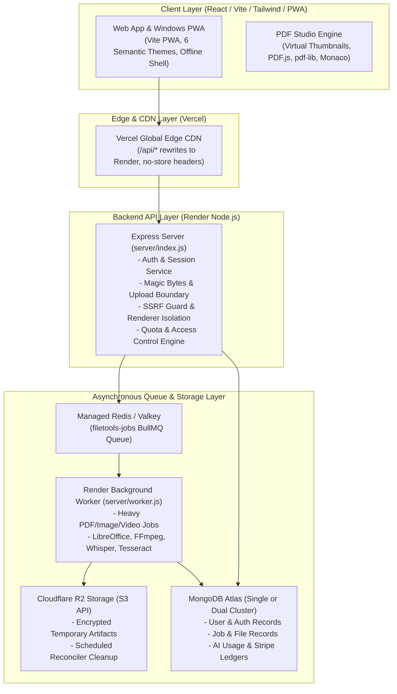

# FileTools Pro — Developer & Operator Production Handoff Guide

**Document Version:** 2.0.0 (Final Production Release Milestone)  
**Maintained By:** Principal Software Architect & QA Automation Lead  
**Date:** 2026-10-24  
**Workspace:** [`C:/Users/Admin/test_app/filetools-app`](file:///C:/Users/Admin/test_app/filetools-app)

---

## 1. System Architecture Overview

FileTools Pro is designed as a decoupled, privacy-preserving, high-performance document and media processing platform:



---

## 2. Directory & Component Layout

```text
filetools-app/
├── client/                     # Frontend Application (React 18, Vite 6, Tailwind 4)
│   ├── src/
│   │   ├── components/         # Shared UI, UserMenu, FileDropzone, backgrounds
│   │   │   ├── navigation/     # Responsive Navbar, ThemeSelector
│   │   │   ├── pdf-studio/     # Central PDF Studio, Thumbnails, Inspector
│   │   │   └── seo/            # CanonicalHead, SchemaOrgJsonLd
│   │   ├── context/            # AuthContext, ThemeContext (6 semantic themes)
│   │   ├── pages/              # Tool Pages, Landing, Auth, Pricing, WorkflowStudio
│   │   └── hooks/              # useVirtualPdfThumbnails, useDropzone
│   ├── public/                 # Favicons, Web App Manifest, robots.txt, sitemap.xml
│   ├── vercel.json             # Edge rewrite ordering & cache-control headers
│   └── vite.config.js          # PWA Workbox config, Rollup chunking, plugins
├── server/                     # Backend API & Processing Pipeline (Node 20+)
│   ├── config/                 # plans.js (SSOT), database.js
│   ├── middleware/             # auth.js, security.js, upload.js, accessControl.js
│   ├── models/                 # User, FileRecord, JobRecord, StripeEvent, UserByokKey
│   ├── queue/                  # connection.js, jobQueue.js, jobProcessors.js
│   ├── routes/                 # pdf, auth, job, payment, workflow, ai, video, etc.
│   ├── services/               # ai, quota, storage, redact, cleanup, stripe, etc.
│   ├── utils/                  # aiKeyVault.js, ssrfGuard.js, browser.js, cloudRespond.js
│   ├── worker.js               # Dedicated BullMQ Background Worker process
│   └── index.js                # Primary Express HTTP/WebSocket server
├── docs/                       # Complete Production & Engineering Documentation
│   ├── architecture/           # System Architecture, Job System, DAG Schema
│   ├── ops/                    # ONCALL_RUNBOOK.md, ROLLBACK_PLAN.md
│   ├── releases/               # FINAL_PRODUCTION_READINESS.md, RELEASE_GATES_EVIDENCE.md
│   ├── security/               # FINAL_SECURITY_AUDIT.md, BYOK_THREAT_MODEL.md
│   └── qa/                     # FINAL_TEST_RESULTS.md, PDF_GOLDEN_FIXTURES.md
├── reports/                    # FINAL_AUDIT_BACKLOG.md
├── scripts/                    # load-benchmark.js, verify-syntax.cjs, generate-icons.cjs
├── tests/                      # Automated Test Suites (10 suites, 129 tests)
├── .github/workflows/          # Hardened ci.yml and deploy.yml
├── Dockerfile                  # Hardened Debian Bookworm container manifest
└── package.json                # Project scripts, dependencies, engines (Node >=20)
```

---

## 3. Environment Variables Reference

| Variable Name | Required | Default / Description |
|:---|:---:|:---|
| `PORT` | Optional | `3001` (Render automatically assigns port) |
| `NODE_ENV` | **Required** | `production` in live deployments |
| `CLIENT_URL` | **Required** | `https://filetools-app.vercel.app` (CORS allowlist & auth redirects) |
| `MONGODB_URI` | **Required** | MongoDB connection string (or `MONGODB_AUTH_URI` + `MONGODB_DATA_URI`) |
| `JWT_SECRET` | **Required** | Cryptographic secret for signing auth tokens ($\ge 32\text{ characters}$) |
| `JWT_REFRESH_SECRET` | **Required** | Cryptographic secret for refresh tokens ($\ge 32\text{ characters}$) |
| `AI_KEY_ENCRYPTION_SECRET` | **Required** | 32-byte secret for BYOK AES-256-GCM envelope encryption |
| `BILLING_ENABLED` | **Required** | `false` (Safety gate: keep false until ready for live Stripe charges) |
| `FREE_MODE` | Optional | `false` (Legacy test toggle: must remain false in production) |
| `REDIS_URL` / `VALKEY_URL` | Optional | Redis connection string for BullMQ (falls back to resilient in-memory if unset) |
| `R2_ENDPOINT` | Optional | Cloudflare R2 S3 endpoint URL |
| `R2_ACCESS_KEY_ID` | Optional | Cloudflare R2 access key |
| `R2_SECRET_ACCESS_KEY` | Optional | Cloudflare R2 secret key |
| `R2_BUCKET_NAME` | Optional | Cloudflare R2 target bucket |
| `GOOGLE_AI_API_KEY` | Optional | Primary Google Gemini API key |
| `GROQ_API_KEY` | Optional | Secondary Groq Whisper / Llama API key |
| `STRIPE_SECRET_KEY` | Optional | Stripe secret key (`sk_test_...` or `sk_live_...`) |
| `STRIPE_WEBHOOK_SECRET` | Optional | Stripe webhook endpoint secret (`whsec_...`) |

---

## 4. Key Operational Commands

```bash
# 1. Run complete automated test suite (129 tests across 10 suites)
npm run test:all

# 2. Run AST JavaScript syntax verification (93 backend files)
npm test

# 3. Run reproducible load & performance benchmark
npm run benchmark

# 4. Build production frontend (Vite + PWA)
npm run build

# 5. Start background worker process locally
npm run worker

# 6. Start full development stack concurrently
npm run dev:all
```

---

## 5. Owner Launch Checklist (Mandatory Human Actions)

Prior to public launch, the human repository owner must complete these sequential steps:

1. [ ] **Repository Push:** Commit and push the verified patch set to `origin main`.
2. [ ] **Environment Configuration:** Populate production environment variables in Render and Vercel dashboards.
3. [ ] **Staging Smoke Test:** Verify `https://filetools-jkx7.onrender.com/api/ready` returns HTTP 200 `status: "ready"` (or via staging backend `staging-filetools-api.onrender.com/api/ready`).
4. [ ] **Stripe Sandbox / Live Transition:** When ready for paid subscriptions, review tax and currency disclosures, configure Stripe webhook `https://filetools-jkx7.onrender.com/api/payment/webhook`, and set `BILLING_ENABLED=true`.
5. [ ] **Microsoft Partner Center Enrollment:** Follow [`docs/OWNER_ACTIONS.md`](file:///C:/Users/Admin/test_app/filetools-app/docs/OWNER_ACTIONS.md) to register an individual developer account on `storedeveloper.microsoft.com` and package the Windows MSIX candidate.
