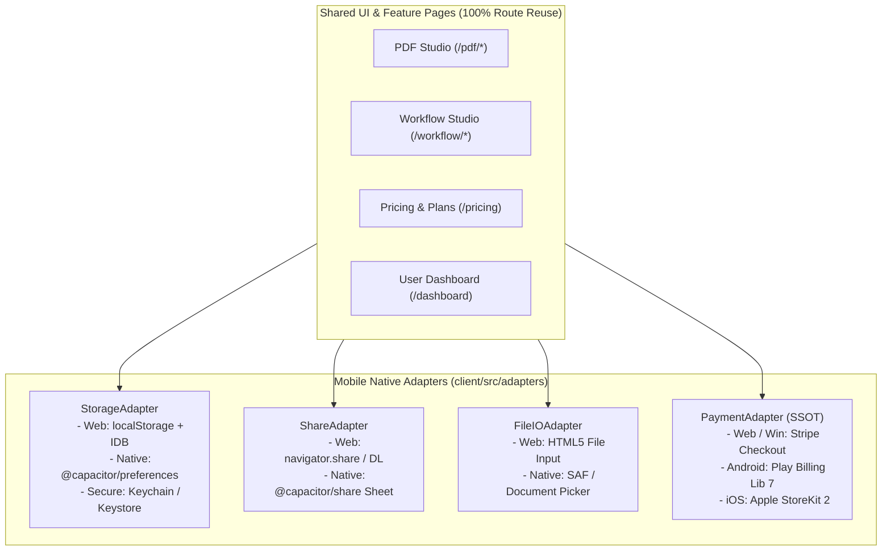
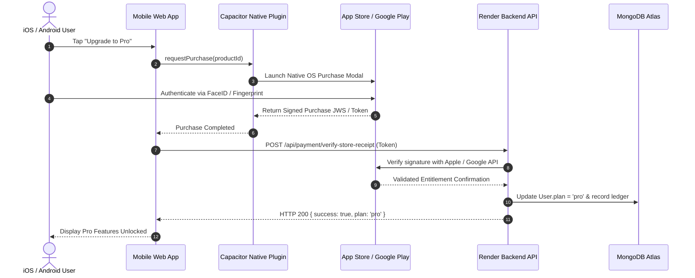

# FileTools Pro — Mobile Adapter Architecture & Cross-Platform Design

**Document Version:** 1.0.0  
**Maintained By:** Cross-Platform Mobile Application Architect  
**Date:** 2026-10-24  
**Target Runtimes:** Web (Vercel SPA), Windows (PWA/MSIX), Android (Capacitor), iOS (Capacitor)

---

## 1. Architectural Vision: The Adapter Pattern for Cross-Platform Native Parity

To deliver a unified product experience across Web, Windows Desktop, Android, and iOS without maintaining divergent codebases, FileTools Pro employs the **Mobile Adapter Design Pattern**.

All native OS capabilities (Storage, File Sharing, Payments, Deep Links, and App Lifecycle) are accessed through platform-agnostic TypeScript/JavaScript interfaces. At runtime, the application detects the execution environment (`Capacitor.getPlatform()`) and delegates to the appropriate platform adapter.



---

## 2. Platform-Specific Billing Provider Interfaces

### The Unified Payment Adapter Contract
To prevent store policy violations (Google Play Payments Policy and Apple App Store Review Guideline 3.1.1) while maintaining server-side entitlement semantics, the frontend interacts with an abstracted `PaymentAdapter`:

```typescript
export interface PaymentPlan {
  id: string;              // 'plus', 'pro'
  interval: 'month' | 'year';
  priceDisplay: string;    // '$4.99 / mo' or localized store currency
  productId?: string;      // Google Play / Apple App Store product ID
}

export interface PaymentAdapter {
  isSupported(): boolean;
  getPlatformName(): 'stripe' | 'google_play' | 'apple_storekit';
  fetchAvailablePlans(): Promise<PaymentPlan[]>;
  purchaseSubscription(planId: string, interval: string): Promise<PurchaseResult>;
  restorePurchases?(): Promise<RestoreResult>;
}
```

### Platform Implementations

#### 1. Web & Windows PWA: `StripePaymentAdapter`
- Uses `@stripe/stripe-js` to initialize Stripe Checkout redirect or embedded Stripe Elements.
- Only active when server reports `isBillingEnabled: true`.
- Completely isolated from mobile builds to ensure zero App Store / Play Store scrutiny.

#### 2. Android: `GooglePlayBillingAdapter`
- Interacts with Google Play Billing Library via `@capgo/capacitor-purchases` or `RevenueCat`.
- Maps product IDs: `com.filetools.pro.sub.plus.monthly`, `com.filetools.pro.sub.pro.monthly`.
- Server-side verification endpoint: `POST /api/payment/verify-google-play` passes purchase token to Google Play Developer API and awards entitlements.

#### 3. iOS: `AppleStoreKitAdapter`
- Communicates directly with iOS StoreKit 2.
- Handles native subscription sheets, Family Sharing, and App Store refund webhooks.
- Server-side verification endpoint: `POST /api/payment/verify-apple-receipt` verifies JWS transaction tokens with Apple App Store Server API.



---

## 3. Native Storage & Security Adapter

On mobile, standard browser `localStorage` can be cleared unpredictably by iOS WebKit when device storage is constrained. 

### Implementation Architecture
```javascript
// client/src/adapters/storageAdapter.js
import { Capacitor } from '@capacitor/core';

export const storageAdapter = {
  async getItem(key) {
    if (Capacitor.isNativePlatform()) {
      const { Preferences } = await import('@capacitor/preferences');
      const { value } = await Preferences.get({ key });
      return value;
    }
    return localStorage.getItem(key);
  },

  async setItem(key, value) {
    if (Capacitor.isNativePlatform()) {
      const { Preferences } = await import('@capacitor/preferences');
      await Preferences.set({ key, value });
      return;
    }
    localStorage.setItem(key, value);
  },

  async removeItem(key) {
    if (Capacitor.isNativePlatform()) {
      const { Preferences } = await import('@capacitor/preferences');
      await Preferences.remove({ key });
      return;
    }
    localStorage.removeItem(key);
  }
};
```

---

## 4. Native File I/O & Document Sharing Adapter

### The Share Sheet Pattern
Instead of downloading files to a browser download folder, mobile users expect the native OS **Share Sheet** (AirDrop, WhatsApp, Google Drive, Print, Save to Files).

```javascript
// client/src/adapters/shareAdapter.js
import { Capacitor } from '@capacitor/core';

export async function shareExportedDocument({ title, text, url, localFilePath }) {
  if (Capacitor.isNativePlatform()) {
    const { Share } = await import('@capacitor/share');
    if ((await Share.canShare()).value) {
      await Share.share({
        title,
        text,
        url: localFilePath || url,
        dialogTitle: 'Chia sẻ tài liệu FileTools Pro',
      });
      return { shared: true, native: true };
    }
  }

  // Web Fallback: Web Share API or download link
  if (navigator.share) {
    try {
      await navigator.share({ title, text, url });
      return { shared: true, native: false };
    } catch (_) {}
  }

  // Fallback to standard HTTP download
  const link = document.createElement('a');
  link.href = url;
  link.download = title;
  link.click();
  return { shared: false, downloaded: true };
}
```

---

## 5. Route & UI Reuse Map

Because FileTools Pro's frontend is built with responsive Tailwind CSS, **100% of functional tool pages are reused across mobile**:

| Route Path | Mobile Adaptation & UX Optimization | Reused Components |
|:---|:---|:---|
| `/` (Landing) | Hero layout stacks vertically; reduced motion background poster active on mobile networks. | `NorthernLightsBackground`, `SolitudeSkyBackground` |
| `/pdf/studio` | Single-column view; sidebar slides in as bottom sheet drawer; gesture drag-and-drop. | `PdfStudioEngine`, `useVirtualPdfThumbnails` |
| `/pdf/merge` | Card tiles stack vertically; large touch targets ($48\times 48\text{px}$ minimum). | `FileDropzone` |
| `/image/compress` | Before/after comparison slider adapts to touch drag gestures. | `ImageTools` |
| `/pricing` | Dynamic checkout button routing: displays StoreKit / Play Billing on mobile, Stripe on Web. | `PricingPage`, `PaymentAdapter` |
| `/dashboard` | File cards display native share pills and quick delete confirmation modals. | `Dashboard` |
| `/settings` | Exposes mandatory **"Delete Account"** self-service button calling `DELETE /api/auth/account`. | `UserMenu`, `AuthContext` |

---

## 6. Mobile Release Backlog & Milestone Roadmap

- [x] **M0: Capacitor Core Hardening** (Completed in Phase 14)
  - `client/capacitor.config.json` hardened with `cleartext: false` and strict origin allowlist.
  - Added self-service account deletion endpoint `DELETE /api/auth/account`.
  - Upgraded Android target SDK to API 36 in `variables.gradle`.
- [ ] **M1: Android Closed Testing Track (Play Console)**
  - Register developer account on [play.google.com/console](https://play.google.com/console).
  - Generate release keystore and compile `app-release.aab`.
  - Complete Data Safety Questionnaire.
  - Distribute build to internal testing team.
- [ ] **M2: iOS Project Initialization (macOS Runner)**
  - Execute `npx cap add ios` on a macOS workstation with Xcode.
  - Configure `PrivacyInfo.xcprivacy` and App Transport Security.
  - Archive and publish initial build to Apple TestFlight.
- [ ] **M3: Unified Mobile In-App Purchases (StoreKit 2 + Play Billing)**
  - Integrate `@capgo/capacitor-purchases` or `RevenueCat`.
  - Implement backend verification endpoints `POST /api/payment/verify-store-receipt`.
  - Conduct sandbox end-to-end purchasing and subscription renewal tests.
