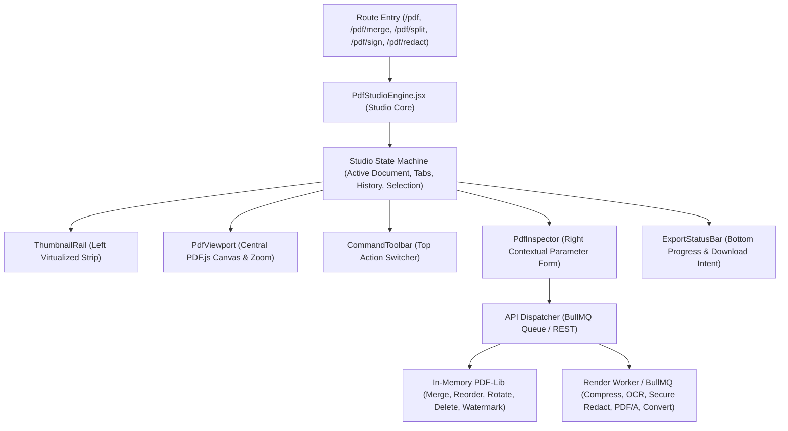
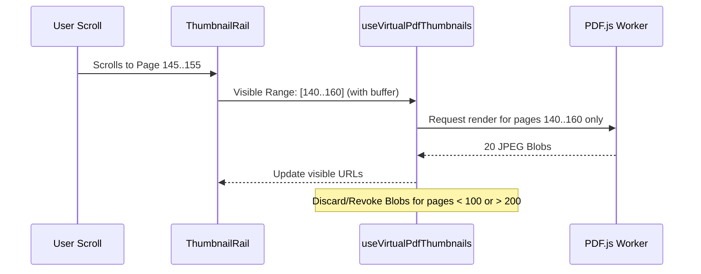

# FileTools Pro — PDF Studio Architecture & Engine Specification
**Document Version:** 1.0.0 (Phase G1.6 — PDF Studio Consolidation)  
**Standard:** Desktop-Grade Web Document Workbench + PDF.js / PDF-Lib Hybrid Engine  
**Target:** Web, Windows Desktop PWA, iPad/Tablet, Mobile Touch Viewports

---

## 1. Architectural Philosophy & Engine Topology

Rather than forcing users to navigate between disparate pages for individual PDF tasks, **PDF Studio** provides a unified, continuous document workbench. 



---

## 2. 5-Pane Studio Topology

```
+-----------------------------------------------------------------------------------------------------------------------+
|                                                   COMMAND TOOLBAR                                                     |
| [Back] Document.pdf (32 pages - 4.2 MB)  |  [Undo] [Redo]  |  [Merge] [Split] [Rotate] [Redact] [Sign] [Compress] ... |
+----------------------+----------------------------------------------------------------+-------------------------------+
|    THUMBNAIL RAIL    |                        CENTRAL VIEWPORT                        |      CONTEXTUAL INSPECTOR     |
|   (220px - Left)     |                        (Flexible Zoom)                         |        (320px - Right)        |
|                      |                                                                |                               |
| [Select All] [Invert]|  [Zoom -] [100%] [Zoom +] [Fit Width] [Page 3 of 32]           | Active Tool: Secure Redact    |
|                      |  ------------------------------------------------------------- | ----------------------------- |
| +------------------+ |                                                                | Automated PII Detection:      |
| | Page 1 [v] [Rot] | |  +----------------------------------------------------------+  | [x] CCCD: 07909300xxxx (p.1)  |
| +------------------+ |  |                                                          |  | [x] Email: user@corp.vn (p.3) |
| +------------------+ |  |                  HIGH-FIDELITY PDF.JS                    |  |                               |
| | Page 2 [v] [Rot] | |  |                     PAGE RENDER                          |  | Custom Keywords:              |
| +------------------+ |  |                                                          |  | [ + Add Keyword ]             |
| +------------------+ |  |            [ Redaction Bounding Box ]                    |  |                               |
| | Page 3 [ACTIVE]  | |  |                                                          |  | Security Assurance:           |
| +------------------+ |  |                                                          |  | - Poppler Vector Removal      |
| ... (Lazy Windowed   |  +----------------------------------------------------------+  | - Metadata Cleanse            |
|      Virtual Scroll) |                                                                |                               |
+----------------------+----------------------------------------------------------------+-------------------------------+
|                                                STATUS & EXPORT BAR                                                    |
| Unsaved Edits: 3 pages reordered, 1 page rotated  |  Quota: 1 of 5 daily used  |  [Reset Changes]  [Export & Download PDF] |
+-----------------------------------------------------------------------------------------------------------------------+
```

---

## 3. Virtualization & Memory Management for 300+ Page Documents

### The 300-Page Problem:
In naive implementations, generating thumbnail image data URLs for a 300-page document allocates $300 \times \sim 150\text{KB} = 45\text{MB}$ of base64 strings in JavaScript heap, and rendering 300 canvas elements locks the browser main thread for 15–30 seconds.

### The Virtualized Lazy Thumbnail Strategy (`useVirtualPdfThumbnails.js`):
1. **Two-Tier Extraction:**
   - **Tier 1 (Instant Metadata):** `pdf-lib` inspects the document trailer to immediately retrieve `pageCount`, dimensions, and `/Rotate` without rendering canvas pixels ($< 50\text{ms}$).
   - **Tier 2 (Windowed Viewport):** An `IntersectionObserver` detects which thumbnail cards are currently within the scroll view ($\pm 5$ pages buffer).
2. **On-Demand PDF.js Page Rendering:**
   - Only visible pages invoke `pdf.getPage(n).render()`.
   - Off-screen pages render a lightweight placeholder card with page number and aspect ratio box.
3. **Blob URL Lifecycle Management:**
   - Canvas outputs are converted to `Blob` and stored as `URL.createObjectURL(blob)`.
   - When thumbnails leave the cache or the file unmounts, `URL.revokeObjectURL()` is called immediately to prevent memory leaks.



---

## 4. State Machine & History Stack (Undo / Redo)

The Studio maintains a pure immutable state tree of page operations:

```typescript
interface StudioState {
  originalFile: File | null;
  documents: Array<{ id: string; name: string; file: File; pageCount: number }>;
  activeDocId: string;
  activeAction: 'inspect' | 'merge' | 'split' | 'organize' | 'redact' | 'sign' | 'compress' | 'watermark' | 'protect';
  
  // Page Geometry & Order Tree
  pages: Array<{
    id: string;             // Unique uuid
    sourceDocId: string;    // Reference to parent file
    originalPageNum: number;// 1-based original index
    rotation: number;       // 0, 90, 180, 270 degrees
    deleted: boolean;
    crop?: { x: number; y: number; width: number; height: number };
  }>;

  // Visual Overlays & Redactions
  redactions: Array<{ pageNum: number; x: number; y: number; width: number; height: number; label: string }>;
  signatures: Array<{ pageNum: number; x: number; y: number; width: number; height: number; dataUrl: string }>;
  
  // History Stacks
  history: Array<StudioHistorySnapshot>;
  historyIndex: number;
  isDirty: boolean;
}
```

### Action Semantics & Honest Save Transparency:
- **In-Memory Modifications:** Page reordering, rotation, deletion, and crop parameters are held in the browser state machine. They are applied instantaneously with zero server round-trips.
- **Server Dispatch on Export:** Clicking **"Export & Download PDF"** sends the final transformation instruction array to `POST /api/pdf/merge` or the specific action endpoint.
- **No Misleading "Auto-Save":** The UI explicitly communicates: *"Các thay đổi đang được lưu tạm trong bộ nhớ trình duyệt. Bấm 'Xuất File PDF' để tạo file hoàn chỉnh."*

---

## 5. Password-Protected PDF Workflow

When an encrypted PDF is supplied:
1. `pdfjsLib.getDocument()` triggers an `onPassword` callback or throws `PasswordException`.
2. The Studio immediately traps the exception and opens [`PdfPasswordModal`](file:///C:/Users/Admin/test_app/filetools-app/client/src/components/pdf-studio/PdfPasswordModal.jsx).
3. The user inputs their document password.
4. If correct, the document renders normally and caches the authorization key for subsequent export.
5. If invalid, the UI displays *"Mật khẩu không đúng. Vui lòng thử lại"* without crashing.

---

## 6. SEO-Friendly Deep Links & Route Preservation

All legacy URLs continue to function seamlessly:
- `/pdf/merge` → Mounts Studio with `action='merge'` and multi-file dropzone active.
- `/pdf/split` → Mounts Studio with `action='split'` and range selector active.
- `/pdf/sign` → Mounts Studio with `action='sign'` and signature pad active.
- `/pdf/redact` → Mounts Studio with `action='redact'` and PII scanner active.
- `/pdf/organize` & `/pdf/delete` → Mounts Studio with `action='organize'` and thumbnail rail expanded.

Each route renders semantic HTML titles, Meta descriptions, OpenGraph tags, and crawlable FAQs below the interactive workbench when in idle state. Search engines receive 200 OK responses with rich structured schema (`WebApplication`).
