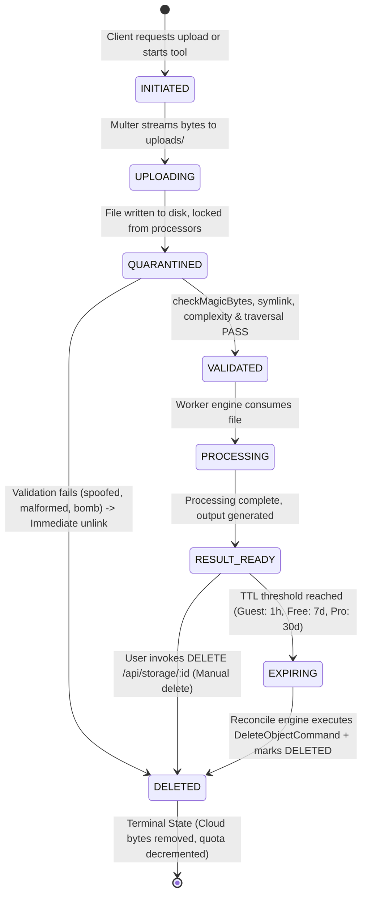
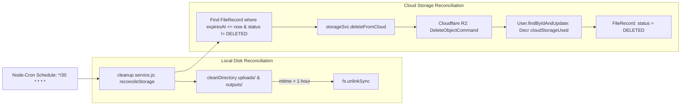

# FileTools Pro — Storage Lifecycle & Data Flow Architecture
**Version:** 1.0.0 (Production Specification)  
**Date:** 23/10/2026  
**Scope:** Storage Models, Lifecycle State Machine, Streaming Pipelines, Reconciliation Engine  
**Status:** IMPLEMENTED & TESTED

---

## 1. File Lifecycle State Machine

FileTools Pro separates the **File Storage Lifecycle** (which governs physical bytes on disk and R2 objects) from the **Job Execution Lifecycle** (which tracks asynchronous compute queues, workers, and Socket.IO progress):



### 1.1 State Definitions

| State | Storage Location | Accessible to Workers | Description |
| :--- | :--- | :---: | :--- |
| **`INITIATED`** | None (Metadata only) | No | Upload session created, pre-signed upload URL issued (if direct upload) or upload form initialized. |
| **`UPLOADING`** | Ephemeral `uploads/` buffer | No | Multi-part or Multer stream in transit; chunks being received. |
| **`QUARANTINED`** | `uploads/<uuid>.<ext>` | No | File upload complete but held in isolation; not accessible to any route processor. |
| **`VALIDATED`** | `uploads/<uuid>.<ext>` | Yes | Binary magic bytes verified, no malicious PDF actions, symlinks rejected, path checked. |
| **`PROCESSING`** | `uploads/` $\rightarrow$ `outputs/` | Yes | Active compute worker (ffmpeg, pdftk, potrace, tesseract) executing operation. |
| **`RESULT_READY`** | `outputs/` or Cloudflare R2 | Yes (Owner only) | Result generated; signed download token minted or pre-signed R2 URL available. |
| **`EXPIRING`** | Cloudflare R2 / Local disk | Read-only | File has exceeded its retention window; queued for scheduled garbage collection. |
| **`DELETED`** | None (Record purged) | No | Object deleted from R2, local files unlinked, user storage quota decremented. |

---

## 2. Streaming & Zero-Heap Buffer Architecture

### 2.1 The Problem with `fs.readFileSync`
Previous implementations loaded the entire file into Node.js buffer memory:
```javascript
// UNACCEPTABLE IN PRODUCTION:
const fileBytes = fs.readFileSync(localFilePath);
await client.send(new PutObjectCommand({ Body: fileBytes, ... }));
```
For large multimedia files (e.g., 200MB–500MB video or heavy batch archives), concurrent uploads quickly consume all available RAM on small web instances (e.g. Render 512MB / 1GB instances), leading to Out-Of-Memory (OOM) fatal crashes and HTTP 502/503 service drops.

### 2.2 Streaming Implementation
[`server/services/storage.service.js`](file:///C:/Users/Admin/test_app/filetools-app/server/services/storage.service.js) transfers data using native Node.js streams:
```javascript
const stat = fs.statSync(localFilePath);
const checksum = await computeFileSha256(localFilePath); // Computed via stream
const fileStream = fs.createReadStream(localFilePath);

await client.send(new PutObjectCommand({
  Bucket:        process.env.R2_BUCKET_NAME,
  Key:           cloudKey,
  Body:          fileStream,          // High-performance stream
  ContentLength: stat.size,           // Explicit length prevents chunked buffer spikes
  ContentType:   mimeType,
  Metadata: {
    'checksum-sha256': checksum,
    'original-name':   encodeURIComponent(originalName),
  },
}));
```
**Benefits:**
- Constant, negligible memory usage ($\approx 64\text{KB}$ per active stream buffer) regardless of file size.
- SHA-256 checksum verification ensures data integrity without loading files into heap.
- High-throughput streaming to Cloudflare R2.

---

## 3. Storage Retention & Reconciliation Engine

Cloudflare R2 objects are not deleted by MongoDB TTL indexes. Relying purely on MongoDB TTL leads to silent cloud storage accumulation and mounting costs. FileTools Pro implements an active reconciliation engine:



### 3.1 Retention Policies

| Tier / Context | Local Temp Retention | Cloud Storage Retention | Max Batch Files | Max File Size |
| :--- | :---: | :---: | :---: | :---: |
| **Anonymous (Guest)** | 1 hour | N/A (Local only) | 10 files | 50 MB |
| **Free Plan** | 1 hour | 7 days | 20 files | 100 MB |
| **Plus Plan** | 1 hour | 14 days | 50 files | 250 MB |
| **Pro / Business Plan** | 1 hour | 30 days | 100 files | 500 MB |

### 3.2 Idempotent Deletion Contract
- `deleteFromCloud(recordId, userId)` can be called multiple times without side effects.
- If a record is already marked `status: 'DELETED'`, the function returns `{ success: true }` immediately without sending duplicate S3 commands or double-decrementing user storage quotas.
- If R2 is temporarily unreachable, the record remains in `status: 'EXPIRING'`, guaranteeing retry on the subsequent 30-minute cron cycle.

---

## 4. Frontend Resilient Uploader Architecture

File uploads across tool pages use [`client/src/components/FileDropzone.jsx`](file:///C:/Users/Admin/test_app/filetools-app/client/src/components/FileDropzone.jsx):

1. **Client-Side Size & Quota Pre-Check:** Prevents wasted bandwidth by intercepting files exceeding `maxSizeMB` before network transmission.
2. **Duplicate File Deduplication:** Detects duplicate files in a batch selection based on composite key (`${name}_${size}_${lastModified}`) and provides user feedback.
3. **In-Component Error Feedback:** Clean error banners replace jarring browser `alert()` popups.
4. **Removable Selected File Badges:** Users can inspect selected files with human-readable file sizes and individually remove files prior to processing.
