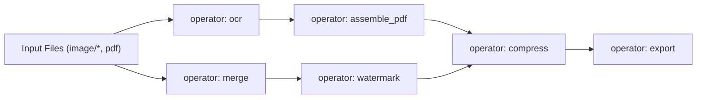
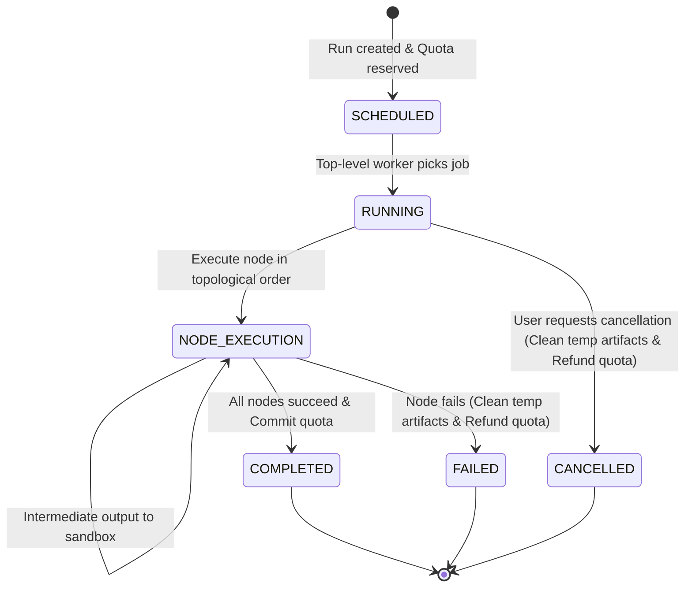

# FileTools Pro — Workflow DAG Schema & Engine Specification
**Document Version:** 1.0.0 (Phase 07 — Durable Workflow Orchestration)  
**Standard:** Directed Acyclic Graph (DAG) Execution Model / JSON Schema Draft 2020-12  
**Security Policy:** Strict Operator Allowlist — Zero Untrusted Script or Shell Execution

---

## 1. Executive Summary

Workflow Studio v1 enables users to compose complex multi-step file processing pipelines (e.g. `Scan Images → Enhance → OCR → Assemble PDF → Watermark → Compress`). 

To eliminate remote code execution (RCE) and infinite loop vulnerabilities, the execution engine enforces:
1. **Strict Operator Allowlist:** Only verified internal service functions can be invoked. No dynamic `eval`, no shell execution (`sh`, `bash`, `cmd`), and no arbitrary Python/Node scripts.
2. **Acyclic Graph Validation:** Graphs are verified at submission time using Kahn's algorithm. Circular references are rejected with HTTP 400 `DAG_CYCLE_DETECTED`.
3. **Complexity & Depth Bounds:**
   - Maximum nodes per DAG: **15**
   - Maximum dependency depth: **8**
   - Maximum input files per workflow: **50**
4. **Strong Port Typing:** Edges must connect compatible MIME output ports to compatible input ports.

---

## 2. Operator Allowlist & Type Signatures



| Operator | Allowed Parameters | Input Port MIME | Output Port MIME | Max Timeout | Quota Units |
|---|---|---|---|:---:|:---:|
| `input_source` | `fileIds: string[]` | *N/A (Source)* | `*/*` | Instant | 0 |
| `merge` | `pageOrder?: object[]` | `application/pdf` | `application/pdf` | 60s | 1 |
| `split` | `range?: string` | `application/pdf` | `application/zip` | 60s | 1 |
| `compress` | `quality: 'screen'\|'ebook'\|'prepress'` | `application/pdf`, `image/*` | Match input | 120s | 1 |
| `ocr` | `language: 'vie'\|'eng'\|'vie+eng'` | `image/*`, `application/pdf` | `text/plain`, `application/pdf` | 180s | 2 |
| `convert` | `targetFormat: 'pdf'\|'docx'\|'xlsx'\|'md'` | Dependent | Target MIME | 180s | 2 |
| `watermark` | `text: string, opacity: number` | `application/pdf`, `image/*` | Match input | 60s | 1 |
| `rotate` | `angle: 90\|180\|270` | `application/pdf`, `image/*` | Match input | 30s | 1 |
| `export` | `destination: 'download'\|'workspace'` | `*/*` | Signed URL / FileRecord | 30s | 0 |

---

## 3. DAG JSON Schema (`v1`)

```json
{
  "$schema": "https://json-schema.org/draft/2020-12/schema",
  "title": "WorkflowDAGDefinition",
  "type": "object",
  "required": ["version", "nodes", "edges"],
  "properties": {
    "version": {
      "type": "string",
      "enum": ["v1"]
    },
    "title": {
      "type": "string",
      "maxLength": 100
    },
    "nodes": {
      "type": "array",
      "minItems": 2,
      "maxItems": 15,
      "items": {
        "type": "object",
        "required": ["id", "operator", "params"],
        "properties": {
          "id": { "type": "string", "pattern": "^node_[a-zA-Z0-9_-]{1,16}$" },
          "operator": {
            "type": "string",
            "enum": ["input_source", "merge", "split", "compress", "ocr", "convert", "watermark", "rotate", "export"]
          },
          "label": { "type": "string", "maxLength": 50 },
          "params": { "type": "object" }
        }
      }
    },
    "edges": {
      "type": "array",
      "minItems": 1,
      "maxItems": 30,
      "items": {
        "type": "object",
        "required": ["fromNode", "toNode"],
        "properties": {
          "fromNode": { "type": "string" },
          "fromPort": { "type": "string", "default": "output" },
          "toNode": { "type": "string" },
          "toPort": { "type": "string", "default": "input" }
        }
      }
    }
  }
}
```

---

## 4. Acyclic Verification Algorithm (Kahn's Implementation)

```javascript
function validateAcyclicDAG(nodes, edges) {
  const inDegree = new Map();
  const adj = new Map();

  nodes.forEach(n => {
    inDegree.set(n.id, 0);
    adj.set(n.id, []);
  });

  for (const e of edges) {
    if (!adj.has(e.fromNode) || !adj.has(e.toNode)) {
      throw new Error(`Edge references nonexistent node: ${e.fromNode} -> ${e.toNode}`);
    }
    adj.get(e.fromNode).push(e.toNode);
    inDegree.set(e.toNode, inDegree.get(e.toNode) + 1);
  }

  const queue = [];
  inDegree.forEach((deg, id) => {
    if (deg === 0) queue.push(id);
  });

  let visitedCount = 0;
  const executionOrder = [];

  while (queue.length > 0) {
    const current = queue.shift();
    executionOrder.push(current);
    visitedCount++;

    for (const neighbor of adj.get(current)) {
      const nextDeg = inDegree.get(neighbor) - 1;
      inDegree.set(neighbor, nextDeg);
      if (nextDeg === 0) queue.push(neighbor);
    }
  }

  if (visitedCount !== nodes.length) {
    throw new Error('DAG_CYCLE_DETECTED: Graph contains circular dependency');
  }

  return executionOrder;
}
```

---

## 5. Execution State Machine & Intermediate Cleanup



### Intermediate Storage Lifecycle:
- Every workflow run executes in an isolated sandbox directory: `uploads/sandbox/run_{runId}/`.
- Intermediate files passing between Node A and Node B are stored strictly in this sandbox.
- When the run transitions to `COMPLETED`, `FAILED`, or `CANCELLED`, the sandbox directory is recursively deleted via `fs.rmSync(sandboxDir, { recursive: true, force: true })`.
- Only explicitly exported artifacts are stored in Cloudflare R2 / `FileRecord`.
