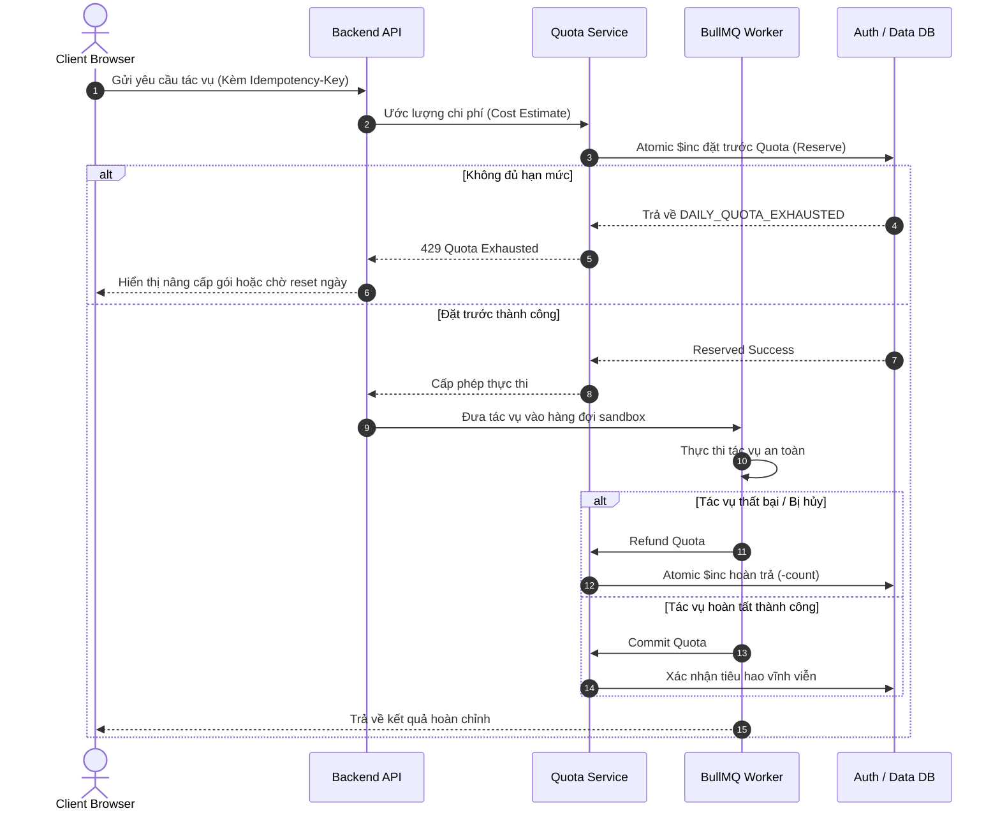

# Ma Trận Gói Dịch Vụ & Phân Quyền Hạn Mức (Plan & Entitlement Matrix)

**Tài liệu:** PLAN_ENTITLEMENT_MATRIX.md  
**Phiên bản:** 1.0.0  
**Vai trò:** Senior Subscription Platform Engineer & FinOps Lead  
**Nguyên tắc cốt lõi:** Single Source of Truth (SSOT). Phân quyền được quyết định và kiểm soát 100% tại máy chủ backend, client chỉ hiển thị dữ liệu (Display Only).

---

## 1. Bảng Giá & Chu Kỳ Thanh Toán (Pricing Hypothesis)

> [!NOTE]
> Bảng giá dưới đây là giả thuyết mô hình hóa tài chính cho môi trường Sandbox Test Mode. Tuyệt đối không bật thanh toán thực tế khi chưa có phê duyệt từ Owner.

| Gói Dịch Vụ | Hàng Tháng (Monthly) | Hàng Năm (Yearly) | Hàng Tuần (Weekly - Tắt Mặc Định) | Chiết Khấu Năm |
|---|:---:|:---:|:---:|:---:|
| **Free** | \$0.00 | \$0.00 | N/A | 0% |
| **Plus** | \$4.99 / tháng | \$39.99 / năm | \$1.99 / tuần (Disabled) | Tiết kiệm ~33% |
| **Pro** | \$9.99 / tháng | \$79.99 / năm | \$3.99 / tuần (Disabled) | Tiết kiệm ~33% |
| **Business** | \$29.99 / tháng | \$249.99 / năm | N/A | Tiết kiệm ~30% |

*Lưu ý: Tùy chọn gói hàng tuần (\$1.99 và \$3.99) tạm thời bị vô hiệu hóa (`enabled: false`) để tránh rủi ro tỷ lệ rời bỏ cao (churn rate) và chi phí cố định tối thiểu của cổng thanh toán (\$0.30 + 2.9% mỗi giao dịch).*

---

## 2. Ma Trận Phân Quyền Kỹ Thuật (Entitlement Specification)

| Chỉ Tiêu Hạn Mức (Quota) | Free | Plus | Pro | Business |
|---|:---:|:---:|:---:|:---:|
| **Dung lượng tối đa mỗi tệp (`maxFileSizeMB`)** | 25 MB | 250 MB | 1,000 MB (1 GB) | 5,000 MB (5 GB) |
| **Số lượng tác vụ mỗi ngày (`maxDailyJobs`)** | 10 tác vụ | 100 tác vụ | 300 tác vụ | 10,000 tác vụ |
| **Xử lý đồng thời (`maxConcurrentJobs`)** | 1 luồng | 2 luồng | 4 luồng | 20 luồng |
| **Số trang OCR mỗi tháng (`maxOcrPagesPerMonth`)** | 20 trang | 300 trang | 1,000 trang | Không giới hạn |
| **Hạn mức AI tín dụng (`includedAiCredits`)** | 0 credits | 100 credits / tháng | 500 credits / tháng | 2,000 credits / tháng |
| **Dung lượng Cloud R2 cá nhân (`maxStorageBytes`)** | 500 MB | 10 GB | 50 GB | 200 GB |
| **Thời gian lưu trữ tệp Cloud (`retentionDays`)** | 1 ngày | 7 ngày | 30 ngày | 90 ngày |
| **Quy trình Workflow Studio (DAG Nodes)** | Tối đa 3 nodes | Tối đa 8 nodes | Tối đa 15 nodes | Tối đa 25 nodes |
| **Tự mang khóa API cá nhân (BYOK)** | Không hỗ trợ | Có hỗ trợ | Có hỗ trợ | Có hỗ trợ |

---

## 3. Quy Trình Khấu Trừ & Đặt Trước Nguyên Tử (Atomic Entitlement Lifecycle)

Mỗi tác vụ tiêu thụ hạn mức trải qua 4 giai đoạn nguyên tử tại máy chủ:

---

## 4. Ánh Xạ Trạng Thái Gói Đăng Ký (Subscription State Mapping)

| Trạng Thái Stripe | Trạng Thái Hệ Thống | Quyền Hạn Phục Vụ | Hành Động Phía Máy Chủ |
|---|---|:---:|---|
| `active` | `ACTIVE` | Toàn quyền theo gói | Gia hạn ngày hết hạn `planExpiresAt`, cấp lại tín dụng AI tháng mới. |
| `trialing` | `TRIAL` | Toàn quyền theo gói | Áp dụng trong thời gian dùng thử (nếu có). |
| `past_due` | `GRACE_PERIOD` | Duy trì quyền hạn (3 ngày) | Gửi cảnh báo thanh toán không thành công, nhắc nhở cập nhật thẻ. Sau 3 ngày tự động chuyển `SUSPENDED`. |
| `incomplete` | `FREE` | Về gói Free | Giao dịch ban đầu thất bại (3D Secure không thành công), không nâng cấp. |
| `canceled` | `CANCELED` | Giữ quyền đến hết chu kỳ | Sau khi hết `planExpiresAt`, tự động hạ cấp về `free` và giảm dung lượng R2. |
| `unpaid` | `SUSPENDED` | Về gói Free | Khóa tính năng nâng cao, dữ liệu Cloud R2 chuyển sang chế độ chỉ đọc (Read-only). |

---

## 5. Nguyên Tắc Bảo Mật Quyền Sở Hữu (Security & Anti-Spoofing)

1. **Khách hàng không bao giờ được gửi plan lên máy chủ để nhận quyền:** Trường `plan` trong JWT chỉ dùng cho việc hiển thị (UI rendering); mọi quyết định cấp phép đều đọc trực tiếp từ `User.findById(userId)` với cờ fail-closed.
2. **Fail-Closed khi AuthDB gặp sự cố:** Nếu AuthDB bị ngắt kết nối, hệ thống trả về mã lỗi HTTP 503 `AUTH_DB_UNAVAILABLE`, tuyệt đối không tự nâng quyền người dùng lên `pro`.
3. **Tuân thủ chuẩn PCI-DSS:** Máy chủ FileTools Pro không lưu trữ bất kỳ số thẻ tín dụng (PAN), ngày hết hạn hay mã CVV nào. Toàn bộ thông tin thẻ được xử lý trực tiếp qua Stripe Elements / Checkout có chữ ký TLS 1.3.
