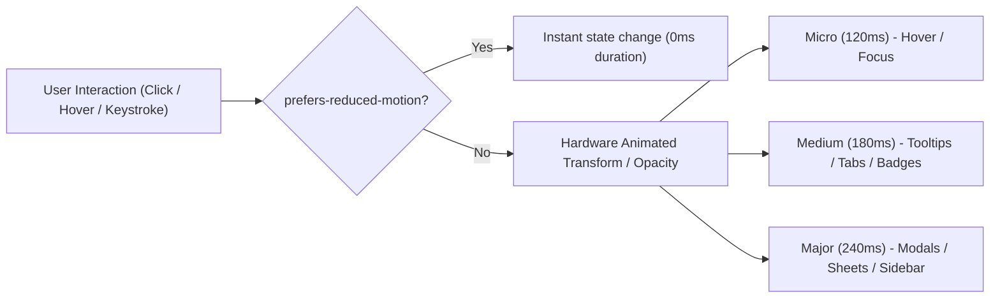

# FileTools Pro — Motion Policy & Performance Specification
**Document Version:** 1.0.0 (Phase G1.5 — UX, IA & Design System Modernization)  
**Standard:** Apple Fluid Motion Curves + W3C `prefers-reduced-motion` Compliance + Static-First Energy Efficiency

---

## 1. Principles of Motion

Motion in FileTools Pro serves exclusively to provide spatial orientation and confirmation of state changes. It must never distract, cause dizziness, or consume background battery.

1. **Static-First Default:**
   - Background canvas loops (`NorthernLightsBackground`) and looping video backgrounds (`SolitudeSkyBackground`) are **disabled by default**.
   - No looping `requestAnimationFrame` render calls occur when the app is in default state.
   - An optional **Ambient Mode** toggle allows users with dedicated GPUs to activate aesthetic background effects. State is stored in `localStorage('filetools_ambient_mode')`.
2. **Sub-240ms Velocity:**
   - Long, sluggish transitions (>300ms) make utility tools feel slow. All FileTools Pro micro-interactions complete within **120ms to 240ms**.
3. **Hardware Acceleration:**
   - Animated properties are strictly limited to `transform` and `opacity`.
   - Layout-triggering properties (`width`, `height`, `top`, `left`, `margin`, `padding`) are strictly prohibited in animations.
4. **Accessible Reduced-Motion Enforcement:**
   - When `@media (prefers-reduced-motion: reduce)` is detected, all transitions, scales, and transforms are set to `none` or `0.01ms`.

---

## 2. Timing Standards & Easing Curves



### Micro-Interaction Timing Hierarchy:

| Class | Duration | Curve (Cubic-Bezier) | Applicable UI Elements |
|---|---|---|---|
| **Micro (Instant)** | 120ms | `cubic-bezier(0.2, 0, 0, 1)` | Button active press, hover highlight, focus outline ring, checkbox checkmark. |
| **Medium (Fluid)** | 180ms | `cubic-bezier(0.16, 1, 0.3, 1)` | Dropdown popovers, tab switching, tool card scale-up, badge appear. |
| **Major (Structural)** | 240ms | `cubic-bezier(0.16, 1, 0.3, 1)` | Modal dialog appearance, AppSidebar collapse/expand, Mobile bottom sheet slide. |

---

## 3. Reduced Motion CSS System Implementation

The following rule is compiled globally in `client/src/index.css`:

```css
@media (prefers-reduced-motion: reduce) {
  *,
  *::before,
  *::after {
    animation-duration: 0.01ms !important;
    animation-iteration-count: 1 !important;
    transition-duration: 0.01ms !important;
    scroll-behavior: auto !important;
  }
  
  .ambient-orb-container,
  canvas.ambient-canvas,
  video.ambient-video {
    display: none !important;
  }
}
```

---

## 4. Energy & CPU Utilization Benchmark Standard

- **Baseline CPU Drain (Previous implementation with video/canvas running simultaneously):**
  - Continuous CPU load: 12% - 25% on mid-range laptops (continuous GPU/Canvas paint loop).
  - Background energy impact: High (prevented low-power idle states).
- **Target Standard (Static-First Engine):**
  - Idle CPU load: **0.0% - 0.2%** (Zero repaints when interface is static).
  - First Input Delay / Interaction to Next Paint (INP): $< 50\text{ms}$.
  - Cumulative Layout Shift (CLS): $0.000$.
