# FileTools Pro — Information Architecture & Navigation Specification
**Document Version:** 1.0.0 (Phase G1.5 — UX, IA & Design System Modernization)  
**Standard:** Desktop 3-Pane Productivity Suite + Apple HIG Touch Ergonomics  
**Scope:** Navigation taxonomy, Command Palette (`Cmd+K`), Responsive Layouts, SEO / Deep Link Routing

---

## 1. Information Architecture & Taxonomy

FileTools Pro organizes 50+ file operations into 6 core functional clusters, eliminating fragmented and redundant tool cards:

```mermaid
graph TD
    Root["FileTools Pro Unified IA"] --> DocCluster["1. Document & PDF Studio"]
    Root --> MediaCluster["2. Image & Media Studio"]
    Root --> CreativeCluster["3. Creative AI & Video"]
    Root --> DataCluster["4. Data, Code & Office"]
    Root --> UtilityCluster["5. OCR & Utilities"]
    Root --> WorkspaceCluster["6. Workspace & Personal"]

    DocCluster --> P1["PDF Hub (/pdf)"]
    DocCluster --> P2["Merge & Split (/pdf/merge, /pdf/split)"]
    DocCluster --> P3["Sign & Redact (/pdf/sign, /pdf/redact)"]
    DocCluster --> P4["Organize & Delete (/pdf/organize, /pdf/delete)"]

    MediaCluster --> I1["Image Convert & Compress (/image)"]
    MediaCluster --> I2["Vectorize SVG & Remove BG (/image)"]
    MediaCluster --> I3["Batch Photo Processing (/batch)"]

    CreativeCluster --> C1["Viral Shorts & TikTok AI (/creative)"]
    CreativeCluster --> C2["Stem / Vocal Separation (/creative)"]
    CreativeCluster --> C3["Video Studio & Watermark Eraser (/video)"]

    DataCluster --> D1["Advanced Editor - Monaco / CSV (/editor)"]
    DataCluster --> D2["Office Converter - Word / Excel / PPT (/office)"]
    DataCluster --> D3["Multi-format File Converter (/convert)"]

    UtilityCluster --> U1["OCR Text Extraction (/ocr)"]
    UtilityCluster --> U2["Speech-to-Text Whisper (/speech)"]
    UtilityCluster --> U3["Archive & ZIP Manager (/archive)"]
    UtilityCluster --> U4["QR & Barcode Studio (/qr)"]

    WorkspaceCluster --> W1["My Cloud Files & Jobs (/dashboard)"]
    WorkspaceCluster --> W2["Developer REST API Docs (/api-docs)"]
    WorkspaceCluster --> W3["Settings & Theme Customization"]
```



---

## 2. Desktop 3-Pane Topology

For viewports $\ge 1280\text{px}$, FileTools Pro provides an integrated productivity workbench inspired by professional desktop suites (Apple Preview, Foxit PDF, Figma):

```
+---------------------------------------------------------------------------------------------------------+
|                                              TOP BAR                                                    |
|  [Logo] FileTools PRO  |  [Ctrl+K] Quick Search Tools...  |  [Theme Picker]  [Ambient Mode]  [User/Login] |
+------------------------+------------------------------------------------------+-------------------------+
|     APP SIDEBAR        |                 MAIN WORKBENCH                       |   CONTEXTUAL INSPECTOR  |
|  (Collapsible 260px)   |               (Flexible Width)                       |   (Collapsible 320px)   |
|                        |                                                      |                         |
|  - All Tools (Home)    |   Active Tool Workspace                              |   Tool Parameters:      |
|  - PDF Studio          |   - Interactive File Dropzone                        |   - Output Format       |
|  - Image Studio        |   - Page Grid / Thumbnail Reorder                    |   - Compression Ratio   |
|  - Creative & Video    |   - Canvas Preview / Monaco Editor                   |   - Redaction Level     |
|  - Office & Data       |   - Real-time Visual Feedback                        |   - OCR Language        |
|  - AI & Speech         |                                                      |                         |
|  - Archive & QR        |   Primary Action CTA Bar                             |   Queue & Job Status:   |
|  -------------------   |   [Cancel]                      [Execute Process]    |   - BullMQ Job ID       |
|  - My Cloud Files      |                                                      |   - Progress Bar        |
|  - Developer API       |                                                      |   - Download Intent     |
|  - Settings            |                                                      |                         |
+------------------------+------------------------------------------------------+-------------------------+
|                                              STATUS BAR                                                 |
|  Storage Quota: 45% Used  |  Workers Online: 4  |  Theme: Midnight Neon (Active)  |  Version: 2026.10   |
+---------------------------------------------------------------------------------------------------------+
```

### Pane Behaviors:
1. **Left Sidebar (`AppSidebar.jsx`):**
   - Width: $260\text{px}$ (expanded) or $64\text{px}$ (collapsed icon-only mode).
   - Collapse state toggleable via keyboard (`Ctrl+\` or `Cmd+\`) or top bar toggle button.
   - Persisted in `localStorage('filetools_sidebar_collapsed')`.
2. **Main Workbench:**
   - Dominant focus area where user manipulates files, previews pages, reviews redaction masks, or inspects Monaco code.
3. **Right Contextual Inspector:**
   - Dynamically exposes tool-specific parameters (e.g. DPI slider for image convert, regex search for PDF redaction, stem separation mode for audio).
   - Slides smoothly off-canvas on screens $< 1280\text{px}$ and becomes an accessible drawer.

---

## 3. Command Palette (`Cmd+K` / `Ctrl+K`) Interaction Model

- **Trigger:** Global shortcut `Ctrl+K` (Windows/Linux) or `Cmd+K` (macOS), or clicking the search pill in `TopBar`.
- **Fuzzy Search:** Queries tool titles, categories, keywords, and file extension synonyms (e.g., searching "docx" surfaces Word to PDF converter).
- **Direct Actions:**
  - `> theme [name]`: Switch immediately to one of the 6 themes.
  - `> ambient on/off`: Toggle ambient canvas/video mode.
  - `> clear cache`: Clear cached local file records.
  - `> logout` / `> login`: Authentication quick actions.
- **Keyboard Navigation:**
  - `ArrowDown` / `ArrowUp`: Move selection ring.
  - `Enter`: Navigate or execute action immediately.
  - `Escape`: Close palette and restore previous focus.

---

## 4. Mobile Ergonomics & Bottom Sheet Navigation

For screens $< 768\text{px}$:
1. **Bottom Navigation Bar (`MobileNav.jsx`):**
   - Fixed to viewport bottom with safe area inset support (`env(safe-area-inset-bottom)`).
   - 4 primary thumb targets:
     - 🏠 **Trang chủ** (Home & Search)
     - 📑 **PDF & File** (Quick document tools)
     - ✨ **AI & Media** (Creative & AI tools)
     - 👤 **Tài khoản** (Dashboard / Profile / Settings)
     - ⋯ **Khác** (Triggers Bottom Sheet with full taxonomy)
2. **Overflow Bottom Sheet Drawer:**
   - Opens smoothly with spring physics on clicking "Khác".
   - Displays all categories, theme switcher pill, and Ambient mode switch.
   - Closes on swipe down or background tap.
3. **Touch Targets:**
   - Every tap target is guaranteed $\ge 44 \times 44\text{px}$ with a minimum $8\text{px}$ touch gutter.
