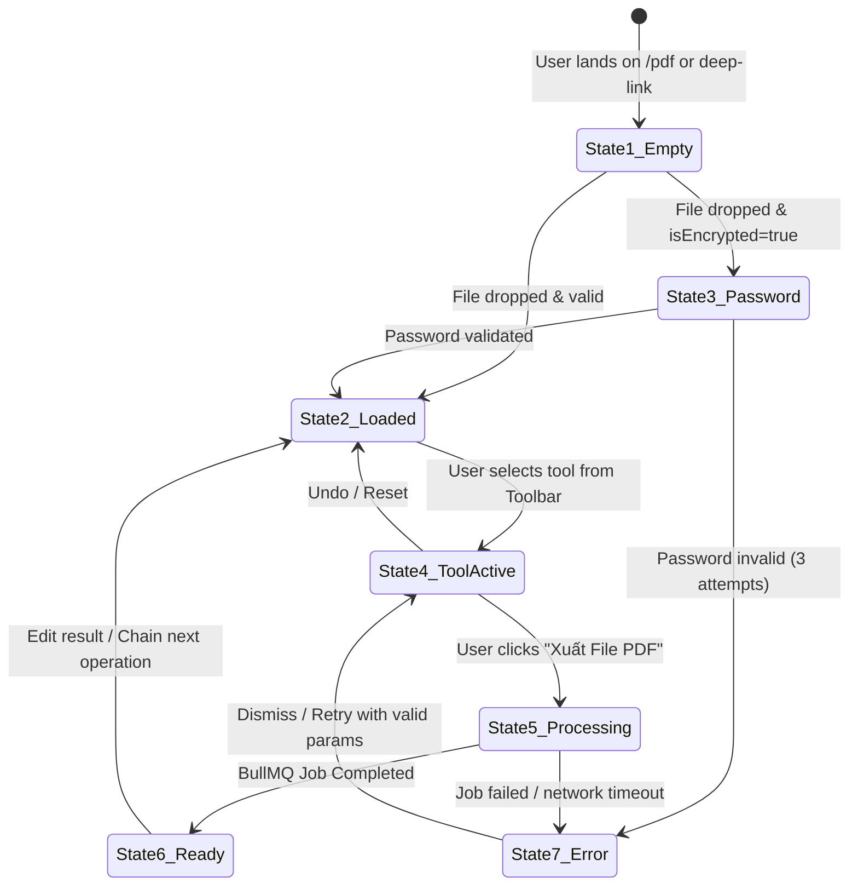

# FileTools Pro — PDF Studio Screen States & UX Interaction Flow
**Document Version:** 1.0.0 (Phase G1.6 — PDF Studio Consolidation)  
**Standard:** Apple HIG Fluid States / WCAG 2.2 AA Keyboard Operability  
**Target:** Web Desktop, Windows Store App, iPad Touch, Mobile Responsive

---

## 1. Studio State Machine Diagram

---

## 2. Comprehensive Screen States Catalog

### State 1: Empty Workbench & Intent Selector
- **UI Presentation:** Clean, distraction-free dropzone consuming semantic `--bg-surface` with high-contrast dashed border.
- **Deep-Link Awareness:** If entered via `/pdf/merge`, hero banner indicates *"Gộp nhiều file PDF — Kéo thả tối đa 50 file để ghép trang"*. If via `/pdf/redact`, indicates *"Che thông tin nhạy cảm PII — Tự động quét CCCD, SĐT, Email"*.
- **Quick Templates:** Displays sample document button for rapid evaluation without uploading private data.

### State 2: Document Loaded & Virtualized Rail
- **Left Rail (220px):** Vertical scroll rail of page cards. Visible cards show rendered thumbnails; off-screen cards display placeholder index badges.
- **Center Viewport:** High-resolution PDF.js canvas with interactive zoom pill ($50\%$ to $300\%$, Fit Page, Fit Width).
- **Navigation Shortcuts:** `PageUp` / `PageDown` or `ArrowUp` / `ArrowDown` navigates active page.

### State 3: Password Required Modal
- **Trigger:** PDF document with Standard Security Handler where permissions or contents are encrypted.
- **Modal Dialog:** Accessible dialog with auto-focused password field, reveal/hide eye icon, and explicit notice: *"File PDF này được bảo vệ bằng mật khẩu. Nhập mật khẩu để mở khóa xem và xử lý."*
- **Fail-Closed Security:** PDF bytes are never sent to unauthenticated endpoints.

### State 4: Active Tool States
1. **Redact State:**
   - Inspector displays detected PII list with toggle checkboxes (e.g. `[x] CCCD: 07909300xxxx (Trang 1)`).
   - Viewport highlights redaction bounding boxes with semi-transparent warning red tint before final burn-in.
   - User can drag custom bounding boxes directly on the viewport canvas.
2. **Merge State:**
   - Top tab strip displays all loaded files (`File A (12p)`, `File B (5p)`, `[+ Thêm file]`).
   - Thumbnail rail allows inter-file page drag and drop.
3. **Split State:**
   - Inspector allows typing page ranges (`1-5, 8, 11-14`) or clicking thumbnails to toggle selection.
   - Viewport shows green checkmark badges on selected pages.
4. **Sign State:**
   - Inspector provides Draw Signature Pad, Upload Signature Image, and Type Name tabs.
   - Clicking on the viewport places the signature stamp at the cursor coordinates with drag-to-resize handles.

### State 5: Processing & BullMQ Job Queue
- **UI Presentation:** Viewport dims with a subtle glassmorphic backdrop.
- **Progress Bar:** High-precision animated progress bar showing stage:
  - `Đang tải file lên Cloudflare R2... (25%)`
  - `Worker đang xử lý tác vụ... (65%)`
  - `Đang hoàn thiện và ký số URL... (95%)`
- **Cancellation:** Accessible `Hủy tác vụ` button invokes `POST /api/jobs/:id/cancel` and refunds quota atomically.

### State 6: Export Ready & Download Intent
- **UI Presentation:** Success badge with file size comparison (`Giảm 42% từ 4.2 MB → 2.4 MB`).
- **Primary CTA:** Prominent `Tải file về máy` button consuming short-lived signed download intent URL.
- **Chained Workflow:** Secondary button `Tiếp tục chỉnh sửa file này trong Studio` re-loads the output file directly into the workbench without re-uploading.

### State 7: Error Recovery State
- **UI Presentation:** High-contrast alert card explaining the exact failure reason in friendly Vietnamese (e.g., *"File PDF bị lỗi định dạng XRef hoặc vượt quá giới hạn 100MB"*).
- **Action:** Clear `Thử lại` button and `Báo cáo sự cố` link. No unhandled crashes or blank screens.
