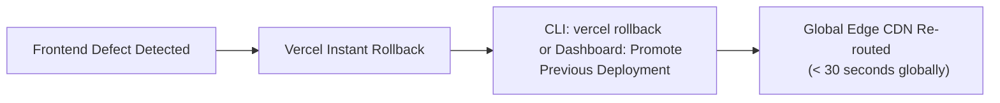

# FileTools Pro — Production Rollback Plan & Recovery Procedures

**Document Version:** 1.0.0  
**Maintained By:** Production SRE & Release Engineering Lead  
**Last Updated:** 2026-10-24  
**Target Environments:** Vercel (Edge Frontend) & Render (Node.js API & Worker Backend)

---

## 1. Rollback Overview & Trigger Criteria

A production rollback MUST be initiated immediately under any of the following conditions:
1. **Critical P0 Security Flaw:** Any regression allowing unauthorized cross-tenant file access, unauthenticated download, or bypass of signed tokens.
2. **Crash Loop / Process Death:** Render backend or background worker fails to boot or crashes repeatedly upon launch.
3. **Elevated Error Rate:** 5xx error rate exceeds $2\%$ across all API traffic for more than 5 consecutive minutes.
4. **Data Corruption:** Unrecoverable schema migration defect or storage corruption.

---

## 2. Layer 1: Vercel Frontend Rollback (Recovery Time: $< 1\text{ minute}$)

Vercel maintains immutable prebuilt deployment artifacts for every deployment SHA.



### Procedure A: Via Vercel Dashboard (Fastest & Safest)
1. Navigate to **Vercel Dashboard** $\rightarrow$ **filetools-app** $\rightarrow$ **Deployments**.
2. Locate the previous known-good deployment (marked with green checkmark).
3. Click the three dots (`...`) menu next to the previous deployment.
4. Select **Instant Rollback** (or **Promote to Production**).
5. Traffic is re-routed globally within 15–30 seconds.

### Procedure B: Via Vercel CLI
```bash
# List recent production deployments to identify previous deployment URL
npx vercel list --token=$VERCEL_TOKEN

# Re-alias production domain to known-good deployment URL
npx vercel alias set <previous-deployment-url> filetools-app.vercel.app --token=$VERCEL_TOKEN
```

---

## 3. Layer 2: Render Backend Rollback (Recovery Time: $\approx 2-3\text{ minutes}$)

Render retains image and commit history for both the Web API service and the Background Worker service.

### Procedure A: Via Render Dashboard
1. Navigate to **Render Dashboard** $\rightarrow$ **FileTools API** service.
2. Go to the **Events** / **Deploys** tab.
3. Locate the previous successful commit deployment.
4. Click **Roll back to this deploy**.
5. Repeat the exact same step for the **FileTools Background Worker** service so that API and Worker versions remain in sync.

### Procedure B: Via Git Revert & Deploy Hook
```bash
# 1. Identify bad commit and create revert commit
git revert HEAD --no-edit

# 2. Push revert commit to origin
git push origin main

# 3. Trigger Render deploy hook (if configured)
curl -X POST "$RENDER_DEPLOY_HOOK_URL"
```

---

## 4. Layer 3: Database & Queue State Rollback

### MongoDB Data Rollback
- FileTools Pro uses backward-compatible MongoDB document models. New fields (such as `isBYOK`, `sessionSecret`, `idempotencyKey`) default gracefully to `null` or schema defaults.
- No destructive collection renames or index drops are executed during standard deployments.
- If an erroneous data mutation occurs, restore point-in-time snapshot from **MongoDB Atlas** $\rightarrow$ **Backup** $\rightarrow$ **Restore to Point in Time**.

### BullMQ / Redis Queue Rollback
- If queued jobs format is incompatible with an older worker:
  ```bash
  # Connect to Redis via redis-cli
  redis-cli -u "$REDIS_URL"
  
  # Check active queue keys
  KEYS "bull:filetools-jobs:*"
  
  # Drain or pause queue if required
  # Note: The fallback queue will automatically process in-memory jobs without Redis
  ```
- Workers gracefully drain active jobs before shutting down (`SIGTERM` handler waits up to $10\text{s}$).

---

## 5. Post-Rollback Verification Checklist

Immediately after executing a rollback, verify system health:

- [ ] Execute `curl -s https://filetools-api.onrender.com/api/ready | jq .`
  - Verify `"status": "ready"`
  - Verify backing services report connected
- [ ] Execute `curl -s https://filetools-app.vercel.app/`
  - Verify HTTP 200 and HTML bundle loads
- [ ] Test sample guest file upload and download:
  - Verify signed token generation and download intent
- [ ] Check Sentry / Server Logs for residual 5xx errors
- [ ] Notify stakeholders and team via incident channel
