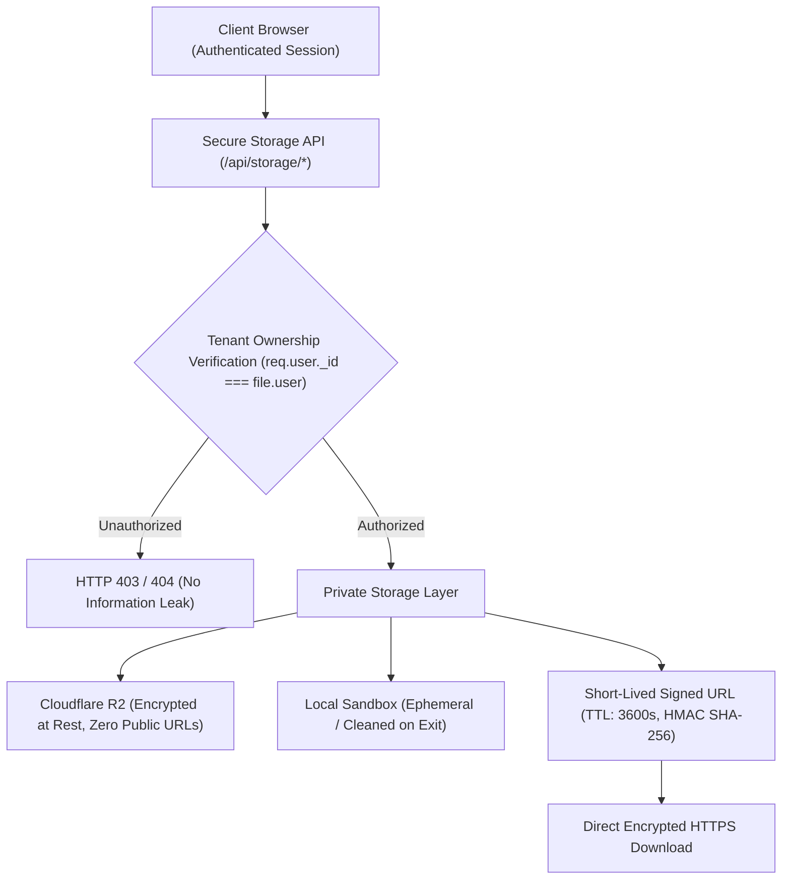

# FileTools Pro — My Files Workspace & Storage Specification
**Document Version:** 1.0.0 (Phase 07 — Durable Workflow Orchestration)  
**Standard:** Zero-Knowledge Multi-Tenant Document Privacy / GDPR & ISO 27001 Data Hygiene  
**Scope:** File storage architecture, indexing, folder & tag taxonomy, lifecycle retention, and UI interactions

---

## 1. Storage Location & Data Privacy Guarantees

Every file uploaded to or generated by FileTools Pro is governed by strict privacy invariants:



### Where are the bytes stored?
1. **Primary Cloud Vault:** Cloudflare R2 object storage in an encrypted-at-rest private bucket. The bucket **does not possess a public bucket URL or public CNAME**. All access requires an AWS Signature Version 4 (SigV4) authenticated pre-signed URL.
2. **Ephemeral Local Cache:** During active processing or quarantine inspection, temporary chunks reside in `uploads/quarantine/` or `uploads/sandbox/`. These are automatically purged after processing or within 1 hour by the reconciliation cleaner.

### Who can read the bytes?
- **Exclusively the authenticated owner (`user: req.user._id`).**
- Guests who process single-session files receive a cryptographically random `sessionSecret` (24 bytes). Only clients presenting this exact secret can download the result.
- Support staff, third parties, and other registered users **cannot** list, inspect, or decrypt files belonging to another account.

---

## 2. Workspace Capabilities & REST Contracts

| Feature | Endpoint | Method | Key Parameters | Privacy & Data Hygiene Behavior |
|---|---|:---:|---|---|
| **List My Files** | `/api/storage/files` | `GET` | `page, limit, folder, tag, search, sort, isTrash` | Paginated listing scoped strictly to `user: req.user._id`. Compound index query. |
| **Get File Details** | `/api/storage/files/:id` | `GET` | `:id` (UUID `fileId`) | Returns metadata without exposing physical server storage paths. |
| **Folder List** | `/api/storage/folders` | `GET` | *None* | Aggregates distinct active folders owned by the user. |
| **Tag List** | `/api/storage/tags` | `GET` | *None* | Aggregates distinct tags created by the user. |
| **Rename File** | `/api/storage/files/:id/rename` | `POST` | `newName: string` | Sanitizes name; enforces original MIME extension to prevent file type spoofing. |
| **Update Metadata** | `/api/storage/files/:id/meta` | `PATCH` | `folder?: string, tags?: string[]` | Assigns file to custom folder or tags. |
| **Soft Delete (Trash)** | `/api/storage/files/:id/trash` | `POST` | *None* | Sets `isSoftDeleted = true` and `deletedAt = now()`. File is hidden from normal view. |
| **Restore File** | `/api/storage/files/:id/restore` | `POST` | *None* | Sets `isSoftDeleted = false` and `deletedAt = null`. Returns file to active workspace. |
| **Permanent Delete** | `/api/storage/files/:id/permanent` | `DELETE` | *None* | Hard-deletes object from Cloudflare R2 immediately and purges database record. |
| **Mint Download URL** | `/api/storage/download/:id` | `GET` | *None* | Mints 1-hour pre-signed URL with content disposition header matching original name. |

---

## 3. Database Indexing & Deduplication Policy

### Compound Index Strategy (`FileRecord.js`):
To guarantee sub-10ms queries across thousands of user documents:
```javascript
// Active workspace listing index
fileRecordSchema.index({ user: 1, isSoftDeleted: 1, createdAt: -1 });

// Folder filtering index
fileRecordSchema.index({ user: 1, folder: 1, isSoftDeleted: 1 });

// Tag filtering index
fileRecordSchema.index({ user: 1, tags: 1, isSoftDeleted: 1 });

// Scheduled TTL expiration cleaner index
fileRecordSchema.index({ status: 1, expiresAt: 1 });
```

### Checksum Deduplication Policy:
- A SHA-256 hash is computed for each file during quarantine upload validation.
- **Privacy Boundary:** Deduplication is strictly scoped **within the same user tenant**:
  ```javascript
  const existing = await FileRecord.findOne({
    user: req.user._id,
    checksum: fileHash,
    status: { $ne: 'DELETED' },
    isSoftDeleted: false,
  });
  ```
- **Cross-tenant deduplication is strictly forbidden.** Performing cross-tenant deduplication would allow an attacker to confirm whether another user possesses a specific confidential file by probing hash collisions (Known-File Oracle Attack).

---

## 4. UI / UX Design & Responsive Interactions

- **Layout Structure:**
  - **Left Rail (Folder Tree):** "Tất cả tệp", "Gần đây", "Thư mục riêng", "Thùng rác".
  - **Top Bar:** Search input (`Ctrl+F`), Sort dropdown (Mới nhất, Cũ nhất, Tên A-Z, Kích thước), View toggle (Grid / Table).
  - **Main Area:**
    - Skeleton loader during initial query.
    - Responsive Grid of cards (mobile 1 col, tablet 2 cols, desktop 4 cols) with thumbnail previews, format badges, and size indicators.
    - Contextual action menu per card: Tải xuống, Đổi tên, Chuyển thư mục, Gắn thẻ, Chuyển vào Thùng rác.
  - **Empty States:** Friendly illustration with direct drag-and-drop call to action when a folder or search query is empty.
