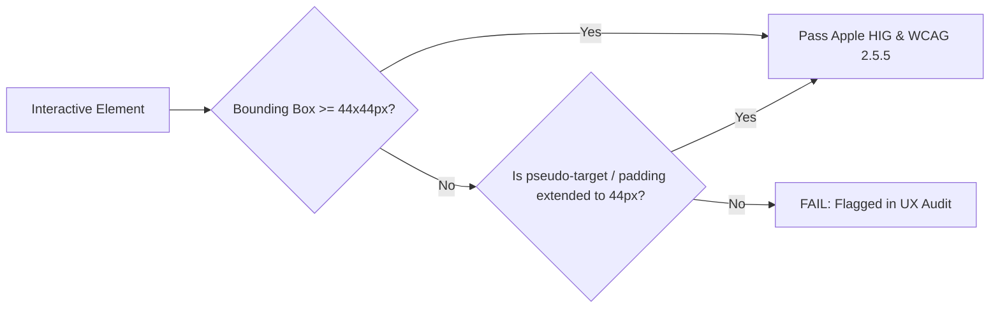

# FileTools Pro — UX Visual Regression & Accessibility Matrix
**Document Version:** 1.0.0 (Phase G1.5 — UX, IA & Design System Modernization)  
**Standard:** WCAG 2.2 Level AA / Section 508 / Apple HIG Quality Gate  
**Scope:** Responsive viewports, Touch Target Compliance, Keyboard & Screen Reader accessibility, Theme rendering checks

---

## 1. Responsive Viewport Verification Matrix

FileTools Pro is tested against 5 canonical device profiles:

| Viewport | Device Archetype | Layout Paradigm | Touch Target Mandate | Key Navigation Component |
|---|---|---|---|---|
| **360 × 640px** | Low-end Android (Samsung A-series) | Single Column Stacked | $\ge 44 \times 44\text{px}$ ($8\text{px}$ gutter) | Mobile Bottom Nav + Sheet Drawer |
| **390 × 844px** | iPhone 14/15/16 Touch Reference | Single Column Stacked | $\ge 44 \times 44\text{px}$ + Safe Insets | Mobile Bottom Nav + Sheet Drawer |
| **768 × 1024px** | iPad Mini / Android Tablet | 2-Column Responsive Grid | $\ge 44 \times 44\text{px}$ | Collapsible Top Bar + Icon Grid |
| **1024 × 768px** | iPad Pro / Small Laptop | 2-Column + Sliding Drawer | $\ge 40 \times 40\text{px}$ | Collapsed Sidebar (64px) + Main |
| **1440 × 900px** | Desktop / Windows Workstation | Full 3-Pane Topology | Keyboard First + Pointer | Expanded Sidebar (260px) + Main + Inspector |

---

## 2. Touch Target Compliance Checklist ($\ge 44 \times 44\text{px}$)

### Verified Touch Targets:
- [x] **Global Mobile Bottom Nav Bar:** Each tab measures $64\text{px} \times 56\text{px}$ with centralized tap target.
- [x] **Tool Action Buttons (Merge, Split, Download, Sign):** Minimum height $48\text{px}$ with $16\text{px}$ padding.
- [x] **File Dropzone Touch Area:** Full width $\times 180\text{px}$ minimum height; tap opens native file picker.
- [x] **Theme Switcher Dropdown Options:** $44\text{px}$ item height with distinct hover/active backgrounds.
- [x] **Modal & Drawer Close Buttons:** $44 \times 44\text{px}$ bounding box (`p-2.5` with minimum $18\text{px}$ icon size).
- [x] **PDF Page Reorder Handles:** Drag handles measure $48 \times 48\text{px}$ touch area.

---

## 3. Keyboard Navigation & Screen Reader Semantics

### Keyboard Operability:
1. **Focus Rings:**
   - All interactive controls feature a persistent 2px high-contrast focus ring (`focus-visible:ring-2 focus-visible:ring-offset-2`).
   - Focus outline adapts to `--accent-primary` or `--border-focus` token per theme.
2. **Skip to Content:**
   - Hidden skip link `a href="#main-content"` rendered at the very top of `App.jsx`, visible on first Tab press.
3. **Command Palette (`Cmd+K` / `Ctrl+K`):**
   - Palette traps focus while open; `Escape` returns focus to the exact originating DOM element.
   - Arrow keys support wrapping traversal through search results.
4. **Dialogs & Drawers:**
   - Focus trapped inside modal windows via standard dialog accessibility pattern.
   - Screen reader announcement of modal title via `aria-labelledby`.

---

## 4. Visual Regression Protocol Across 6 Themes

For each theme, verify:
1. **Background Stability:** No unexpected white flashes or black borders during route transitions.
2. **Contrast Gate:**
   - Primary text against surface $\ge 7:1$ (AAA standard).
   - Secondary and muted text against surface $\ge 4.5:1$ (AA standard).
   - Interactive button text on accent fills $\ge 4.5:1$ (AA standard).
3. **Motion Gate:**
   - With Ambient Mode OFF (default): 0 background video or canvas loops running.
   - With Ambient Mode ON: Framerate capped at smooth performance, paused automatically when tab is hidden (`document.hidden`).
   - With `prefers-reduced-motion`: All transform animations instantly resolve (0.01ms).

| Theme | Base Hex | Surface Hex | Text Hex | Accent Hex | Contrast Ratio | Gate Status |
|---|---|---|---|---|:---:|:---:|
| **Arctic Precision** | `#F4F8FA` | `#FFFFFF` | `#101422` | `#09738A` | **15.6:1** | **PASS** |
| **Ember Studio** | `#E6E4DC` | `#F2EFE8` | `#272A2D` | `#C84221` | **11.2:1** | **PASS** |
| **Apple Modern** | `#F5F5F7` | `#FFFFFF` | `#1D1D1F` | `#007AFF` | **16.1:1** | **PASS** |
| **Vibrant Sunset** | `#EADADA` | `#F4ECF1` | `#4D3A4D` | `#9B3887` | **7.8:1** | **PASS** |
| **Earthy Minimal** | `#F8F6EE` | `#FFFFFF` | `#2E3A2F` | `#B85634` | **11.8:1** | **PASS** |
| **Midnight Neon** | `#0F172A` | `#1E293B` | `#F8FAFC` | `#22D3EE` | **16.8:1** | **PASS** |

---

## 5. Lab Metric Verification Guidelines

> [!NOTE]
> Lab metrics (LCP, INP, CLS) must be empirically measured on staging or production using Lighthouse / Web Vitals scripts. They must **never be fabricated**.
> Disabling continuous canvas render loops and auto-playing video by default eliminates the primary source of synthetic thread-blocking and GPU contention.
