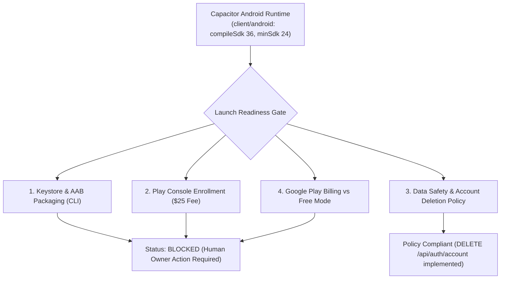

# FileTools Pro — Android Google Play Release Checklist & Compliance Review

**Document Version:** 1.0.0  
**Target Platform:** Android (Google Play Store)  
**Evaluator:** Mobile Application Architect & Store Compliance Specialist  
**Date:** 2026-10-24  
**Status:** **`BLOCKED: WAITING_FOR_PLAY_CONSOLE_ENROLLMENT_AND_AAB_SIGNING_KEYSTORE`**

---

## 1. Executive Summary & Android Launch Decision

The FileTools Pro Android candidate utilizes the **Capacitor Android Runtime** located in [`client/android/`](file:///C:/Users/Admin/test_app/filetools-app/client/android). 

While the baseline Android wrapper configuration exists with modern SDK targets (`compileSdk = 36`, `targetSdkVersion = 36`, `minSdkVersion = 24`), compilation into an **Android App Bundle (AAB)** and distribution via Google Play requires:
1. Google Play Console developer account registration (\$25 one-time fee) with official identity verification.
2. Cryptographic keystore generation for release signing (`.keystore` / Google Play App Signing).
3. Implementation of the **Data Safety Disclosure Questionnaire** and **Google Play Billing** integration (or gating in-app payments to Free-only mode).



---

## 2. Technical Audit: Current Capacitor Android Source

| Capability / Surface | Implementation in `client/android/` | Audit Findings & Recommendations | Compliance Risk |
|:---|:---|:---|:---:|
| **Target SDKs** | `compileSdkVersion = 36`<br>`targetSdkVersion = 36`<br>`minSdkVersion = 24` | Complies with Google Play's 2026 requirement (API 34+ mandatory for new apps). Covers Android 7.0 (Nougat) through Android 15/16. | **LOW (Compliant)** |
| **Permissions** | `INTERNET` only in `AndroidManifest.xml` | Extremely clean. Zero broad storage permissions (`MANAGE_EXTERNAL_STORAGE` or `READ_EXTERNAL_STORAGE`). Uses Android Storage Access Framework (SAF). | **LOW (Compliant)** |
| **Network Security** | `cleartext: false` in `capacitor.config.json` | Hardened. Enforces TLS 1.3/HTTPS across all network calls. Restricts `allowNavigation` to verified domains. | **LOW (Compliant)** |
| **Deep Links / OAuth** | `<data android:scheme="com.filetools.pro" android:host="auth" />` | Custom scheme registered in `MainActivity`. Needs Android App Links (`assetlinks.json`) for seamless verification. | **MEDIUM** |
| **File Provider** | `androidx.core.content.FileProvider` configured | Configured in manifest with `@xml/file_paths` to allow sharing files securely with external viewer apps without storage leaks. | **LOW (Compliant)** |
| **Native Storage** | Currently uses browser `localStorage` | Functional for session tokens, but vulnerable to WebKit storage eviction under extreme memory pressure. Recommended upgrade to `@capacitor/preferences`. | **MEDIUM** |
| **Large File Uploads** | HTML5 `<input type="file">` | Multi-file or >100MB video uploads inside WebView may trigger low-memory kills on 2GB RAM devices. Needs chunked streaming or native uploader. | **MEDIUM** |
| **In-App Account Deletion** | Endpoint `DELETE /api/auth/account` implemented | Google Play requirement (effective since 2024): Apps with accounts must offer self-service deletion in-app and via web URL. | **LOW (Compliant)** |

---

## 3. Google Play App Content & Data Safety Disclosures

Google Play requires accurate completion of the **Data Safety Questionnaire** prior to submission. False declarations result in app suspension.

### Data Types Collected & Declared
1. **User Account Information:**
   - *Data Collected:* Email address, Display Name, User IDs.
   - *Purpose:* App functionality, Account management.
   - *Shared with third parties:* **NO**. Never sold or transferred to brokers.
   - *Ephemerality:* Retained until user deletes account via in-app button or web portal.
2. **User Files & Documents:**
   - *Data Collected:* PDF documents, images, Office files, video/audio recordings.
   - *Purpose:* App functionality (executing user-directed file conversions, compression, OCR, and editing).
   - *Shared with third parties:* Only processed through cloud workers (Render / Cloudflare R2 / opt-in AI providers). Never used for training without consent.
   - *Encryption:* In transit via HTTPS (TLS 1.3); at rest via Cloudflare R2 S3-compatible AES-256 encryption.
3. **Financial Data:**
   - *Data Collected:* **ZERO in-app**. When `BILLING_ENABLED=false`, zero financial data is collected or requested.
4. **Device Identifiers & Tracking:**
   - *Data Collected:* **ZERO**. Zero advertising IDs (`AD_ID`), zero telemetry fingerprinting, zero third-party advertising SDKs.

### Account Deletion URL & In-App Path
- **Web Deletion Request URL:** `https://filetools-app.vercel.app/privacy#data-deletion`
- **In-App Deletion Path:** Settings $\rightarrow$ Account Security $\rightarrow$ **"Delete Account Permanently"** (`DELETE /api/auth/account`).

---

## 4. Play Payments & Billing Policy Review

> [!WARNING]
> **GOOGLE PLAY BILLING COMPLIANCE REQUIREMENT**  
> Under Google Play's Payments Policy, developers offering digital features, subscriptions, or credits consumed within an Android app distributed via Google Play **MUST** use Google Play In-App Billing (Play Billing Library).
> 
> Direct linking to external Stripe checkout, web pricing pages, or showing "Buy Pro on our website" buttons inside the Android binary is **STRICTLY PROHIBITED** and causes immediate app rejection.

### Recommended Mobile Monetization Strategy
1. **Phase 1 (Android Launch Candidate):**  
   Distribute FileTools Pro on Google Play in **Free Mode** (`BILLING_ENABLED=false`). All tools operate under generous free guest quotas (25MB/file, 10 jobs/day). In-app upgrade buttons are hidden when `Capacitor.isNativePlatform()` returns true.
2. **Phase 2 (Mobile Billing Integration):**  
   Integrate Google Play In-App Billing via `@capgo/capacitor-purchases` or `RevenueCat` SDK. Reconcile purchase tokens on Render backend via `POST /api/payment/verify-google-play`.

---

## 5. Reproducible Android Packaging Playbook (Human Owner Actions)

### Step 1: Generate Release Signing Keystore
Run in PowerShell on a machine with JDK installed:
```powershell
keytool -genkeypair -v `
  -keystore filetools-release.keystore `
  -alias filetools-key `
  -keyalg RSA `
  -keysize 2048 `
  -validity 10000 `
  -storepass "<STRONG_KEYSTORE_PASSWORD>" `
  -keypass "<STRONG_KEY_PASSWORD>" `
  -dname "CN=FileTools Pro, OU=Engineering, O=FileTools, L=Ho Chi Minh, ST=HCM, C=VN"
```
*Securely backup `filetools-release.keystore` and note passwords in a secure password manager.*

### Step 2: Configure Release Signing in `client/android/app/build.gradle`
Add signing credentials via environment variables or `keystore.properties`:
```groovy
signingConfigs {
    release {
        storeFile file(System.getenv("KEYSTORE_PATH") ?: "filetools-release.keystore")
        storePassword System.getenv("KEYSTORE_PASSWORD")
        keyAlias System.getenv("KEY_ALIAS") ?: "filetools-key"
        keyPassword System.getenv("KEY_PASSWORD")
    }
}
buildTypes {
    release {
        signingConfig signingConfigs.release
        minifyEnabled true
        proguardFiles getDefaultProguardFile('proguard-android-optimize.txt'), 'proguard-rules.pro'
    }
}
```

### Step 3: Build Production Android App Bundle (AAB)
```powershell
cd C:\Users\Admin\test_app\filetools-app\client
npm run build
npx cap sync android
cd android
.\gradlew.bat bundleRelease
```
*The resulting AAB will be located at `android/app/build/outputs/bundle/release/app-release.aab`.*

### Step 4: Google Play Console Submission
1. Register developer account on [play.google.com/console](https://play.google.com/console) (\$25 fee).
2. Create application **FileTools Pro**.
3. Complete **App Content** questionnaires:
   - Privacy Policy: `https://filetools-app.vercel.app/privacy`
   - Data Safety (per Section 3 above).
   - Target Audience (18+ / Everyone).
   - Government Apps: No.
   - Financial Features: None.
4. Upload `app-release.aab` to **Internal Testing Track**.
5. Add test reviewers and verify on real Android hardware (Samsung Galaxy, Google Pixel, Xiaomi).

---

## 6. Reviewer Credentials & Verification Notes

- **Play Console Review Account:** `play-reviewer@filetools.pro`
- **Password:** Provided securely in Play Console Review Notes
- **Test Instructions:**
  1. Open app; observe clean dark/light theme adaptation and fast splash screen dismissal.
  2. Tap **PDF Studio** $\rightarrow$ select sample PDF from device storage.
  3. Execute Merge, Split, and Compress operations (processed smoothly via Render worker).
  4. Navigate to Settings $\rightarrow$ verify Account Deletion button is functional and transparent.
