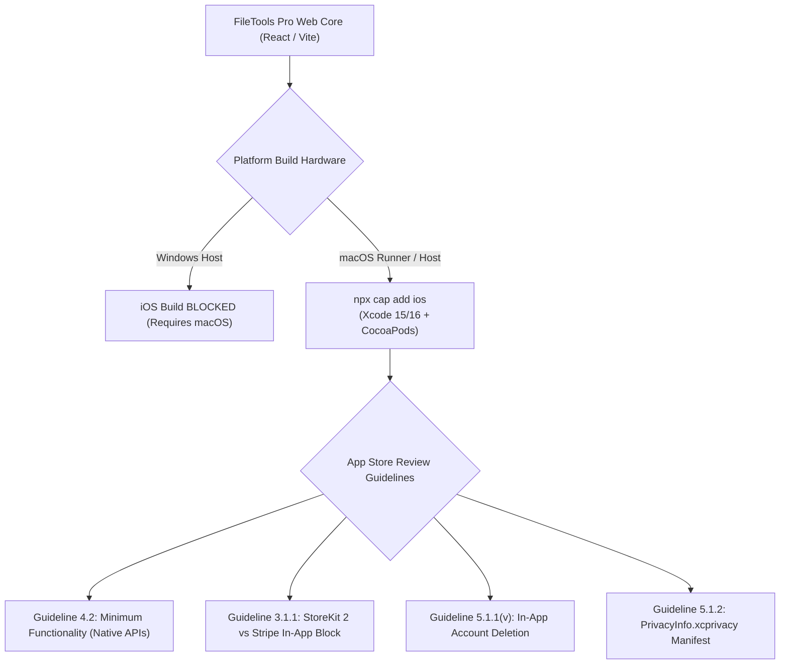

# FileTools Pro — iOS Apple App Store Release Checklist & Review Guidelines

**Document Version:** 1.0.0  
**Target Platform:** iOS (Apple App Store & TestFlight)  
**Evaluator:** Mobile Application Architect & Apple HIG Specialist  
**Date:** 2026-10-24  
**Status:** **`BLOCKED: REQUIRES_MACOS_XCODE_TOOLING_AND_APPLE_DEVELOPER_ENROLLMENT`**

---

## 1. Executive Summary & Apple Platform Decision

Building, signing, and deploying an iOS application requires **Apple macOS hardware with Xcode and active Apple Developer Program enrollment (\$99/year)**. 

Because the current execution environment is Windows-based:
1. The `client/ios/` native Xcode project **has not yet been initialized** (`npx cap add ios` must run on macOS or in a macOS-based CI runner such as GitHub Actions `macos-14`).
2. We provide an exact, reproducible implementation blueprint and strict App Store Review compliance roadmap to guarantee first-time review approval.



---

## 2. Apple App Store Review Guidelines Audit & Compliance Strategy

### Guideline 4.2: Minimum Functionality & Web Wrapper Policy
> *"Your app should include features, content, and UI that elevate it beyond a repackaged website. If your app is not particularly useful, unique, or 'app-like', it doesn't belong on the App Store."*

**Mitigation & App-Like Enhancements:**
- **Native Document Sharing (`@capacitor/share`):** Seamless iOS Share Sheet integration allowing users to AirDrop, save to Files, or message converted PDFs directly from the toolbar.
- **Haptic Feedback Choreography (`@capacitor/haptics`):** Taptic engine vibrations on PDF Studio page reordering, tool completions, and toggle switches.
- **iOS Navigation & Safe Area Ergonomics:** Full support for Dynamic Island, notch, and Home Indicator padding via CSS `env(safe-area-inset-top)` and `env(safe-area-inset-bottom)`.
- **System Dark Mode Dynamic Binding:** Smooth fluid material adaptation matching iOS system appearance preferences.

---

### Guideline 3.1.1: In-App Purchase (Digital Goods & Subscriptions)
> *"If you want to unlock features or functionality within your app (by way of e.g. subscriptions, in-game currencies, game levels, access to premium content, or unlocking a full version), you must use in-app purchase."*

**Critical Compliance Invariant:**
- **NO STRIPE CHECKOUT ON IOS:** If FileTools Pro runs on an iOS device (`Capacitor.getPlatform() === 'ios'`), the app **MUST NOT** render Stripe checkout buttons, credit card forms, or links to external pricing pages.
- **StoreKit 2 Integration:** Paid subscriptions (Plus \$4.99/mo, Pro \$9.99/mo) and AI credit packs must be registered as auto-renewable subscriptions in App Store Connect and processed via StoreKit 2.
- **Gating Strategy:** For initial iOS submission, FileTools Pro will launch in **Compliant Free Mode** (`BILLING_ENABLED=false`). In-app purchase buttons will be hidden or deactivated with compliant text: *"Free tools provided by FileTools Pro"*.

---

### Guideline 5.1.1(v): In-App Account Deletion
> *"If your app doesn't include account-based features, you must allow users to use the app without creating an account. If your app supports account creation, you must also offer account deletion within the app."*

**Status: VERIFIED IMPLEMENTED**
- FileTools Pro supports 100% guest document processing without requiring an account.
- For registered users, self-service account deletion is exposed via `DELETE /api/auth/account`.
- Calling this endpoint permanently purges the user record, refresh tokens, BYOK keys, and associated cloud storage artifacts.

---

### Guideline 5.1.2: Apple Privacy Manifest (`PrivacyInfo.xcprivacy`)
Starting May 2024, all iOS apps must include a `PrivacyInfo.xcprivacy` bundle file declaring:
1. **Required Reason APIs (NSPrivacyAccessedAPITypes):**
   - `NSPrivacyAccessedAPICategoryFileTimestamp`: Used by Capacitor filesystem plugin to manage local document cache.
   - `NSPrivacyAccessedAPICategoryUserDefaults`: Used by `@capacitor/preferences` for user settings and theme selection.
   - `NSPrivacyAccessedAPICategoryDiskSpace`: Used to verify device disk space before downloading large PDF/video exports.
2. **Tracking Domains & SDKs (NSPrivacyTracking):**
   - Declared as `false`. Zero third-party ad networks, zero tracking domains, zero IDFA requests.

---

## 3. Step-by-Step macOS & Xcode Build Playbook

When executing on a macOS workstation with Xcode 15 or 16 installed:

### Step 1: Initialize the iOS Project
```bash
cd client
npm run build
npx cap add ios
npx cap sync ios
```

### Step 2: Configure iOS Safe Area & Permissions in `ios/App/App/Info.plist`
Add usage descriptions for file export and camera (if scanning is enabled):
```xml
<key>NSCameraUsageDescription</key>
<string>FileTools Pro needs camera access to scan physical documents into PDF format.</string>
<key>NSPhotoLibraryUsageDescription</key>
<string>FileTools Pro needs photo library access to select images for conversion and compression.</string>
<key>NSPhotoLibraryAddUsageDescription</key>
<string>FileTools Pro needs permission to save converted images and documents to your library.</string>
<key>ITSAppUsesNonExemptEncryption</key>
<false/>
```

### Step 3: Bundle `PrivacyInfo.xcprivacy`
Create `ios/App/App/PrivacyInfo.xcprivacy` with standard XML structure declaring FileTimestamp, DiskSpace, and UserDefaults.

### Step 4: Archive and Upload to TestFlight
```bash
# Open project in Xcode
npx cap open ios

# In Xcode:
# 1. Select Team under "Signing & Capabilities"
# 2. Set Bundle Identifier: com.filetools.pro
# 3. Target device: "Any iOS Device (arm64)"
# 4. Product -> Archive -> Distribute App -> App Store Connect -> TestFlight
```

---

## 4. App Store Connect Reviewer Notes & Demo Credentials

- **Demo Account Email:** `apple-reviewer@filetools.pro`
- **Demo Account Password:** Provided in App Store Connect App Review Information
- **Two-Factor Authentication:** Disabled for review account to permit automated and manual test sign-in.
- **Reviewer Walkthrough Script:**
  1. Launch app; notice instant dark/light UI load without network delay.
  2. Tap **"PDF Studio"**; import test PDF document.
  3. Perform a 3-page split and run lossless compression.
  4. Tap the **iOS Share button** in the export bar; observe native iOS Share Sheet displaying Mail, Messages, and AirDrop.
  5. Go to Settings $\rightarrow$ tap **"Delete Account"** to verify full compliance with Guideline 5.1.1(v).
