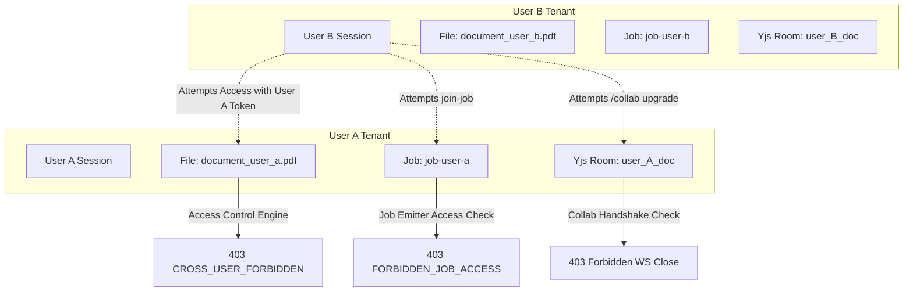

# FileTools Pro — Access Control Matrix & Tenant Isolation
**Version:** 1.0.0 (Production Blueprint G1 Gate)  
**Date:** 23/10/2026  
**Status:** IMPLEMENTED & TESTED (Gate: PASS)

---

## 1. Role Definitions

| Role | Description | Plan Level / Privileges |
| :--- | :--- | :--- |
| **Anonymous (Guest)** | Unauthenticated public visitor | Free quotas, local temporary files with signed download tokens; no persistent cloud storage. |
| **Authenticated User** | Logged-in user with MongoDB record | Plan determined by `user.plan` (`free`, `plus`, `pro`). Full file ownership ACL. |
| **Administrator** | User with `role: 'admin'` in MongoDB | Full operational access, mutate server pronunciation dictionary, view system audit logs. |

---

## 2. Resource & Endpoint Access Control Matrix

| Resource / Route | Permitted Roles | Authorization Mechanism | Failure Response |
| :--- | :--- | :--- | :--- |
| **Public Static Outputs (`/outputs/*`)** | **NONE** | **REMOVED** — Directory browsing and static file serving disabled. | `404 Not Found` |
| **Public Static Uploads (`/uploads/*`)** | **NONE** | **REMOVED** — Static file serving disabled. | `404 Not Found` |
| **Download Output (`/api/download/:filename`)** | Anonymous, User | `validateDownloadAccess`: Signed Download Token (`type: 'file_download'`) or active session matching `FileRecord`. | `403 FORBIDDEN_FILE_ACCESS` `400 PATH_TRAVERSAL_DETECTED` |
| **View Output (`/api/view/:filename`)** | Anonymous, User | `validateDownloadAccess`: Signed Download Token or active session matching `FileRecord`. | `403 FORBIDDEN_FILE_ACCESS` `400 PATH_TRAVERSAL_DETECTED` |
| **Cloud File Download (`/api/storage/download/:id`)** | User (Owner) | `requireAuth` + `requireFileOwner`: Must match `record.user === req.user._id`. | `401 UNAUTHENTICATED` `404 / 403 FILE_NOT_FOUND_OR_FORBIDDEN` |
| **Cloud File Delete (`/api/storage/:id`, `/api/user/files/:id`)** | User (Owner) | `requireAuth` + `storageSvc.deleteFromCloud`: Must match `user: req.user._id`. | `401 UNAUTHENTICATED` `404 FILE_NOT_FOUND` |
| **Socket.IO Job Progress (`join-job`)** | Job Owner, Authorized Guest | `hasJobAccess`: Verified against `jobRegistry` by `userId` or cryptographically random `jobSecret`. | `job-error` event: `FORBIDDEN_JOB_ACCESS` |
| **Yjs Collaboration (`/collab`)** | Authenticated User | HTTP Upgrade Handshake verification: JWT access token required. Scoped rooms `user_<id>_*` restricted to room owner. | `HTTP 401 Unauthorized` `HTTP 403 Forbidden` |
| **Batch Processing (`/api/batch/process`)** | Anonymous, User | `optionalAuth` + `registerJob`: Creates job registry entry with `ownerId` and `jobSecret`. | `400 Bad Request` |
| **TTS Pronunciation Dict Read (`GET /api/speech/tts/dictionary`)** | Anonymous, User | Public read of system pronunciation rules. | `200 OK` |
| **TTS Pronunciation Dict Write (`POST /api/speech/tts/dictionary`)** | **Admin Only** | `requireAuth` + `requireRole('admin')`: Restricts server-wide disk mutations. | `401 UNAUTHENTICATED` `403 FORBIDDEN` |
| **User Profile & Sessions (`/api/auth/me`, `/api/auth/sessions`)** | User | `requireAuth`: Bound to `req.user._id`. | `401 UNAUTHENTICATED` |
| **Session Revocation (`DELETE /api/auth/sessions/:id`)** | User (Owner) | `requireAuth`: Session must match `userId: req.user._id`. | `401 UNAUTHENTICATED` |

---

## 3. Tenant Boundary & Isolation Rules

### 3.1 File Isolation
- Every generated output file receives a signed download token:
  `authSvc.signDownloadToken(filename, userId, '1h')`
- If User A creates a file, the token binds `userId = userA._id`.
- If User B attempts to present User A's download token:
  - `validateDownloadAccess` detects `req.user._id !== decoded.userId`.
  - Immediate rejection with `403 CROSS_USER_FORBIDDEN`.
- If an unauthenticated attacker tries guessing file names without any token:
  - Immediate rejection with `403 FORBIDDEN_FILE_ACCESS`.

### 3.2 WebSocket Room Isolation
- Socket.IO `join-job`:
  - When `registerJob(jobId, { ownerId, secret })` registers a job for User A, non-owner User B cannot receive `job-progress`, `job-complete`, or `job-error` events.
  - Sockets attempting unauthorized joins are rejected without joining the room.
- Yjs Collaboration (`/collab`):
  - WebSocket upgrade requests without valid JWT are terminated before connection with `HTTP 401 Unauthorized`.
  - Rooms prefixed with `user_<userId>_` or `user:<userId>:` verify that the connected socket's `userId` matches the room owner. Foreign users receive `HTTP 403 Forbidden` and the TCP socket is immediately destroyed.

### 3.3 Path Traversal Prevention
- `path.basename()` sanitizes the input parameter.
- The path is resolved against `path.resolve('outputs')` and verified with `targetPath.startsWith(outputsDir)`.
- Input containing `..`, `/`, or `\` is rejected immediately with `400 PATH_TRAVERSAL_DETECTED`.

---

## 4. Verification Evidence Matrix

All matrix rules are verified by automated tests in `tests/security/auth-access.test.js`:

| Rule ID | Scenario Tested | Input Conditions | Expected Result | Verified Status |
| :--- | :--- | :--- | :--- | :--- |
| **ACL-01** | User A accesses User A file | Valid token with matching userId | Pass (Next called) | **CONFIRMED (PASS)** |
| **ACL-02** | User B accesses User A file | User B session + User A token | 403 `CROSS_USER_FORBIDDEN` | **CONFIRMED (PASS)** |
| **ACL-03** | Anonymous access without token | No token, no session | 403 `FORBIDDEN_FILE_ACCESS` | **CONFIRMED (PASS)** |
| **ACL-04** | Token filename mismatch | Valid token for file X, request file Y | 403 `FILE_TOKEN_MISMATCH` | **CONFIRMED (PASS)** |
| **ACL-05** | Directory traversal attack | `filename: '../../etc/shadow'` | 400 `PATH_TRAVERSAL_DETECTED` | **CONFIRMED (PASS)** |
| **ACL-06** | Cross-user Socket.IO job join | User B attempts `join-job` on User A job | `FORBIDDEN_JOB_ACCESS` | **CONFIRMED (PASS)** |
| **ACL-07** | Guest job access with secret | Guest provides valid `jobSecret` | Pass (Authorized) | **CONFIRMED (PASS)** |
| **ACL-08** | Guest job access without secret | Anonymous with null secret | Denied | **CONFIRMED (PASS)** |
| **ACL-09** | Yjs room cross-user access | User B accesses `user_<userA_id>_doc` | 403 Forbidden | **CONFIRMED (PASS)** |
| **ACL-10** | Global dictionary write by user | User role 'user' POST `/tts/dictionary` | 403 `FORBIDDEN` | **CONFIRMED (PASS)** |
| **ACL-11** | Global dictionary write by admin | User role 'admin' POST `/tts/dictionary` | 200 OK (Allowed) | **CONFIRMED (PASS)** |
