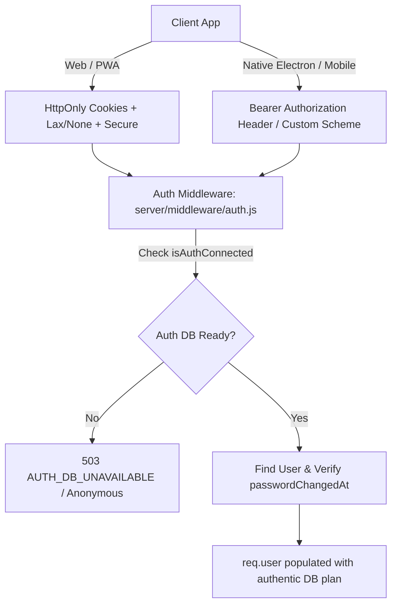

# FileTools Pro — Auth & Session Security Contract
**Version:** 1.0.0 (Production Blueprint G1 Gate)  
**Date:** 23/10/2026  
**Scope:** Authentication, Session Lifecycle, Token Rotation, Multi-Platform Support & Migration  
**Status:** IMPLEMENTED & TESTED (Gate: PASS)

---

## 1. Platform Architecture & Client Contracts

FileTools Pro operates across multiple client targets: Web Browser, Progressive Web App (PWA), Desktop (Electron), and Mobile (Capacitor / Android / iOS). To guarantee security across diverse environments, FileTools Pro enforces a dual session model:



### 1.1 Web & PWA Clients (Cookie-First)
- **Primary Transport:** `HttpOnly`, `SameSite=Lax` (development) / `SameSite=None; Secure` (cross-domain proxy in production like Vercel).
- **Cookie Definitions:**
  - `accessToken` / `token`: Short-lived JWT (15 minutes).
  - `refreshToken`: Long-lived cryptographic random string (7 days, stored in MongoDB with SHA-256 hash).
- **Zero URL Token Leakage:** Web OAuth and callback redirect flows (`/api/auth/google/callback`, `/api/auth/github/callback`, `/api/auth/telegram/callback`) **NEVER** append `?token=...` to web browser URLs. Session credentials are transported strictly via `HttpOnly` response cookies.
- **CSRF Protection:** SameSite cookie isolation + state check on OAuth callbacks.

### 1.2 Native Desktop & Mobile Clients (Secure Storage + Custom Schemes)
- **Platform Schemes:** `filetools://auth` (Electron), `com.filetools.pro://auth` (Capacitor/Android).
- **Storage:** Secure Encrypted Storage (`safeStorage` on Electron, Keystore/Keychain on Android/iOS).
- **Transport:** Standard HTTP Header `Authorization: Bearer <accessToken>`.
- **Query Scheme Exception:** During OAuth callback redirects to native apps, custom deep-link URI schemes receive the initial handshake token via redirect URI (e.g. `filetools://auth/dashboard?token=...`), which the native runtime immediately extracts, persists into OS keychain, and strips from application memory.

---

## 2. Token Specifications & Cryptographic Signatures

### 2.1 Access Token (JWT)
- **Algorithm:** `HS256` signed with cryptographically random `JWT_ACCESS_SECRET` (minimum 256 bits).
- **TTL:** 15 minutes (`JWT_ACCESS_EXPIRES=15m`).
- **Payload Claims:**
  ```json
  {
    "userId": "507f1f77bcf86cd799439011",
    "id": "507f1f77bcf86cd799439011",
    "type": "access",
    "iat": 1729668000,
    "exp": 1729668900
  }
  ```
- **Rule:** The token claims DO NOT contain user role or subscription plan. Roles and plans are **NEVER** trusted from JWT claims alone; they are queried from MongoDB on every authenticated request.

### 2.2 Refresh Token & Replay Family Rotation
- **Format:** 48-byte cryptographically secure random hexadecimal token.
- **Database Storage:** Stored as SHA-256 hash in collection `refresh_tokens`.
- **Rotation Policy:** On every `/api/auth/refresh` invocation:
  1. The presented refresh token is validated against the active database session.
  2. If valid, the current token is immediately marked `revokedAt = new Date()` with `replacedByToken`.
  3. A new child token is generated within the same token `family`.
  4. **Replay Detection Breach:** If an already-revoked refresh token is re-presented (indicating token theft or replay), the system immediately revokes the **entire token family** (`RefreshToken.revokeFamily()`), emits a high-severity `AuditLog` entry, and logs out all sessions associated with that lineage.

### 2.3 Signed Download Token
- **Format:** Signed JWT with `type: 'file_download'`.
- **TTL:** 1 hour.
- **Payload Claims:**
  ```json
  {
    "filename": "output_compressed_84920.pdf",
    "userId": "507f1f77bcf86cd799439011",
    "type": "file_download",
    "exp": 1729671600
  }
  ```
- **Enforcement:** Verified by `validateDownloadAccess` in `server/middleware/accessControl.js`. Filename and user ownership must match.

---

## 3. Fail-Closed Authentication & Database Outage Contract

### Previous Vulnerability (S-03)
Prior to this patch, when `!isAuthConnected()`, `requireAuth` assigned:
`req.user = { _id: userId, email: decoded.email, role: 'user', plan: 'pro' };`
This permitted arbitrary unprivileged users to obtain free 'pro' tier escalation whenever MongoDB experienced intermittent connectivity losses.

### Corrected Production Contract
- **`requireAuth`:**
  - If `!isAuthConnected()`: Immediately halts request processing and returns:
    ```json
    HTTP 503 Service Unavailable
    {
      "error": "Dịch vụ xác thực tạm thời không khả dụng. Vui lòng thử lại sau.",
      "code": "AUTH_DB_UNAVAILABLE"
    }
    ```
  - It **NEVER** elevates, infers, or defaults `req.user.plan` to 'pro'.
- **`optionalAuth`:**
  - If `!isAuthConnected()`: Leaves `req.user = undefined`, allowing unauthenticated public endpoints to process the request strictly in guest mode without grant of elevated privileges.

---

## 4. Telegram Authentication Security Contract

### Previous Vulnerability (S-02)
`server/routes/auth.routes.js` previously evaluated `if (process.env.TELEGRAM_BOT_TOKEN)` before checking the signature. If the environment variable was missing or undefined, the HMAC verification was skipped entirely, allowing any client to forge arbitrary Telegram IDs and authenticate. Furthermore, verification used insecure `===` string equality susceptible to timing attacks.

### Corrected Production Contract (`server/routes/auth.routes.js`)
1. **Fail-Closed Gate:**
   - If `!process.env.TELEGRAM_BOT_TOKEN`, the endpoint immediately redirects with error `telegram_auth_disabled` (or returns 503). Zero unverified logins are allowed.
2. **Cryptographic Validation:**
   - Data check string is constructed by sorting all query parameters (excluding `hash`) alphabetically: `k=v\n`.
   - Secret key: `SHA256(TELEGRAM_BOT_TOKEN)`.
   - Expected signature: `HMAC-SHA256(checkString, secret)`.
   - Comparison: Constant-time comparison using `crypto.timingSafeEqual(expectedBuf, receivedBuf)`.
3. **Freshness Verification (`auth_date`):**
   - Must be present and integer.
   - Rejects if `now - auth_date > 900` (15 minutes).
   - Rejects if `auth_date - now > 60` (clock skew in future).
4. **Replay Protection:**
   - In-memory cache `processedTelegramHashes` records verified hashes with 15-minute TTL.
   - If a duplicate hash is re-sent within the validity window, the request is rejected with `telegram_auth_replay_detected`.

---

## 5. Host Header Poisoning & OAuth Redirect Whitelist

To eliminate Open Redirect vulnerabilities via spoofed `Host` or `X-Forwarded-Host` headers in `getClientUrl(req)`:
- Permitted hostnames are strictly whitelisted:
  - `localhost`, `127.0.0.1`
  - `*.vercel.app` (e.g. `filetool-app.vercel.app`)
  - Explicit hosts configured in `CLIENT_URL` / `ALLOWED_ORIGINS`.
- Any unapproved host header is discarded, and redirects fall back strictly to `CLIENT_URL` or `http://localhost:5173`.

---

## 6. Zero-Downtime Client Migration Plan

1. **Dual Header/Cookie Acceptance:** `requireAuth` inspects `req.cookies.accessToken`, `req.cookies.token`, and `req.headers.authorization`.
2. **Existing User Continuity:** Existing web clients holding tokens in `localStorage` continue functioning via `Authorization: Bearer <token>`.
3. **Gradual Cookie Adoption:** On the next token refresh (`/api/auth/refresh`) or re-login, the server issues HttpOnly cookies with `SameSite=None; Secure`, automatically enabling transparent cookie-based session management without forcing user logouts.
