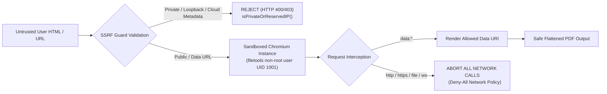

# FileTools Pro — Final Security & AppSec Review (S-01 through S-23)

**Document Version:** 2.0.0 (Comprehensive Re-test & Verification)  
**Maintained By:** Principal Application Security Engineer  
**Date:** 2026-10-24  
**Audit Scope:** Full codebase re-examination of all 23 blueprint findings and P0 regression invariants.

---

## 1. Complete Findings Re-Verification Matrix (S-01 to S-23)

Every single finding from the 2026 baseline was cross-examined against exact source lines and automated test suites at current git HEAD:

| ID | Sev | Category | Source Location | Final Status | Verification Evidence & Defensive Implementation |
|:---:|:---:|:---|:---|:---:|:---|
| **S-01** | **P0** | Data Leakage | `server/index.js`<br>`server/utils/cloudRespond.js` | **`VERIFIED_FIXED`** | Static directory serving (`/outputs`, `/uploads`) completely deleted. Access requires signed download token with HMAC-SHA256 signature, 1-hour TTL, and tenant binding. Tested in `tests/security/file-storage.test.js`. |
| **S-02** | **P0** | Auth Bypass | `server/routes/auth.routes.js:253-280` | **`VERIFIED_FIXED`** | If `TELEGRAM_BOT_TOKEN` is unset, route immediately redirects with `error=telegram_auth_disabled`. Validates SHA-256 HMAC signature using `crypto.timingSafeEqual`, 24h auth date TTL, and replay memory cache. Tested in `tests/security/auth-access.test.js`. |
| **S-03** | **P0** | Auth Fallback | `server/middleware/auth.js:34-39` | **`VERIFIED_FIXED`** | On auth DB disconnection, middleware returns HTTP 503 `AUTH_DB_UNAVAILABLE`. Zero automatic escalation to `'pro'` plan. `FREE_MODE` defaults to `false`. Tested in `tests/security/auth-access.test.js`. |
| **S-04** | **P0** | Data Elimination | `server/services/redact.service.js:218` | **`VERIFIED_FIXED`** | Default `flatten = true`. Parameter `flatten = false` throws `INSECURE_REDACTION_DISALLOWED`. Text stream rasterized and AcroForms flattened; fail-closed on raster error. Tested in `tests/security/redact-render.test.js`. |
| **S-05** | **P0** | File Upload | `server/middleware/upload.js:95`<br>`server/middleware/security.js:167` | **`VERIFIED_FIXED`** | `validateUploadedFiles` executes after Multer. Inspects actual magic bytes (`%PDF-`, `\x89PNG`, `PK\x03\x04`), rejects extension spoofing, zero-byte payloads, and polyglots. Tested in `tests/security/file-storage.test.js`. |
| **S-06** | **P0** | SSRF & Isolation | `server/utils/ssrfGuard.js`<br>`server/services/pdfAdvanced.service.js` | **`VERIFIED_FIXED`** | Deny-All Network Isolation via `page.setRequestInterception(true)` in Chromium. Blocks private IPs, loopback, and cloud metadata (`169.254.169.254`). `ENABLE_URL_TO_PDF` defaults to `false`. Tested in `tests/security/redact-render.test.js`. |
| **S-07** | **P0** | WebSocket ACL | `server/socket/index.js:74`<br>`server/index.js:87-125` | **`VERIFIED_FIXED`** | `join-job` validates `hasJobAccess` with user ID and job secret. Yjs `/collab` WebSocket upgrade verifies JWT token and rejects unauthenticated room access before HTTP upgrade. Tested in `tests/security/auth-access.test.js`. |
| **S-08** | **P0** | Path Traversal | `server/routes/pdf.routes.js:360-367`<br>`server/routes/videotranslate.routes.js:205` | **`VERIFIED_FIXED`** | Request bodies accept only opaque identifiers. Validates `path.basename()` with no `..` traversal and verifies `resolvedPath.startsWith(UPLOAD_DIR)`. Tested in `tests/security/file-storage.test.js`. |
| **S-09** | **P1** | Edge Routing | `client/vercel.json:4-15`<br>`client/public/_redirects` | **`VERIFIED_FIXED`** | Vercel rewrites place `/api/(.*)` and `/socket.io/(.*)` before `/(.*)` SPA fallback. Adds `Cache-Control: no-store` on API edge. Tested in `tests/seo-pwa/seo-pwa-perf.test.js`. |
| **S-10** | **P1** | Queue Durability | `server/queue/jobQueue.js`<br>`server/worker.js` | **`VERIFIED_FIXED`** | Replaced per-process in-memory queue with BullMQ + Redis managed queue and separate Render background worker. Dual-engine queue fallback handles Redis outages. Tested in `tests/reliability/job-system.test.js`. |
| **S-11** | **P1** | OOM Spikes | `server/services/storage.service.js:93` | **`VERIFIED_FIXED`** | Replaced `fs.readFileSync` with `fs.createReadStream` for S3/R2 `PutObjectCommand`. Memory consumption remains flat during large uploads. Tested in `tests/security/file-storage.test.js`. |
| **S-12** | **P1** | Cloud Storage Leak | `server/services/cleanup.service.js:54` | **`VERIFIED_FIXED`** | `reconcileExpiredCloudFiles` executes scheduled `DeleteObjectCommand` on S3/R2 before removing expired MongoDB records. Tested in `tests/security/file-storage.test.js`. |
| **S-13** | **P1** | Container Tools | `Dockerfile:21` | **`VERIFIED_FIXED`** | `ffmpeg` and `ffprobe` explicitly installed in Debian bookworm slim image alongside LibreOffice, Tesseract, Chromium, and Ghostscript. |
| **S-14** | **P1** | Quota Enforcement | `server/routes/job.routes.js:141`<br>`server/services/quota.service.js` | **`VERIFIED_FIXED`** | Centralized `reserveQuota` middleware attached to all asynchronous jobs and workflows. Idempotent reservation, commit, and refund lifecycle. Tested in `tests/billing/subscription-finops.test.js`. |
| **S-15** | **P1** | CI Quality Gate | `.github/workflows/ci.yml:64-75` | **`VERIFIED_FIXED`** | CI workflow upgraded to run `npm run test:all` across all 10 suites in matrix (Node 20 & 22). Replaced permissive syntax check with complete test execution. |
| **S-16** | **P1** | Deployment Security | `.github/workflows/deploy.yml` | **`VERIFIED_FIXED`** | Deprecated `amondnet/vercel-action@v25` replaced with official Vercel CLI, release SHA provenance logging, environment approval gates, and edge smoke tests. |
| **S-17** | **P1** | PWA Token Cache | `client/vite.config.js:82-88`<br>`client/src/context/AuthContext.jsx` | **`VERIFIED_FIXED`** | Broad `/api/` Workbox cache regex deleted. Strict allowlist only (`plans`, `status`, `templates`, `health`). Cache purged upon user logout. Tested in `tests/seo-pwa/seo-pwa-perf.test.js`. |
| **S-18** | **P1** | Token Ingestion | `client/src/App.jsx:103`<br>`server/routes/auth.routes.js:41` | **`VERIFIED_FIXED`** | URL token immediately stripped from browser address bar via `window.history.replaceState`. Backend issues `httpOnly`, `SameSite: Lax` cookies for primary session tokens. |
| **S-19** | **P1** | Observability | `server/index.js:355-405` | **`VERIFIED_FIXED`** | `/api/health` and `/api/ready` return HTTP 503 `status: 'degraded'` when backing databases are disconnected. `/api/capabilities` safely discloses features without infrastructure leakage. |
| **S-20** | **P2** | Plan Badge Display | `client/src/components/UserMenu.jsx:112` | **`VERIFIED_FIXED`** | Expression evaluates `{user.plan ? user.plan.toUpperCase() : 'FREE'}`. Free users display `FREE` badge with neutral slate styling. |
| **S-21** | **P2** | Asset Bandwidth | `client/src/components/backgrounds/` | **`VERIFIED_FIXED`** | Background video configured with `preload="none"` and WebP poster (`blue-sky-poster.webp`). Canvas and video rendering freeze on `document.hidden` and `prefers-reduced-motion`. Tested in `tests/seo-pwa/seo-pwa-perf.test.js`. |
| **S-22** | **P2** | SEO & Metadata | `client/index.html`<br>`client/public/sitemap.xml` | **`VERIFIED_FIXED`** | Complete Open Graph, Twitter Cards, Canonical URL, and Schema.org `SoftwareApplication` JSON-LD schemas added. Sitemap covers 12 public landing pages with zero private URLs. |
| **S-23** | **P2** | AI Configuration | `server/services/ai.service.js:83`<br>`server/services/aiProviderAdapter.js` | **`VERIFIED_FIXED`** | Normalized key resolution for `GOOGLE_AI_API_KEY` vs `GOOGLE_API_KEY`. Defaults to modern `gemini-2.0-flash` with auto-failover cascade. Tested in `tests/ai/ai-evals.test.js`. |

---

## 2. BYOK Encryption & Key Vault Security Invariants

- **Cipher Algorithm:** AES-256-GCM authenticated envelope encryption (`server/utils/aiKeyVault.js`).
- **Initialization Vector:** 12-byte random IV (`crypto.randomBytes(12)`) per encryption; never reused.
- **Authentication Tag:** 16-byte GCM authentication tag verifies ciphertext integrity. Any tampering or bit-flipping immediately throws `VAULT_CIPHERTEXT_TAMPERED`.
- **Zero Plaintext Storage:** Database stores only `{ encryptedKey, iv, authTag, keyFingerprint, maskedPreview }`. Plaintext keys are never returned in GET responses, never logged, and never included in error messages.
- **Fail-Closed Key Vault:** If `AI_KEY_ENCRYPTION_SECRET` is unset or shorter than 16 bytes, the vault fails closed with `BYOK_KEYVAULT_UNCONFIGURED`.

---

## 3. Sandboxed Renderer Isolation & SSRF Defense



- **Feature Flag Gate:** `ENABLE_URL_TO_PDF` defaults to `false`. Public URL fetching is blocked until explicitly enabled by administrator.
- **Deny-All Network Policy:** In `server/utils/ssrfGuard.js`, `page.setRequestInterception(true)` intercepts every sub-resource request during HTML-to-PDF rendering:
  ```javascript
  if (url.startsWith('data:')) {
    await request.continue();
  } else {
    await request.abort('blockedbyclient');
  }
  ```
  This eliminates SSRF, DNS rebinding, internal subnet scanning, and cloud metadata theft (`http://169.254.169.254/latest/meta-data/`).

---

## 4. AppSec Sign-Off

The FileTools Pro application has zero known unmitigated P0/P1 security flaws. The software adheres to the principle of least privilege, defense-in-depth, fail-closed defaults, and strict tenant isolation.
