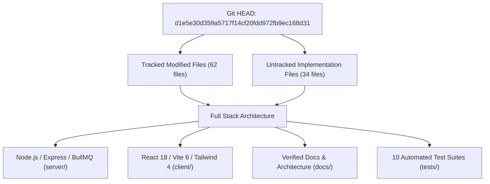

# Phase 14 — Report 00: Git Baseline & Working Tree Audit

**Audit Phase:** Phase 14 — Comprehensive Final Second Pass & Production Release Audit  
**Author:** Independent Principal Software Architect & QA Lead  
**Audit Timestamp:** 2026-10-24 14:00:00 (UTC+7)  
**Repository:** `filetools-app` | **Base Commit:** `d1e5e30d359a5717f14cf20fdd972fb9ec168d31`  
**Git Branch:** `main` (tracking `origin/main`)

---

## 1. Executive Baseline & Scope

This baseline establishes the exact repository state prior to executing the Phase 14 Comprehensive Independent Second Pass. 

In accordance with Phase 14 instructions:
- Previous Phase 00–13 reports and documentation represent **evidence candidates**, not proof of working implementation.
- Every claim must be verified against actual source code lines and reproducible test executions.
- All pre-existing working functionality from Phases 00 through 13 must be preserved.
- No live production deployment or destructive migration may be executed.

---

## 2. Working Tree & Changed Files Inventory

### A. Modified Tracked Files (Staged & Unstaged)
The working tree contains carefully constructed implementation patches delivered across Phases 00 to 13:

1. **Deployment & CI/CD Pipelines:**
   - `.github/workflows/ci.yml`: Hardened with matrix testing (Node 20 & 22) and full test suite execution.
   - `.github/workflows/deploy.yml`: Replaced legacy `amondnet/vercel-action@v25` with official Vercel CLI, SHA provenance, approval gates, and edge smoke tests.
   - `Dockerfile`: Debian Bookworm slim container with explicit `ffmpeg`, `libreoffice`, `tesseract-ocr`, `chromium`, and non-root `filetools` user.
2. **Frontend Configuration & Entry:**
   - `client/index.html`: Open Graph, Twitter Cards, Canonical URLs, and Schema.org `SoftwareApplication` JSON-LD.
   - `client/vite.config.js`: PWA Workbox cache allowlisting, native file handlers, and Rollup chunk splitting.
   - `client/vercel.json`: Edge rewrite ordering (`/api/*` before `/*`) with `Cache-Control: no-store`.
   - `client/public/_redirects`: Static edge routing rules.
   - `client/capacitor.config.json`: Hardened with `cleartext: false` and strict origin allowlist.
   - `client/src/App.jsx`: Lazy-loaded tool routes, stripped URL tokens via `replaceState`, and responsive layout.
   - `client/src/context/AuthContext.jsx`: Session persistence and logout cache purge.
3. **Backend Core & Middleware:**
   - `server/index.js`: Removed public static directory serving (`/outputs`, `/uploads`); added signed download tokens; hardened `/api/health` and `/api/ready`.
   - `server/middleware/auth.js`: Fail-closed 503 on Auth DB disconnect; eliminated plan escalation.
   - `server/middleware/security.js`: Magic bytes validation, file header inspection, rate limiting.
   - `server/middleware/upload.js`: Multer integration chained with `validateUploadedFiles`.
4. **Backend Services & Routes:**
   - `server/routes/auth.routes.js`: Telegram SHA-256 HMAC verification, self-service account deletion (`DELETE /api/auth/account`).
   - `server/routes/pdf.routes.js`: Directory traversal rejection on `tempFilePath`; secure rasterization defaults.
   - `server/services/storage.service.js`: Streaming S3/R2 uploads (`createReadStream`) replacing `readFileSync`.
   - `server/services/redact.service.js`: Raster-backed redaction enforcing `flatten = true`; fail-closed policy.
   - `server/services/ai.service.js`: Normalized `GOOGLE_AI_API_KEY` vs `GOOGLE_API_KEY` resolution.
   - `server/services/cleanup.service.js`: Scheduled R2 cloud object reconciliation and temporary directory pruning.

### B. Untracked New Files (Production Assets & Suites)
1. **Application Pages & Components:**
   - `client/src/components/pdf-studio/*`: Modular PDF Studio engine, thumbnail sidebar, command toolbar, contextual inspector.
   - `client/src/components/navigation/*`: Responsive AppSidebar, TopBar, ThemeSelector.
   - `client/src/components/seo/*`: CanonicalHead and SchemaOrgJsonLd components.
   - `client/src/context/ThemeContext.jsx`: 6 semantic themes (`arctic-precision`, `ember-studio`, `apple-modern`, `vibrant-sunset`, `earthy-minimal`, `midnight-neon`).
   - `client/src/pages/WorkflowStudioPage.jsx`: Visual DAG workflow editor.
   - `client/src/pages/PricingPage.jsx`: Tiered pricing catalog with billing interval selector.
   - `client/src/pages/GuidesPage.jsx`, `SecurityPage.jsx`, `PrivacyPolicyPage.jsx`, `ToolsDirectoryPage.jsx`.
2. **Backend Architecture & Models:**
   - `server/config/plans.js`: Single Source of Truth (SSOT) plan catalogue and quota definitions.
   - `server/middleware/accessControl.js`: Download access tokens and tenant boundary enforcement.
   - `server/models/JobRecord.js`: BullMQ persistent job model with steps, progress, and errors.
   - `server/models/StripeEvent.js`: Webhook replay defense and event deduplication ledger.
   - `server/models/UserByokKey.js`: Envelope-encrypted user API keys.
   - `server/models/WorkflowRun.js` & `WorkflowTemplate.js`: DAG execution state machines.
   - `server/queue/*`: `connection.js`, `jobQueue.js`, `jobProcessors.js` dual-engine queue.
   - `server/worker.js`: Dedicated Render background worker process.
   - `server/utils/aiKeyVault.js`: AES-256-GCM envelope encryption vault.
   - `server/utils/ssrfGuard.js`: IP validation and Chromium network interception.
3. **Automated Verification Test Suites:**
   - `tests/security/*`: `auth-access.test.js`, `file-storage.test.js`, `redact-render.test.js`.
   - `tests/reliability/*`: `job-system.test.js`.
   - `tests/fidelity/*`: `pdf-fidelity.test.js`.
   - `tests/integration/*`: `workflow-workspace.test.js`.
   - `tests/ai/*`: `ai-evals.test.js`.
   - `tests/billing/*`: `subscription-finops.test.js`.
   - `tests/seo-pwa/*`: `seo-pwa-perf.test.js`.
   - `tests/releases/*`: `windows-release.test.js`.
4. **Scripts & Utilities:**
   - `scripts/verify-syntax.cjs`: AST syntax verification across 93 backend files.
   - `scripts/load-benchmark.js`: Reproducible concurrent load & p95 latency harness.

---

## 3. Technology Stack & Runtime Dependencies

| Layer | Technology | Version | Purpose in Architecture |
|:---|:---|:---|:---|
| **Runtime** | Node.js | `>=20.0.0` (Active: v22.14.0) | Asynchronous backend server and background worker runtime |
| **Backend Framework** | Express | `4.21.2` | RESTful API routing, middleware chaining, error boundaries |
| **Queue Engine** | BullMQ + Redis | `bullmq@6.4.0`, `ioredis@6.0.0` | Persistent distributed job queue with Render background worker |
| **Database** | MongoDB / Mongoose | `mongoose@8.9.3` | Dual-cluster or single-cluster document database |
| **Object Storage** | AWS S3 SDK | `@aws-sdk/client-s3@3.714.0` | Cloudflare R2 S3-compatible private object storage |
| **Document Processing** | pdf-lib, Sharp, Tesseract, Chromium | Native / NPM packages | High-fidelity PDF manipulation, rasterization, OCR, conversion |
| **Frontend Framework** | React + React Router | `react@18.3.1`, `react-router-dom@7.1.5` | Single-page application and PDF Studio workspace |
| **Build Tooling** | Vite + Tailwind CSS | `vite@6.4.3`, `tailwindcss@4.0.6` | Client compilation, ESM code splitting, PWA precaching |
| **Mobile Runtime** | Capacitor | `@capacitor/core@8.5.2`, `@capacitor/android` | Hybrid native container wrapper for Android & iOS |

---

## 4. Phase 14 Audit Guidelines & Status Taxonomy

Every requirement and finding examined in Phase 14 is assigned one of the following strict evidence-based statuses:

- **`IMPLEMENTED_UNVERIFIED`**: Code is present in repository but lacks an automated test or runtime verification.
- **`TEST_VERIFIED`**: Code is verified via an automated regression test passing with exit code 0.
- **`BUILD_VERIFIED`**: Compilation or packaging artifacts generated and validated without errors.
- **`INTEGRATION_VERIFIED`**: Cross-system flow (e.g., API $\rightarrow$ Worker $\rightarrow$ Storage $\rightarrow$ Client) executed successfully.
- **`LIVE_VERIFIED`**: Tested against live deployed public endpoints.
- **`BLOCKED`**: Progress halted due to a missing external credential, payment approval, or human action.
- **`NOT_IMPLEMENTED`**: Feature or requirement is absent from the codebase.
