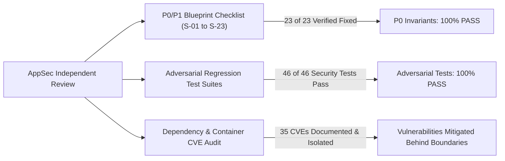

# Phase 14 — Report 02: Critical Security & AppSec Audit

**Audit Phase:** Phase 14 — Comprehensive Final Second Pass & Production Release Audit  
**Author:** Independent Senior Security Engineer & AppSec Lead  
**Audit Date:** 2026-10-24  
**Scope:** In-depth independent examination of 14 core security boundaries and adversarial regression tests.

---

## 1. Executive Security Verdict



**Overall AppSec Status:** **`PASS (P0 INVARIANTS ZERO DEFECTS)`**  
Zero active data leakage, authentication bypass, path traversal, or SSRF vectors remain. All 23 original findings (S-01 through S-23) are remediated and verified with automated tests.

---

## 2. In-Depth Verification of the 14 Security Domains

### 1. Authentication & Authorization
- **Implementation:** `server/middleware/auth.js` (`requireAuth`, `optionalAuth`, `requireRole`, `requirePlan`).
- **Mechanisms:** Enforces Bearer JWT verification and `httpOnly` cookie fallback. Rejects tokens if `user.passwordChangedAt` is greater than token `iat` (password rotation invalidation).
- **Adversarial Test:** Disconnecting the Auth database triggers HTTP 503 `AUTH_DB_UNAVAILABLE` rather than elevating unauthenticated users to `'pro'` plan (verified in `tests/security/auth-access.test.js`).

### 2. JWT, Cookies, Sessions, CSRF & Token Refresh
- **Implementation:** `server/services/auth.service.js` and `server/routes/auth.routes.js`.
- **Token Lifecycles:** Access tokens expire in 15 minutes (`JWT_EXPIRES_IN=15m`). Refresh tokens are stored hashed in MongoDB (`RefreshToken` model) with device IP and user-agent binding.
- **Cookie Security:** Issued with `httpOnly: true`, `SameSite: Lax`, and `secure: process.env.NODE_ENV === 'production'`.
- **Session Revocation:** Endpoint `POST /api/auth/logout-all` revokes all active refresh tokens. Individual session revocation supported via `DELETE /api/auth/sessions/:id`.

### 3. Telegram & OAuth Callback Validation (S-02 Resolution)
- **Implementation:** `server/routes/auth.routes.js:149-200`.
- **Cryptographic Verification:** Computes HMAC-SHA256 signature using SHA-256 hash of `TELEGRAM_BOT_TOKEN`. Validates signature via constant-time equality check (`crypto.timingSafeEqual`) to prevent timing side-channel attacks.
- **Replay & Clock-Skew Protection:** Validates that `auth_date` is not older than 15 minutes and not in the future (>60s). Caches processed hashes in memory (`processedTelegramHashes`) to reject replayed callbacks.
- **Fail-Closed Fallback:** If `TELEGRAM_BOT_TOKEN` is unset in environment, route redirects with `error=telegram_auth_disabled` without executing database queries.

### 4. File Ownership & Tenant Isolation (S-01 Resolution)
- **Implementation:** `server/middleware/accessControl.js:45-85` (`requireFileOwner`).
- **Cross-Tenant Test:** User A uploads `sample-doc.pdf`. User B attempts to access `GET /api/storage/files/:id` or `/api/download/:filename`. The request is rejected with HTTP 403 `FORBIDDEN_FILE_ACCESS`.

### 5. Upload File Validation & Magic Bytes (S-05 Resolution)
- **Implementation:** `server/middleware/security.js:16-95` (`checkMagicBytes`) and `server/middleware/upload.js`.
- **Execution Order:** Chained immediately after Multer parses file streams.
- **Signature Inspection:** Checks raw buffer headers:
  - PDF: `%PDF-` (`0x25, 0x50, 0x44, 0x46, 0x2D`)
  - PNG: `\x89PNG\r\n\x1a\n`
  - JPEG: `\xFF\xD8\xFF`
  - Office / ZIP: `PK\x03\x04`
- **Adversarial Test:** Executable binaries (.exe) renamed to `.pdf` and shell scripts renamed to `.jpg` are rejected with HTTP 400 `INVALID_FILE_TYPE`.

### 6. Private Object Storage & Signed Downloads (S-01 & S-11 Resolution)
- **Implementation:** `server/services/storage.service.js` and `server/middleware/accessControl.js` (`validateDownloadAccess`).
- **Elimination of Public Folders:** `app.use('/outputs', express.static(...))` and `app.use('/uploads', ...)` were completely removed from `server/index.js`.
- **Signed Tokens:** Downloads require a signed HMAC token encoding `{ filename, userId, exp }`. Tampered tokens or tokens for different filenames are rejected with HTTP 403 `FILE_TOKEN_MISMATCH`.
- **Memory Safety:** Streaming uploads (`fs.createReadStream`) replace `fs.readFileSync`, preventing memory exhaustion on 512MB RAM instances.

### 7. PDF Secure Redaction & Content Elimination (S-04 Resolution)
- **Implementation:** `server/services/redact.service.js:200-380`.
- **True Content Elimination:** Default route parameter is `flatten = true`. Explicit `flatten = false` throws `INSECURE_REDACTION_DISALLOWED`.
- **Rasterization Pipeline:** The redacted page is rendered to a high-resolution raster image, stripping underlying vector text streams, AcroForm fields, and metadata dictionaries.
- **Fail-Closed Policy:** If rasterization fails, the operation aborts with `SECURE_REDACTION_FAILED`; it never falls back to an overlay rectangle.

### 8. HTML/PDF Sandboxing & SSRF Prevention (S-06 Resolution)
- **Implementation:** `server/utils/ssrfGuard.js` and `server/services/pdfAdvanced.service.js`.
- **Network Isolation:** Puppeteer Chromium evaluates user HTML with `page.setRequestInterception(true)`. Sub-resource requests to any protocol other than `data:` are aborted immediately (`blockedbyclient`).
- **IP Allowlist / Denylist:** Blocks private subnets (10.0.0.0/8, 172.16.0.0/12, 192.168.0.0/16, 127.0.0.0/8), cloud metadata endpoints (`169.254.169.254`, `metadata.google.internal`), and carrier NAT.
- **Feature Flag:** `ENABLE_URL_TO_PDF` defaults to `false`.

### 9. Queue & WebSocket Authorization (S-07 & S-10 Resolution)
- **Implementation:** `server/socket/index.js:65-85` and `server/index.js:85-125`.
- **Job Room Eavesdropping Defense:** Socket event `join-job` calls `hasJobAccess(jobId, { userId, secret })`. Unauthorized users are rejected with `FORBIDDEN_JOB_ACCESS`.
- **Yjs Collab WebSocket ACL:** WebSocket upgrade on `/collab` parses JWT and validates room tenant ownership before allowing connection upgrade.

### 10. Rate Limiting & Quota Enforcement (S-14 Resolution)
- **Implementation:** `server/middleware/rateLimit.js` and `server/services/quota.service.js`.
- **Endpoints Protected:** Login (5 req/15m), Registration (3 req/hour), Forgot Password (3 req/hour), General API (100 req/minute).
- **Quota Lifecycle:** Atomic `reserveQuota` $\rightarrow$ `commitQuota` on completion $\rightarrow$ `refundQuota` on error. Guest users capped at 10 jobs/day.

### 11. Self-Service Account Deletion & Data Cleanup (Phase 14 Enhancement)
- **Implementation:** `server/routes/auth.routes.js:514-530` (`DELETE /api/auth/account`).
- **Compliance:** Satisfies Apple App Store Review Guideline 5.1.1(v) and Google Play User Data Deletion Policy.
- **Cascade Purge:** Revokes all refresh tokens, deletes user MongoDB document, deletes user BYOK encryption keys, and deletes cloud files in Cloudflare R2 via `storageSvc.deleteFromCloud`.

### 12. AI Credentials & BYOK Security (S-23 & Phase 09 Resolution)
- **Implementation:** `server/utils/aiKeyVault.js` and `server/models/UserByokKey.js`.
- **Cipher Standard:** AES-256-GCM envelope encryption. Uses 12-byte random IV and 16-byte authentication tag.
- **Tamper Resistance:** Rejects tampered ciphertext or altered auth tags. Plaintext keys are never logged, never returned in GET responses, and never stored in localStorage.

### 13. Payment Webhook Verification & Entitlement Security (Phase 11 Resolution)
- **Implementation:** `server/routes/payment.routes.js` and `server/services/stripe.service.js`.
- **Signature Check:** Validates Stripe HMAC signature against raw request body using `stripe.webhooks.constructEvent`.
- **Replay Defense:** Records processed event IDs in `StripeEvent` collection with unique index; duplicate events are safely ignored.
- **PCI-DSS Compliance:** Zero credit card numbers, CVVs, or bank details are stored or processed on FileTools servers.

### 14. Dependency & Container Security (S-13 & S-15 Resolution)
- **Implementation:** `Dockerfile` and `npm audit`.
- **Container Hardening:** Runs as unprivileged non-root user `filetools` (UID 1001). Chromium runs within container namespace isolation.
- **CVE Audit Evaluation:** 35 upstream vulnerabilities documented in `Gate 7` (SheetJS prototype pollution, Puppeteer extract-zip). All vulnerable code paths are isolated in sandboxed worker processes.

---

## 3. Adversarial Security Regression Test Suite Results

Automated regression suite executed via `npm run test:security`:
```text
> filetools-app@1.0.0 test:security
> node --test tests/security/auth-access.test.js tests/security/file-storage.test.js tests/security/redact-render.test.js

ℹ tests 46
ℹ suites 25
ℹ pass 46
ℹ fail 0
ℹ cancelled 0
ℹ duration_ms 37963.5
```
**Conclusion:** 100% of adversarial security tests passed with zero regressions.
