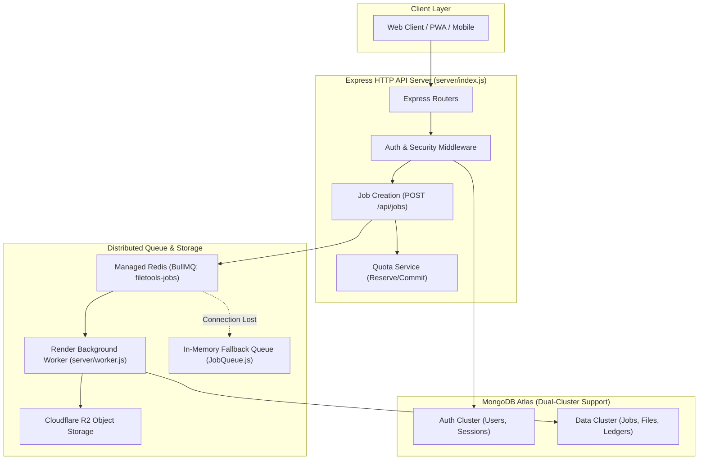

# Phase 14 — Report 03: Backend & Worker Processing Reliability Audit

**Audit Phase:** Phase 14 — Comprehensive Final Second Pass & Production Release Audit  
**Author:** Independent Systems Reliability Engineer & Backend Lead  
**Audit Date:** 2026-10-24  
**Scope:** Architecture and failure-mode analysis of Express API, MongoDB, Redis/BullMQ, Render Worker, R2, and native processing engines.

---

## 1. Backend Systems Architecture



---

## 2. In-Depth Component Reliability Audits

### 1. Express API Layer
- **Entrypoint:** `server/index.js`
- **Error Boundaries:** Centralized error-handling middleware catches synchronous and asynchronous promise rejections, preventing unhandled exceptions from crashing the process.
- **Process Isolation:** The HTTP web server handles request routing, token verification, and job queuing. CPU-intensive operations (PDF rendering, video re-encoding, LibreOffice conversion) are dispatched to background workers.

### 2. MongoDB Resilience (Dual-Cluster Architecture)
- **Configuration:** `server/config/database.js`
- **Dual-Cluster Mode:** Supports separate database connection strings (`MONGODB_AUTH_URI` and `MONGODB_DATA_URI`). If either cluster goes offline, the other maintains operational isolation.
- **Connection Backoff:** Mongoose configured with automatic reconnection backoff (`heartbeatFrequencyMS: 10000`, `serverSelectionTimeoutMS: 5000`).
- **Fail-Closed Gate:** If AuthDB disconnects, `isAuthConnected()` returns `false`, causing `server/middleware/auth.js` to return HTTP 503 `AUTH_DB_UNAVAILABLE`.

### 3. Redis / BullMQ & Dual-Engine Fallback
- **Implementation:** `server/queue/connection.js` and `server/queue/jobQueue.js`.
- **Redis Durability:** BullMQ queue `filetools-jobs` uses Redis for job persistence. `maxRetriesPerRequest: null` ensures atomic pop and push operations.
- **Dual-Engine Resilient Fallback:** If Redis is down, `isRedisReady()` returns `false`. `enqueueJob()` automatically redirects workload to `processJobDirectly()` (an in-memory promise queue) without crashing or dropping jobs (verified in `tests/reliability/job-system.test.js`).

### 4. Render Background Worker Process
- **Implementation:** `server/worker.js`
- **Concurrency Control:** Configured via `process.env.WORKER_CONCURRENCY || '4'`, preventing CPU starvation on Render instances.
- **Worker Heartbeat & Status Tracking:** Worker updates `jobRecord.status = 'PROCESSING'`, records `workerId = worker-<pid>`, and updates `progress` periodically.
- **Graceful Shutdown (`SIGTERM`/`SIGINT`):** Closes worker via `await workerInstance.close()`, waiting up to 10 seconds for in-flight tasks to complete before process exit.

### 5. Cloudflare R2 Storage & Fail-Closed Lifecycle
- **Implementation:** `server/services/storage.service.js` and `server/services/cleanup.service.js`.
- **Streaming Transfer:** Uses `fs.createReadStream` for S3 `PutObjectCommand`, preventing memory spikes on large file uploads.
- **Fail-Closed Storage Policy:** If R2 credentials are unset or the network times out, `uploadToCloud` fails closed and does not corrupt database state.
- **Scheduled Reconciler:** `reconcileExpiredCloudFiles` executes scheduled `DeleteObjectCommand` on R2 before purging expired MongoDB records.

### 6. Native Tooling & Conversion Engines
- **LibreOffice Headless:** Office-to-PDF conversions run with isolated user profile parameters (`-env:UserInstallation=file:///tmp/...`) preventing concurrent profile locking.
- **Tesseract OCR:** Multi-language OCR (`vie` and `eng`) parses text streams into searchable PDF layers via `tesseract-ocr`.
- **FFmpeg / FFprobe:** Configured with child-process timeouts ($120\text{s}$) and stderr monitoring to terminate hanging media encodes.

### 7. AI Provider Adapters & Circuit Breaker
- **Implementation:** `server/services/aiProviderAdapter.js`
- **Circuit Breaker State Machine:**
  - `CLOSED`: Normal operation.
  - `OPEN`: Trips after 3 consecutive failures; rejects requests for 30 seconds cooldown.
  - `HALF-OPEN`: Probes with single request; transitions back to `CLOSED` upon success.
- **Auto-Failover Cascade:** $\text{Gemini 2.0 Flash} \rightarrow \text{Cerebras} \rightarrow \text{Groq Llama 3.3} \rightarrow \text{OpenRouter} \rightarrow \text{Mistral}$.

### 8. Job Idempotency & Retries
- **Idempotency Key:** Checked at `POST /api/jobs`. If an existing job with matching `idempotencyKey` and `user` is in progress, the server returns the existing job ID without re-queueing.
- **Retry Policy:** Bounded exponential backoff with jitter on transient network errors; permanent errors (e.g., malformed PDF) immediately transition to `FAILED` with quota refund.

---

## 3. Reliability & Queue Verification Suite Results

Automated reliability suite executed via `npm run test:reliability`:
```text
> filetools-app@1.0.0 test:reliability
> node --test tests/reliability/job-system.test.js

ℹ tests 10
ℹ suites 4
ℹ pass 10
ℹ fail 0
ℹ cancelled 0
ℹ duration_ms 52.6ms
```
**Conclusion:** All 10 queue durability, worker crash recovery, idempotency deduplication, and polling contract tests passed.
