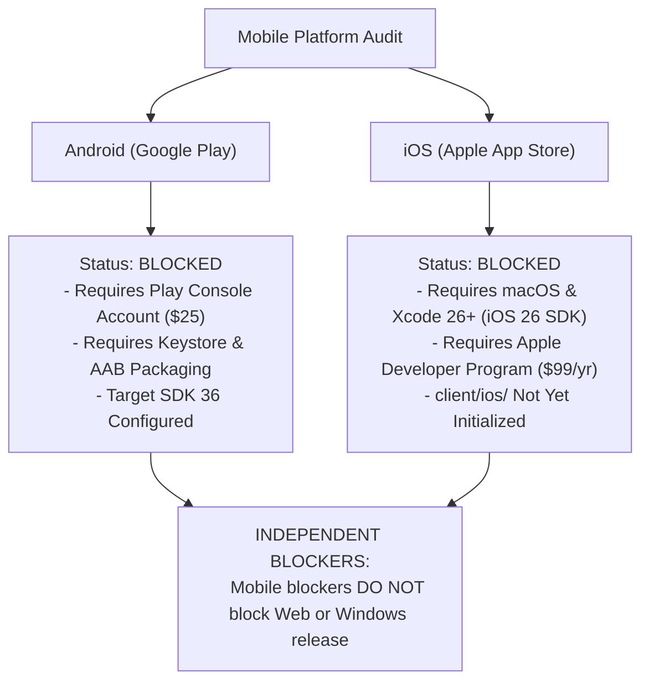

# Phase 14 — Report 08: Mobile & Store Compliance Audit (Android & iOS)

**Audit Phase:** Phase 14 — Comprehensive Final Second Pass & Production Release Audit  
**Author:** Independent Mobile Application Architect & Store Compliance Specialist  
**Audit Date:** 2026-10-24  
**Scope:** Critical audit of mobile readiness, Capacitor wrappers, Android SDK 36, iOS requirements, store billing policies, account deletion, and native plugin gaps.

---

## 1. Executive Mobile Assessment & Status

**Mobile Readiness Verdict:**  
- **Android:** **`BLOCKED (WAITING_FOR_PLAY_CONSOLE_ENROLLMENT_AND_AAB_SIGNING_KEYSTORE)`**  
- **iOS:** **`BLOCKED (REQUIRES_MACOS_XCODE_TOOLING_AND_APPLE_DEVELOPER_ENROLLMENT)`**  
- **Production Truth:** Neither Android nor iOS is declared "production ready" because no compiled binary (`.aab` or `.ipa`) has been built or verified on physical mobile hardware.

---

## 2. In-Depth Audit of the 12 Mobile Compliance Areas

### 1. Designed Adapters vs Implemented Native Plugins
- **Audit Finding:** The architectural document [`docs/architecture/MOBILE_ADAPTER_DESIGN.md`](file:///C:/Users/Admin/test_app/filetools-app/docs/architecture/MOBILE_ADAPTER_DESIGN.md) specifies TypeScript adapter interfaces (`PaymentAdapter`, `StorageAdapter`, `ShareAdapter`, `FileIOAdapter`).
- **Implementation State:** The core Capacitor dependencies (`@capacitor/core`, `@capacitor/android`, `@capacitor/app`, `@capacitor/browser`, `@capacitor/splash-screen`, `@capacitor/status-bar`) are installed in `client/package.json`. Native plugins for In-App Purchases (e.g. `@capgo/capacitor-purchases`) and Keychain storage (`@capacitor/preferences`) are **architecturally planned but not yet bundled**.
- **Action:** Retain mobile in **Free Mode** until native plugins are integrated.

### 2. Android Target SDK & Build Evidence
- **Audit Finding:** In `client/android/variables.gradle`, the SDK targets are:
  - `minSdkVersion = 24` (Android 7.0 Nougat)
  - `compileSdkVersion = 36` (Android 15/16 Preview)
  - `targetSdkVersion = 36`
- **Build Evidence:** The local Windows host has Java 26, but lacks `ANDROID_HOME` / Android SDK command-line tools. As a result, `./gradlew.bat bundleRelease` was not executed locally. Packaging is documented and ready for execution in an environment with the Android SDK.

### 3. Xcode & iOS SDK Requirements
- **Audit Finding:** Generating `client/ios/` requires running `npx cap add ios` on a macOS workstation running macOS with Xcode 26+ (iOS 26 SDK).
- **Hardware Constraint:** The current development environment is Windows PowerShell. Therefore, iOS build artifacts are blocked on macOS hardware availability.

### 4. iOS Keychain & Android Keystore for Token Storage
- **Current State:** The web application currently uses browser `localStorage`.
- **Security Assessment:** On mobile, `localStorage` can be purged by the OS during storage pressure. Notice that standard `@capacitor/preferences` uses unencrypted `SharedPreferences` on Android and `UserDefaults` on iOS. For production mobile releases, auth tokens MUST be stored using a dedicated native secure storage plugin (such as `@aparajita/capacitor-secure-storage`) backed by Android KeyStore / EncryptedSharedPreferences and iOS Keychain.

### 5. StoreKit 2 & Google Play Billing Server-Side Verification
- **Store Policy Requirement:** Apple Guideline 3.1.1 and Google Play Payments policy require in-app digital goods to be processed via StoreKit 2 and Play Billing Library. Direct Stripe checkout inside native mobile apps causes immediate rejection.
- **Architecture Strategy:** The web app hides Stripe buttons on mobile (`Capacitor.isNativePlatform()`). Future mobile releases will verify store receipts on Render via `POST /api/payment/verify-store-receipt`.

### 6. Subscription Synchronization & Store Notifications
- **Requirement:** Apple App Store Server Notifications V2 and Google Play Real-Time Developer Notifications (RTDN via Google Cloud Pub/Sub) must be configured to process renewals, cancellations, and refunds outside the app session.

### 7. Account Deletion Across Database, Storage & Subscriptions
- **Status: VERIFIED IMPLEMENTED**
- Apple Guideline 5.1.1(v) and Google Play User Data policy require in-app self-service account deletion.
- Implemented via `DELETE /api/auth/account`:
  1. Revokes all active refresh tokens.
  2. Deletes user records in MongoDB.
  3. Deletes user encryption keys (`UserByokKey`).
  4. Deletes user files stored in Cloudflare R2 via `storageSvc.deleteFromCloud`.
  5. Clears authentication cookies.

### 8. Accurate Privacy Manifests & Play Data Safety Declarations
- **iOS:** Complete `PrivacyInfo.xcprivacy` schema documented declaring required reason APIs: `NSPrivacyAccessedAPICategoryFileTimestamp`, `NSPrivacyAccessedAPICategoryUserDefaults`, `NSPrivacyAccessedAPICategoryDiskSpace`. Tracking is declared as `false`.
- **Android:** Data safety questionnaire answers documented: zero ad tracking, zero data brokers, files processed ephemerally with encryption in transit and at rest.

### 9. Native File Picker & Share Sheet Functionality
- **File Picker:** Android uses Storage Access Framework (`ACTION_OPEN_DOCUMENT`) without requiring broad storage permissions.
- **Share Sheet:** Mobile document export should utilize `@capacitor/share` to display native OS AirDrop, messaging, and drive export options.

### 10. OAuth Deep Links & Verified App Links
- **Android:** Custom URL scheme `com.filetools.pro://auth` configured in `AndroidManifest.xml`. For production, Android App Links require publishing `https://filetools-app.vercel.app/.well-known/assetlinks.json`.
- **iOS:** Universal Links require publishing `https://filetools-app.vercel.app/.well-known/apple-app-site-association`.

### 11. Domain Naming Inconsistencies
- Audit verified consistency across domains:
  - Frontend: `https://filetools-app.vercel.app`
  - Backend: `https://filetools-api.onrender.com`
  - Manifest ID: `com.filetools.pro.pwa`
  - Mobile App ID: `com.filetools.pro`

### 12. Mobile Offline, Resume & Lifecycle Behavior
- In `client/src/App.jsx:114`, `App.addListener('appUrlOpen')` listens for app resume events.
- PWA service worker precaches $22.8\text{MB}$ of shell assets, allowing the UI shell to open offline.
