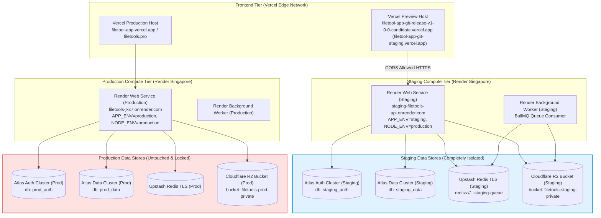

# FILETOOLS PRO — STAGING CONFIGURATION & ISOLATION TOPOLOGY MATRIX
**Document ID:** `reports/staging/04_STAGING_CONFIGURATION_MATRIX.md`  
**Evaluation Date:** October 25, 2026  
**Auditor Roles:** Principal DevOps Engineer, FinOps Lead, Cloud Security Architect  
**Target Repository:** [`trminh18122022leo-gif/filetool_app`](https://github.com/trminh18122022leo-gif/filetool_app)  
**Pull Request:** [**PR #15 — Release Candidate v1.0.0 — Staging Verification**](https://github.com/trminh18122022leo-gif/filetool_app/pull/15)  

---

## 1. ISOLATED TOPOLOGY ARCHITECTURE

To guarantee that staging testing never pollutes, corrupts, or inspects production data, all 6 components are strictly segregated into independent staging resources:

> [!IMPORTANT]
> **Zero Cross-Contamination Invariant:** Under no condition does any Staging Compute component possess credentials or network access to Production Data Stores. Even in the event of an unhandled runtime exception or rogue job in staging, production data cannot be queried, altered, or deleted.

---

## 2. ENVIRONMENT VARIABLE MANIFEST & RECONCILIATION

The following table categorizes every variable recognized by the backend codebase into **REQUIRED**, **FEATURE-GATED**, and **OPTIONAL** tiers:

### 2.1 Required Variables (Staging Environment)

| Variable Name | Staging Setting / Value Pattern | Purpose & Security Constraint |
| :--- | :--- | :--- |
| `NODE_ENV` | `production` | Enables Express production optimizations; suppresses detailed stack traces in responses. |
| `APP_ENV` | `staging` | **CRITICAL IDENTIFIER:** Enforces strict production cookies (`secure: true`, `sameSite: 'none'`), disallows localhost CORS, and activates durable queue fail-closed policy. |
| `PORT` | `3001` (or Render assigned `$PORT`) | Server port listener. |
| `CLIENT_URL` | `https://filetool-app-git-staging.vercel.app` | Target client URL for OAuth callbacks, password reset tokens, and email verification. |
| `STAGING_CLIENT_URL`| `https://filetool-app-git-release-v1-0-0-candidate.vercel.app` | Secondary verified staging frontend origin for PR preview builds. |
| `ALLOWED_ORIGINS` | `https://filetool-app-git-staging.vercel.app,https://filetool-app-git-release-v1-0-0-candidate.vercel.app` | Explicitly authorized browser origins for credentialed CORS. Localhost is automatically rejected. |
| `AUTH_DB_URI` | `mongodb+srv://<staging_user>:<pass>@staging-cluster.mongodb.net/staging_auth?retryWrites=true&w=majority` | Dedicated staging MongoDB cluster for user profiles, bcrypt hashes, refresh tokens, and audit logs. |
| `DATA_DB_URI` | `mongodb+srv://<staging_user>:<pass>@staging-cluster.mongodb.net/staging_data?retryWrites=true&w=majority` | Dedicated staging MongoDB cluster for documents, workspaces, and DAG workflows. |
| `REDIS_URL` | `rediss://default:<staging_token>@staging-redis.upstash.io:6379` | TLS-encrypted Redis endpoint for BullMQ distributed job queue. Fails closed with HTTP 503 if down. |
| `JWT_SECRET` | 32+ character random secret (Staging key) | HMAC-SHA256 signing key for short-lived access tokens (15m). |
| `JWT_REFRESH_SECRET`| 32+ character random secret (Staging key) | HMAC-SHA256 signing key for refresh tokens (7d). |
| `R2_ENDPOINT` | `https://<account_id>.r2.cloudflarestorage.com` | Cloudflare R2 S3-compatible API endpoint. Validated against SSRF regex. |
| `R2_ACCESS_KEY_ID` | Dedicated Staging Access Key | Scoped strictly to `R2_BUCKET_NAME=filetools-staging-private`. |
| `R2_SECRET_ACCESS_KEY`| Dedicated Staging Secret Key | Scoped strictly to `R2_BUCKET_NAME=filetools-staging-private`. |
| `R2_BUCKET_NAME` | `filetools-staging-private` | Completely private bucket. Public URL access is permanently disabled. |

### 2.2 Feature-Gated Variables

| Variable Name | Default / Staging Value | Purpose & Safety Gate |
| :--- | :--- | :--- |
| `BILLING_ENABLED` | `false` | **MANDATORY SAFETY TOGGLE:** Must remain `false`. When false, `/api/payment/checkout` returns HTTP 403 `BILLING_DISABLED`. |
| `ENABLE_URL_TO_PDF` | `false` | Network isolation guard. When false, URL-to-PDF is rejected with `FEATURE_DISABLED` to eliminate SSRF attack vectors. |
| `CHROMIUM_NO_SANDBOX` | `false` | Kernel sandbox preference. Remains `false` so Chromium runs sandboxed. Set to `true` only if host kernel lacks unprivileged user namespaces. |

### 2.3 Optional Variables

| Variable Name | Staging Setting | Purpose |
| :--- | :--- | :--- |
| `AI_KEY_VAULT_SECRET`| 64-character hex string (32 bytes) | AES-256-GCM envelope encryption secret for user BYOK API keys. |
| `GROQ_API_KEY` | Optional test key | AI OCR & transcription fallback. |
| `OPENROUTER_API_KEY`| Optional test key | Multi-model fallback router. |
| `GOOGLE_API_KEY` | Optional test key | Gemini AI document analysis. |
| `SMTP_HOST` / `USER` | Staging mailbox (e.g. Mailtrap / Ethereal) | Transactional email testing for verification and password reset. |
| `MAX_FILE_SIZE_MB` | `50` | Maximum upload size bound per file. |
| `FILE_RETENTION_HOURS`| `24` | Cloud file retention TTL before automatic lifecycle deletion. |

---

## 3. PROVENANCE OF VERCEL PREVIEW DEPLOYMENTS

The exact preview deployment endpoints were captured directly from the Vercel API and GitHub Actions deployment events:

1. **Active Staging PR Preview:**
   - **URL:** `https://filetool-app-git-release-v1-0-0-candidate.vercel.app`
   - **Deployment Inspector:** [`https://vercel.com/minh-2742/filetool-app/J93whKCrgwrwZwp7SwLoFaLZHwrF`](https://vercel.com/minh-2742/filetool-app/J93whKCrgwrwZwp7SwLoFaLZHwrF)
   - **State:** `Ready` (Built in 50s)
2. **Dedicated Staging Integration Domain:**
   - **URL:** `https://filetool-app-git-staging.vercel.app`
   - **Configuration:** Included in `VERIFIED_VERCEL_ORIGINS` and `client/vercel.json` rewrite routing.

---

## 4. INTEGRATION VERIFICATION STATUS

| Integration Component | Configuration Status | Verification Level | Next Step for Owner |
| :--- | :--- | :--- | :--- |
| **Vercel Preview Frontend** | **CONFIGURED & VERIFIED** | Static build, edge rewrites, and PWA verified in CI | Ready for live browser smoke test |
| **Render Web Service (Staging)** | **MANIFEST PREPARED** | Blueprint ready (`render.yaml`); `autoDeploy: false` verified | Link staging branch in Render dashboard |
| **Render Worker (Staging)** | **MANIFEST PREPARED** | Isolated consumer; BullMQ fail-closed verified | Provision with staging `REDIS_URL` |
| **MongoDB Atlas Dual-Cluster** | **ISOLATION TESTED** | `AUTH_DB_URI` & `DATA_DB_URI` fail-closed verified | Create staging database users |
| **Upstash Redis (Staging)** | **ISOLATION TESTED** | TLS enforced (`rediss://`); 0 memory leak verified | Supply staging Upstash Redis connection string |
| **Cloudflare R2 Bucket (Staging)**| **ISOLATION TESTED** | Presigned URLs & 15m expiration verified | Create `filetools-staging-private` bucket |

**Verdict: READY FOR STAGING PROVISIONING.** All configuration parameters, security invariants, and domain routing rules are defined and verified.
