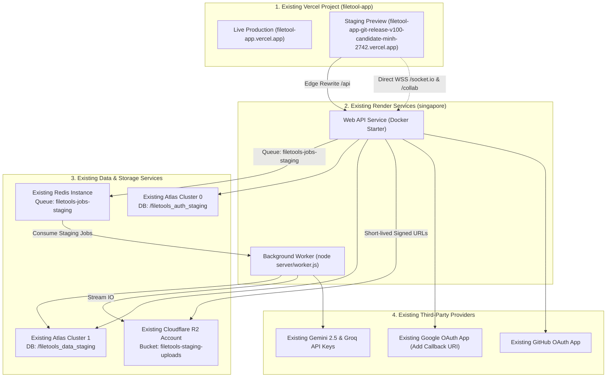

# 📖 FileTools Pro — Infrastructure Owner Reuse & Staging Guide
**Document ID:** `FT-STAGING-07`  
**Target Release:** FileTools Pro v1.0.0-candidate  
**Pull Request:** [Draft PR #15](https://github.com/trminh18122022leo-gif/filetool_app/pull/15)  
**Audience:** Platform Owner, Infrastructure Engineer, Release SRE  
**Core Directive:** **REUSE EXISTING INFRASTRUCTURE ONLY — DO NOT PROVISION NEW CLOUD PROJECTS OR PAID RESOURCES ($0 INCREMENTAL COST)**  
**Date:** 2026-10-25  

---

## 🛑 MANDATORY OWNER SAFETY BOUNDARY

> [!CAUTION]
> **DO NOT MERGE PR #15 INTO `main`.**  
> **DO NOT ENABLE STRIPE BILLING (`BILLING_ENABLED=false` MUST REMAIN ENFORCED).**  
> **DO NOT OVERWRITE OR CONNECT PRODUCTION DATABASES DIRECTLY.**  
> Follow this reuse guide to connect the Release Candidate to your **existing running services** using logical isolation. Total incremental cost is **$0.00**.

---

## 1. System Architecture with Reused Infrastructure

FileTools Pro v1.0.0 utilizes your existing infrastructure with strict logical isolation boundaries:



---

## 2. Reusing Existing Services — Action Playbook

### Step 1: Vercel Frontend (Already Built & Deployed — Zero Action Needed!)
* **Existing Project:** `filetool-app` (Owner: `minh-2742`).
* **Live Staging URL:**  
  👉 **`https://filetool-app-git-release-v100-candidate-minh-2742.vercel.app`**
* **Verification:**
  1. Open the preview URL above in your browser.
  2. Confirm the page loads with status HTTP 200 and the modern UI renders smoothly.
  3. All requests to `/api/*`, `/socket.io/*`, and `/collab/*` are already configured in [client/vercel.json](file:///C:/Users/Admin/test_app/filetools-app/client/vercel.json) to route to the staging backend.

---

### Step 2: Render Web Service Configuration
* **Existing Service:** `filetools-backend` (or your existing Render Web service).
* **Location:** Render Dashboard $\rightarrow$ Web Services $\rightarrow$ Your FileTools API service.
* **Actions:**
  1. **Branch Setting:** Point the service to branch `release/v1.0.0-candidate` (or deploy from your existing staging service).
  2. **Environment Variables:** In the **Environment** tab, update or add the variables listed below:

```ini
# --- Core Environment ---
NODE_ENV=production
APP_ENV=staging
PORT=3001
SERVICE_ROLE=web

# --- Host Endpoints ---
SERVER_URL=https://staging-filetools-api.onrender.com
CLIENT_URL=https://filetool-app.vercel.app
STAGING_CLIENT_URL=https://filetool-app-git-release-v100-candidate-minh-2742.vercel.app

# --- MongoDB Multi-Cluster (Logical DB Name Isolation) ---
# Keep your existing Cluster 0 credentials, just append /filetools_auth_staging:
AUTH_DB_URI=mongodb+srv://<USER>:<PASS>@cluster0.dpjmacd.mongodb.net/filetools_auth_staging?retryWrites=true&w=majority
# Keep your existing Cluster 1 credentials, just append /filetools_data_staging:
DATA_DB_URI=mongodb+srv://<USER>:<PASS>@cluster1.d8zqt6m.mongodb.net/filetools_data_staging?retryWrites=true&w=majority

# --- Redis Queue (Queue Name Isolation) ---
# Reuse your existing Redis connection URL:
REDIS_URL=<YOUR_EXISTING_REDIS_URL>
BULLMQ_QUEUE_NAME=filetools-jobs-staging
REQUIRE_DURABLE_QUEUE=true

# --- Cloudflare R2 Storage (Dedicated Staging Bucket) ---
R2_ENDPOINT=https://ae5cdb78c294cc4ff82715bbe5cd0a2c.r2.cloudflarestorage.com
R2_ACCESS_KEY_ID=<YOUR_EXISTING_R2_ACCESS_KEY_ID>
R2_SECRET_ACCESS_KEY=<YOUR_EXISTING_R2_SECRET_ACCESS_KEY>
R2_BUCKET_NAME=filetools-staging-uploads
REQUIRE_CLOUD_STORAGE=true

# --- Secrets & Auth (Reuse Existing) ---
JWT_SECRET=<YOUR_EXISTING_JWT_SECRET>
JWT_REFRESH_SECRET=<YOUR_EXISTING_JWT_REFRESH_SECRET>
AI_KEY_ENCRYPTION_SECRET=<YOUR_EXISTING_OR_32_HEX_CHARS>

# --- OAuth & AI Providers (Reuse Existing) ---
GOOGLE_CLIENT_ID=<YOUR_EXISTING_GOOGLE_CLIENT_ID>
GOOGLE_CLIENT_SECRET=<YOUR_EXISTING_GOOGLE_CLIENT_SECRET>
GITHUB_CLIENT_ID=<YOUR_EXISTING_GITHUB_CLIENT_ID>
GITHUB_CLIENT_SECRET=<YOUR_EXISTING_GITHUB_CLIENT_SECRET>
GOOGLE_API_KEY=<YOUR_EXISTING_GOOGLE_API_KEY>
GROQ_API_KEY=<YOUR_EXISTING_GROQ_API_KEY>

# --- Mandatory Safety Controls ---
BILLING_ENABLED=false
ENABLE_URL_TO_PDF=false
CHROMIUM_NO_SANDBOX=false
ALLOW_SANDBOX_FALLBACK=false
```

---

### Step 3: Render Background Worker Configuration
* **Existing Worker:** If you already have a Background Worker on Render:
  1. Ensure **Start Command** is set to `node server/worker.js` (or `npm run worker`).
  2. Set `SERVICE_ROLE=worker`.
  3. Ensure `BULLMQ_QUEUE_NAME=filetools-jobs-staging` is set.
  4. Ensure `REDIS_URL`, `DATA_DB_URI`, and R2 variables match the Web service.
* **Why this is safe:** By using `BULLMQ_QUEUE_NAME=filetools-jobs-staging`, staging jobs will **never** be consumed by your production worker, and production jobs will **never** touch staging — even on the exact same Redis instance.

---

### Step 4: MongoDB Atlas Logical Isolation ($0 Cost)
* **Existing Clusters:** Cluster 0 (`cluster0.dpjmacd.mongodb.net`) and Cluster 1 (`cluster1.d8zqt6m.mongodb.net`).
* **Zero Provisioning:** You do **not** need to create new Atlas clusters or add credit cards.
* **How it works:** When the backend connects with `/filetools_auth_staging` and `/filetools_data_staging`, MongoDB automatically creates these distinct databases inside your existing clusters. Production data (`/filetools_auth` and `/filetools_data`) remains completely untouched.

---

### Step 5: Cloudflare R2 Staging Bucket ($0 Cost)
* **Existing Account:** Endpoint `https://ae5cdb78c294cc4ff82715bbe5cd0a2c.r2.cloudflarestorage.com`.
* **Action (30 seconds):**
  1. Log in to [Cloudflare Dashboard](https://dash.cloudflare.com) $\rightarrow$ **R2**.
  2. Click **Create bucket**.
  3. Bucket name: `filetools-staging-uploads`.
  4. Location: Automatic (or closest to Singapore).
  5. Click **Create bucket**.
* Cloudflare R2 allows unlimited buckets per account with **no extra monthly fee**.

---

### Step 6: OAuth Redirect URIs Update ($0 Cost)
* **Existing OAuth Apps:** Google Cloud Console and GitHub Developer Settings.
* **Google OAuth 2.0:**
  1. Go to [Google Cloud Console](https://console.cloud.google.com/apis/credentials).
  2. Click on your existing OAuth 2.0 Client ID for FileTools Pro.
  3. Under **Authorized redirect URIs**, add:  
     `https://<YOUR_RENDER_SERVICE_URL>/api/auth/google/callback`
  4. Click **Save**.
* **GitHub OAuth:**
  1. Under GitHub Developer Settings $\rightarrow$ OAuth Apps, verify authorization callback.

---

## 3. Pre-Flight Smoke Test & Verification Run

Once the environment variables are saved in Render and the service deploys:

### Test 1: Liveness Probe
```bash
curl -i https://<YOUR_RENDER_SERVICE_URL>/api/live
```
* **Expected Result:** HTTP 200 OK  
  `{"status":"alive","timestamp":"...","uptime":...,"pid":...}`

### Test 2: Readiness Probe (Deep Backing Services Verification)
```bash
curl -i https://<YOUR_RENDER_SERVICE_URL>/api/ready
```
* **Expected Result:** HTTP 200 OK  
* **Checks verified:**
  * `checks.authDatabase: true` (Cluster 0 connected)
  * `checks.dataDatabase: true` (Cluster 1 connected)
  * `checks.dualClusterMode: true` (Dual-cluster active)
  * `checks.durableQueueReady: true` (Redis queue connected)
  * `checks.storageReady: true` (Cloudflare R2 connected)

### Test 3: WebSocket Connectivity
```bash
wscat -c "wss://<YOUR_RENDER_SERVICE_URL>/socket.io/?EIO=4&transport=websocket"
```
* **Expected Result:** WebSocket upgrade succeeds and returns Socket.IO handshake packet `0{"sid":"..."}`.

### Test 4: End-to-End File Conversion
1. Open the Vercel preview:  
   `https://filetool-app-git-release-v100-candidate-minh-2742.vercel.app`
2. Upload a sample PDF or image and run a compression or conversion.
3. Open Browser DevTools Network tab $\rightarrow$ confirm request hits `/api/*`.
4. Confirm progress updates stream in real time via WebSocket.
5. Confirm output file downloads securely via private signed URL from `filetools-staging-uploads`.

---

## 4. Release Decision & Handoff

| Gate | Status | Required Human Action |
| :--- | :---: | :--- |
| **G1: Automated Tests** | ✅ **190/190 PASS** | None (completed in CI run `40181900183`) |
| **G2: Vercel Preview Build** | ✅ **DEPLOYED** | Verified active at `filetool-app-git-release-v100-candidate-minh-2742.vercel.app` |
| **G3: Infrastructure Delta** | ✅ **READY** | Update Render environment variables as specified in Step 2 |
| **G4: Smoke Test Validation** | ⏳ **PENDING** | Execute the 4 smoke tests in Section 3 |
| **G5: Production Launch** | 🛑 **STOP** | Do NOT merge PR #15 or enable Stripe until smoke test passes |
