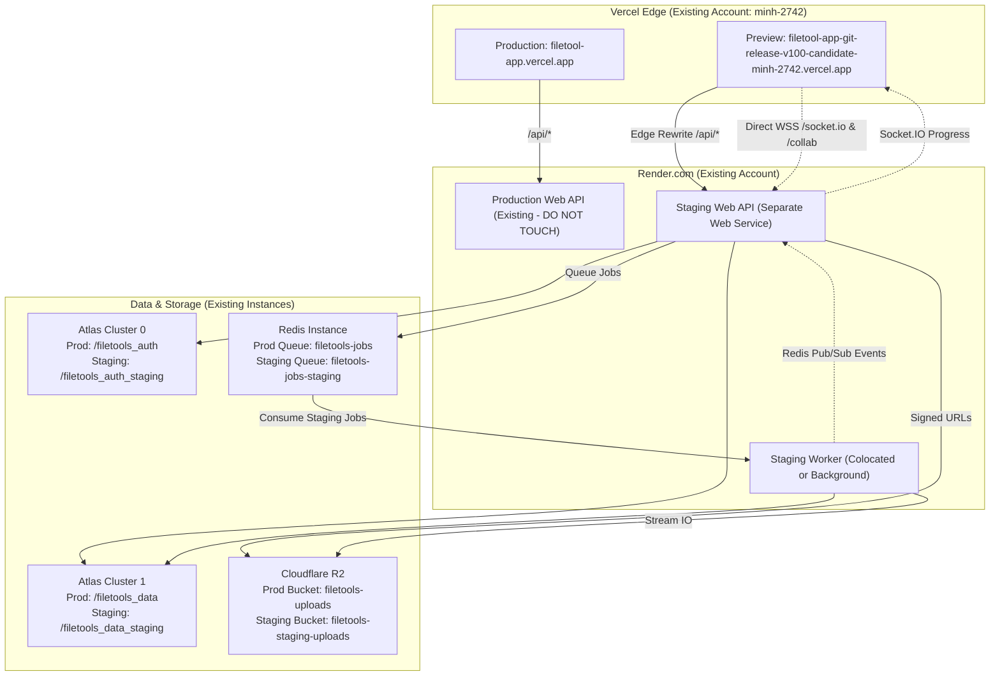

# 📖 FileTools Pro — Infrastructure Owner Reuse & Staging Integration Guide
**Document ID:** `FT-STAGING-07`  
**Target Release:** FileTools Pro v1.0.0-candidate  
**Pull Request:** [Draft PR #15](https://github.com/trminh18122022leo-gif/filetool_app/pull/15)  
**Audience:** Platform Owner, Infrastructure Engineer, Release SRE  
**Core Principle:** **REUSE EXISTING ACCOUNTS & INFRASTRUCTURE WITH STRICT RUNTIME & DATA ISOLATION**  
**Date:** 2026-10-26  

---

## 🛑 MANDATORY OWNER SAFETY BOUNDARIES

> [!CAUTION]
> **1. NEVER CHANGE THE BRANCH OR `APP_ENV` OF YOUR ACTIVE PRODUCTION RENDER SERVICE!**  
> If you have an active production Web API service on Render (e.g., `filetools-api` or `filetools-backend`), modifying its branch to `release/v1.0.0-candidate` or changing its environment to `APP_ENV=staging` will immediately disrupt or downgrade live production traffic.  
> Staging compute MUST run as a separate service on your existing Render account.
> 
> **2. DO NOT REUSE PRODUCTION JWT SIGNING SECRETS FOR STAGING!**  
> Staging must use separate, newly generated `JWT_SECRET` and `JWT_REFRESH_SECRET` values to prevent cross-environment token replay attacks.
> 
> **3. DO NOT MERGE DRAFT PR #15 INTO `main` UNTIL STAGING E2E TESTS PASS.**  
> 
> **4. DO NOT ENABLE STRIPE BILLING (`BILLING_ENABLED=false` MUST REMAIN ENFORCED).**

---

## 1. Account Reuse vs. Runtime Isolation

To balance zero resource waste with strict production safety, FileTools Pro distinguishes **Account Reuse** from **Runtime Isolation**:

| Category | Reused from Existing Account ($0) | Isolated for Staging Environment |
| :--- | :--- | :--- |
| **Render Compute** | Same Render team/billing account | Separate Render Web Service (`staging-filetools-api`) |
| **MongoDB Atlas** | Same Cluster 0 & Cluster 1 instances | Separate logical databases (`/filetools_auth_staging`, `/filetools_data_staging`) + Optional scoped DB user |
| **Redis / Valkey** | Same Redis instance (Upstash or Render) | Separate queue (`BULLMQ_QUEUE_NAME=filetools-jobs-staging`) & Pub/Sub channel (`filetools_staging:job-events`) |
| **Cloudflare R2** | Same Cloudflare R2 account (`ae5cdb78...`) | Separate private bucket (`filetools-staging-uploads`) + Optional bucket-scoped API token |
| **Vercel Web** | Same Vercel project (`filetool-app`) | Isolated preview domain automatically deployed for PR #15 |
| **OAuth Providers** | Same Google Cloud & GitHub OAuth Apps | Staging redirect URI (`/api/auth/google/callback`) with HMAC-signed state origin validation |
| **AI Providers** | Same Gemini 2.5 & Groq API keys | Same keys; token telemetry and logs isolated by staging DB |
| **JWT Secrets** | None (Security Boundary) | **Mandatory separate random 64-char hex secrets** |



---

## 2. Compute Service Architecture & Cost Options

Because production must never be disturbed, you need a separate staging compute service on your existing Render account:

### Option A: Render Free Web Service ($0.00 / month — Recommended for Staging)
* **Instance Type:** Free Web Service
* **RAM / CPU:** 512 MB RAM, shared CPU
* **Spindown Behavior:** Spins down after 15 minutes of inactivity; wakes up in ~30 seconds on the first request.
* **Worker Execution:** Background jobs run concurrently within the Web process via BullMQ worker.
* **Incremental Cost:** **$0.00 USD**.

### Option B: Render Starter Web Service ($7.00 / month — Optional Persistent Compute)
* **Instance Type:** Starter Web Service ($7/mo, prorated to ~$0.23/day)
* **RAM / CPU:** 512 MB RAM, dedicated CPU
* **Spindown Behavior:** Never sleeps.
* **Incremental Cost:** **$7.00 USD / month** (or ~$1.00 for a 4-day staging verification window).

---

## 3. Step-by-Step Staging Setup Playbook

### Step 1: Vercel Preview Verification (Already Live — Zero Action Needed)
* **Existing Project:** `filetool-app` (Owner: `minh-2742`).
* **Active Staging URL:**  
  👉 **`https://filetool-app-git-release-v100-candidate-minh-2742.vercel.app`**
* **Verification:** Open in browser. Status is HTTP 200. The modern dark UI loads without console errors. Edge rewrites in [client/vercel.json](file:///C:/Users/Admin/test_app/filetools-app/client/vercel.json) automatically direct `/api/*`, `/socket.io/*`, and `/collab/*` to the staging backend.

---

### Step 2: Deploy Staging Compute Service on Render
1. Log in to [Render Dashboard](https://dashboard.render.com).
2. Click **New +** $\rightarrow$ **Web Service**.
3. Select your existing repository `trminh18122022leo-gif/filetool_app`.
4. Configure service settings:
   * **Name:** `staging-filetools-api`
   * **Region:** Singapore (same region as Atlas & Redis)
   * **Branch:** `release/v1.0.0-candidate`
   * **Runtime:** `Docker` (uses existing [Dockerfile](file:///C:/Users/Admin/test_app/filetools-app/Dockerfile))
   * **Instance Type:** `Free` ($0/mo) or `Starter` ($7/mo)
   * **Health Check Path:** `/api/live`
5. In the **Environment Variables** tab, enter the exact variables from Section 4.
6. Click **Create Web Service**.

> [!WARNING]
> Do NOT touch your existing production service (`filetools-api` / `filetools-backend`). Keep its branch on `main` and its environment on `production`.

---

### Step 3: Cloudflare R2 Staging Bucket & Scoped Token
1. Log in to [Cloudflare Dashboard](https://dash.cloudflare.com) $\rightarrow$ **R2**.
2. Click **Create bucket** $\rightarrow$ Name: `filetools-staging-uploads` $\rightarrow$ Region: Singapore / Automatic.
3. **Bucket Privacy:** Ensure Public Bucket access is **Disabled** (FileTools Pro v1.0.0 serves files strictly via short-lived signed URLs with HMAC authorization).
4. **(Recommended Security Practice):** Under R2 $\rightarrow$ **Manage R2 API Tokens**, click **Create API Token**:
   * Permissions: `Object Read & Write`
   * Bucket scope: Restrict to `filetools-staging-uploads` only.
   * This guarantees staging code cannot read or overwrite production objects even if credentials were compromised.

---

### Step 4: MongoDB Atlas Staging Isolation
1. **Cluster Reuse:** Use existing Cluster 0 (`cluster0.dpjmacd.mongodb.net`) and Cluster 1 (`cluster1.d8zqt6m.mongodb.net`).
2. **Database Names:** Set the URI path to `/filetools_auth_staging` on Cluster 0 and `/filetools_data_staging` on Cluster 1.
3. **(Recommended Security Practice):** In Atlas $\rightarrow$ **Database Access**, you can create a dedicated staging user (e.g., `filetools_staging_user`):
   * Privileges: Built-in role `readWrite` scoped strictly to `filetools_auth_staging` and `filetools_data_staging`.
   * Staging has zero access to production databases.

---

### Step 5: Redis BullMQ Queue & Cross-Process Pub/Sub Isolation
1. **Instance Reuse:** Use existing Redis connection URL (`REDIS_URL`).
2. **Queue Name:** Set `BULLMQ_QUEUE_NAME=filetools-jobs-staging`.
3. **Prefix Namespace:** Set `BULLMQ_PREFIX=filetools_staging`.
4. **How It Works:**
   * Jobs submitted from staging go to `filetools-jobs-staging`.
   * Realtime progress and completion events publish to channel `filetools_staging:job-events`.
   * Production workers listening to `filetools-jobs` will never consume staging jobs, and staging workers will never touch production jobs.

---

### Step 6: OAuth Redirect URIs Update
1. Go to [Google Cloud Console](https://console.cloud.google.com/apis/credentials) $\rightarrow$ Your existing OAuth 2.0 Client ID.
2. Under **Authorized redirect URIs**, add:  
   `https://staging-filetools-api.onrender.com/api/auth/google/callback`
3. Click **Save**.
4. *(Optional GitHub OAuth):* Verify authorization callback in GitHub Developer Settings.

---

## 4. Staging Environment Variables (Copy-Paste Ready)

```ini
# ==============================================================================
# STAGING ENVIRONMENT VARIABLES — FILETOOLS PRO (PR #15)
# ==============================================================================

# --- Runtime & Security Invariants ---
NODE_ENV=production
APP_ENV=staging
PORT=3001
SERVICE_ROLE=web

# --- Host Endpoints ---
SERVER_URL=https://staging-filetools-api.onrender.com
CLIENT_URL=https://filetool-app.vercel.app
STAGING_CLIENT_URL=https://filetool-app-git-release-v100-candidate-minh-2742.vercel.app

# --- Isolated Cryptographic Secrets (DO NOT REUSE PRODUCTION SECRETS) ---
# Generate separate 64-character random hex strings:
JWT_SECRET=generate_distinct_staging_jwt_secret_hex_64_characters_min
JWT_REFRESH_SECRET=generate_distinct_staging_jwt_refresh_secret_hex_64_min
AI_KEY_ENCRYPTION_SECRET=generate_distinct_staging_byok_encryption_key_32_chars_min

# --- MongoDB Multi-Cluster (Logical DB Name Isolation) ---
AUTH_DB_URI=mongodb+srv://<USER>:<PASS>@cluster0.dpjmacd.mongodb.net/filetools_auth_staging?retryWrites=true&w=majority
DATA_DB_URI=mongodb+srv://<USER>:<PASS>@cluster1.d8zqt6m.mongodb.net/filetools_data_staging?retryWrites=true&w=majority

# --- Redis BullMQ & Pub/Sub (Queue & Channel Isolation) ---
REDIS_URL=<YOUR_EXISTING_REDIS_URL>
BULLMQ_QUEUE_NAME=filetools-jobs-staging
BULLMQ_PREFIX=filetools_staging
REQUIRE_DURABLE_QUEUE=true

# --- Cloudflare R2 (Dedicated Staging Bucket) ---
R2_ENDPOINT=https://ae5cdb78c294cc4ff82715bbe5cd0a2c.r2.cloudflarestorage.com
R2_ACCESS_KEY_ID=<STAGING_SCOPED_OR_ACCOUNT_R2_ACCESS_KEY>
R2_SECRET_ACCESS_KEY=<STAGING_SCOPED_OR_ACCOUNT_R2_SECRET_KEY>
R2_BUCKET_NAME=filetools-staging-uploads
REQUIRE_CLOUD_STORAGE=true

# --- OAuth & AI Providers (Reused from Existing Accounts) ---
GOOGLE_CLIENT_ID=<YOUR_EXISTING_GOOGLE_CLIENT_ID>
GOOGLE_CLIENT_SECRET=<YOUR_EXISTING_GOOGLE_CLIENT_SECRET>
GITHUB_CLIENT_ID=<YOUR_EXISTING_GITHUB_CLIENT_ID>
GITHUB_CLIENT_SECRET=<YOUR_EXISTING_GITHUB_CLIENT_SECRET>
GOOGLE_API_KEY=<YOUR_EXISTING_GOOGLE_API_KEY>
GROQ_API_KEY=<YOUR_EXISTING_GROQ_API_KEY>

# --- Mandatory Safety Gates ---
BILLING_ENABLED=false
ENABLE_URL_TO_PDF=false
CHROMIUM_NO_SANDBOX=false
ALLOW_SANDBOX_FALLBACK=false
```

---

## 5. Pre-Flight Verification & Smoke Testing Checklist

### Test 1: Liveness Probe
```bash
curl -i https://staging-filetools-api.onrender.com/api/live
```
* **Expected:** HTTP 200 OK  
  `{"status":"alive","timestamp":"...","uptime":...,"pid":...}`

### Test 2: Readiness Probe (Deep Backing Services Verification)
```bash
curl -i https://staging-filetools-api.onrender.com/api/ready
```
* **Expected:** HTTP 200 OK  
* **Must Verify:**
  * `checks.authDatabase: true` (`filetools_auth_staging` on Cluster 0)
  * `checks.dataDatabase: true` (`filetools_data_staging` on Cluster 1)
  * `checks.dualClusterMode: true`
  * `checks.durableQueueReady: true` (`filetools-jobs-staging` on Redis)
  * `checks.storageReady: true` (`filetools-staging-uploads` on R2)

### Test 3: Cross-Process Realtime Progress Check
1. Start a multi-step PDF OCR or conversion job from the staging frontend:  
   `https://filetool-app-git-release-v100-candidate-minh-2742.vercel.app`
2. Confirm progress updates stream in real-time across the Redis Pub/Sub event bridge (`filetools_staging:job-events`) to Socket.IO.
3. Refresh the browser page during processing and confirm client reconnects to the job seamlessly via database-backed persistent ownership (`hasJobAccessAsync`).

### Test 4: Database-Backed Yjs Document Authorization Check
1. Connect to `/collab?room=project_confidential_contract&token=<userA_token>`.
2. Confirm User A is granted access (`role: 'room_owner_created'`).
3. Connect with User B (`<userB_token>`) to the same room.
4. Confirm User B is **rejected with HTTP 403 Forbidden** (`ROOM_ACCESS_DENIED`), proving document-level tenant isolation works regardless of naming convention.
