# 🧪 FileTools Pro — Runtime Staging E2E Verification Plan
**Document ID:** `FT-STAGING-08`  
**Execution Context:** Staging Environment (`staging-filetools-api.onrender.com` / `filetool-app-git-staging.vercel.app`)  
**Target Candidate:** `release/v1.0.0-candidate`  
**Role:** Senior SDET, SRE, Application Security Reviewer  
**Billing State:** `BILLING_ENABLED=false` (Mandatory Staging Invariant)  
**Date:** 2026-10-25  

---

## 1. Objectives & Scope

This test plan defines the end-to-end integration and chaos validation scenarios to be executed against the live, provisioned staging infrastructure. It verifies end-to-end user workflows, real-time networking, security boundaries, and fault tolerance across real backing services (Vercel Edge, Render Web/Worker, MongoDB Atlas, Upstash Redis, Cloudflare R2, Google AI).

---

## 2. Test Execution Matrix

```mermaid
flowchart TD
    subgraph Phase1 ["Phase 1: Environment & Network Validation"]
        T01["E2E-NET-01: Vercel Edge Header Routing"]
        T02["E2E-NET-02: Direct WSS WebSocket Upgrade"]
        T03["E2E-NET-03: CORS Hardened Preflight"]
    end

    subgraph Phase2 ["Phase 2: Auth & Identity Lifecycle"]
        T04["E2E-AUTH-01: Free Account Register & Verification"]
        T05["E2E-AUTH-02: OAuth 2.0 with HMAC State Token"]
        T06["E2E-AUTH-03: Self-Service Account Deletion"]
    end

    subgraph Phase3 ["Phase 3: Core Document Processing"]
        T07["E2E-DOC-01: PDF Merge, Split & Compress"]
        T08["E2E-DOC-02: Office to PDF Conversion (LibreOffice)"]
        T09["E2E-DOC-03: Multilingual OCR (Tesseract)"]
        T10["E2E-DOC-04: Real-time Socket.IO Job Tracking"]
    end

    subgraph Phase4 ["Phase 4: Real-time Collaboration (Yjs)"]
        T11["E2E-COL-01: Authenticated WSS Upgrade (/collab)"]
        T12["E2E-COL-02: Multi-User Monaco Awareness Sync"]
        T13["E2E-COL-03: Cross-Tenant Room Isolation Failure"]
    end

    subgraph Phase5 ["Phase 5: Chaos, Security & Billing Gate"]
        T14["E2E-SEC-01: SSRF Metadata & Loopback Blocking"]
        T15["E2E-SEC-02: Chromium Sandbox Fail-Closed (503)"]
        T16["E2E-CHA-01: Dual-Cluster Mongoose Partition (503)"]
        T17["E2E-CHA-02: Upstash Redis Loss Fail-Closed (503)"]
        T18["E2E-BIL-01: Safety Gate Enforcement (BILLING_ENABLED=false)"]
    end

    Phase1 --> Phase2
    Phase2 --> Phase3
    Phase3 --> Phase4
    Phase4 --> Phase5
```



---

## 3. Detailed Test Scenarios

### 3.1 Phase 1 — Environment & Network Routing

#### Test `E2E-NET-01`: Vercel Edge Header Routing
- **Precondition:** Vercel preview deployment active on `*-git-staging.vercel.app`.
- **Action:** Dispatch `GET /api/live` via frontend Vercel domain.
- **Verification:**
  1. HTTP 200 returned.
  2. Response header `x-matched-path` reflects edge proxy.
  3. Response header `Cache-Control` contains `no-store, no-cache, must-revalidate`.
  4. Backend log indicates request handled by `staging-filetools-api.onrender.com`.

#### Test `E2E-NET-02`: Direct WSS WebSocket Upgrade
- **Action:** Connect to `wss://staging-filetools-api.onrender.com/socket.io/?EIO=4&transport=websocket` with `Origin: https://filetool-app-git-staging.vercel.app`.
- **Verification:**
  1. HTTP 101 Switching Protocols.
  2. Socket.IO handshake packet received.
  3. Connection remains persistent without unexpected dropouts.

#### Test `E2E-NET-03`: Hardened CORS Preflight
- **Action:** Dispatch `OPTIONS /api/auth/login` with `Origin: null` and `Origin: https://evil-site.com`.
- **Verification:**
  1. Origin `null` is rejected with HTTP 403 or no `Access-Control-Allow-Origin` header.
  2. Unauthorized domain is rejected.
  3. Verified staging origin returns `Access-Control-Allow-Origin: https://filetool-app-git-staging.vercel.app` and `Access-Control-Allow-Credentials: true`.

---

### 3.2 Phase 2 — Auth & Identity Lifecycle

#### Test `E2E-AUTH-01`: Free Account Registration & Verification
- **Action:** Register new user `qa-staging-user@example.com` via `/api/auth/register`.
- **Verification:**
  1. User created in Atlas Cluster 0 (`authDB`).
  2. Password stored as high-work-factor bcrypt hash (`saltRounds: 12`).
  3. Verification token dispatched. Upon verify, `isVerified: true`.
  4. User plan assigned as `free` with standard default quotas.

#### Test `E2E-AUTH-02`: OAuth 2.0 with HMAC State Token
- **Action:** Initiate OAuth login via `/api/auth/google`.
- **Verification:**
  1. Redirect contains signed `state` parameter: `payload.signature`.
  2. Decoded payload specifies `env: "staging"`.
  3. In callback, signature is verified against `JWT_SECRET`.
  4. Attempting to replay state with modified origin terminates with rejection.

#### Test `E2E-AUTH-03`: Self-Service Account Deletion (Apple 5.1.1(v) & Play Store Compliance)
- **Action:** Authenticated user issues `DELETE /api/auth/account`.
- **Verification:**
  1. All refresh tokens in `RefreshToken` collection revoked (`revokedAt: new Date()`).
  2. User record completely removed from Atlas Cluster 0.
  3. Cookies cleared (`accessToken`, `refreshToken`, `token`).
  4. Attempting subsequent authenticated requests returns HTTP 401.

---

### 3.3 Phase 3 — Core Document Processing Pipeline

#### Test `E2E-DOC-01`: PDF Merge, Split & Compression
- **Action:** Upload two 5MB test PDF documents to `/api/pdf/merge`.
- **Verification:**
  1. Job queued in Upstash Redis.
  2. Background Worker consumes job.
  3. Merged PDF saved in Cloudflare R2 bucket `filetools-staging-uploads`.
  4. Download URL provided is short-lived signed URL (15 minutes).
  5. Content integrity verified (`pdf-lib` inspects page count).

#### Test `E2E-DOC-02`: Office to PDF Conversion (`soffice`)
- **Action:** Upload multi-page sample `.docx` to `/api/convert/word-to-pdf`.
- **Verification:**
  1. LibreOffice converts document in headless mode.
  2. Multilingual fonts (Vietnamese diacritics, CJK characters) render correctly.
  3. Process completes within 10-second timeout.

#### Test `E2E-DOC-03`: Multilingual OCR (Tesseract)
- **Action:** Upload scanned invoice image with Vietnamese text to `/api/pdf/ocr`.
- **Verification:**
  1. Tesseract OCR processes image using `tesseract-ocr-vie`.
  2. Extracted text accuracy $\ge 90\%$.
  3. Searchable PDF layer synthesized.

#### Test `E2E-DOC-04`: Real-Time Socket.IO Progress Tracking
- **Action:** Start batch image conversion while connected to Socket.IO.
- **Verification:**
  1. Client receives `job-progress` events with percentage and file index.
  2. Client receives `job-complete` event with output result payload.
  3. No cross-job information leakage to other concurrent sockets.

---

### 3.4 Phase 4 — Real-Time Collaboration (Yjs + Monaco)

#### Test `E2E-COL-01`: Authenticated WSS Upgrade (`/collab`)
- **Action:** Connect WebSocket to `/collab?room=shared-workspace&token=<jwt>`.
- **Verification:**
  1. Server verifies JWT.
  2. WebSocket upgrades to 101.
  3. Missing or invalid token returns HTTP 401.

#### Test `E2E-COL-02`: Multi-User Monaco Awareness Sync
- **Action:** Connect User 1 and User 2 to room `shared-workspace`.
- **Verification:**
  1. Awareness events propagate cursor position and user color.
  2. Text edits by User 1 synchronize to User 2 with zero operational transform conflicts.

#### Test `E2E-COL-03`: Cross-Tenant Room Isolation Failure
- **Action:** User 2 attempts to connect to `user_<user1_id>_private_doc`.
- **Verification:**
  1. Server detects `roomOwnerId !== tokenUserId`.
  2. Connection destroyed with HTTP 403 Forbidden.
  3. Error log: `Forbidden: cross-user collaboration room access denied`.

---

### 3.5 Phase 5 — Chaos Injection, Security & Billing Gate

#### Test `E2E-SEC-01`: SSRF Metadata & Loopback Defense
- **Action:** Submit URL-to-PDF job with target `http://169.254.169.254/latest/meta-data/` or `http://127.0.0.1:3002/api/health`.
- **Verification:**
  1. `validateSafeUrl` rejects target before DNS lookup.
  2. Puppeteer `protectPageNetwork` aborts outgoing requests in deny-all mode.
  3. Job terminated with error `SSRF_BLOCKED`.

#### Test `E2E-SEC-02`: Chromium Sandbox Fail-Closed Defense
- **Action:** Verify environment has `CHROMIUM_NO_SANDBOX=false` and `ALLOW_SANDBOX_FALLBACK=false`.
- **Verification:**
  1. Headless browser starts in sandboxed mode as non-root user `filetools`.
  2. Injected sandbox failure without dual authorization triggers HTTP 503 `HTML_RENDERING_DISABLED_NO_SANDBOX`.

#### Test `E2E-CHA-01`: Dual-Cluster Partition Chaos
- **Action:** Simulate network disconnect on Atlas Cluster 1 (`dataDB`) while Cluster 0 (`authDB`) remains active.
- **Verification:**
  1. `/api/health` transitions from `ok` to `degraded`.
  2. `/api/ready` returns HTTP 503 Service Unavailable:
     ```json
     {
       "status": "not_ready",
       "ready": false,
       "checks": {
         "authDatabase": true,
         "dataDatabase": false,
         "dualClusterMode": true
       }
     }
     ```
  3. System fails closed; no operations execute against half-connected cluster.

#### Test `E2E-CHA-02`: Upstash Redis Loss Chaos
- **Action:** Temporarily revoke Redis credentials or simulate network timeout to Redis.
- **Verification:**
  1. `REQUIRE_DURABLE_QUEUE=true` detects disconnected Redis.
  2. `/api/ready` returns HTTP 503.
  3. Asynchronous job submissions are rejected rather than falling back silently to volatile memory.

#### Test `E2E-BIL-01`: Stripe Safety Gate Enforcement
- **Action:** Post checkout request to `/api/billing/create-checkout-session`.
- **Verification:**
  1. Request blocked with HTTP 403.
  2. Error message: `Thanh toán hiện đang tạm khóa trong môi trường staging / pre-release`.
  3. Zero requests dispatched to live Stripe API.

---

## 4. Sign-Off Acceptance Criteria

| Criteria | Required Status | Verification Owner |
| :--- | :---: | :--- |
| **All Phase 1–5 Scenarios** | 100% PASS | QA Lead |
| **Zero Production Data Leakage** | VERIFIED | AppSec Lead |
| **Zero Public R2 Buckets** | VERIFIED | Cloud SRE |
| **Bcrypt Salt Rounds $\ge 12$** | VERIFIED | AppSec Lead |
| **Billing Disabled (`BILLING_ENABLED=false`)** | VERIFIED | FinOps Auditor |
| **Fail-Closed 503 on Dependency Loss** | VERIFIED | DevOps Lead |
