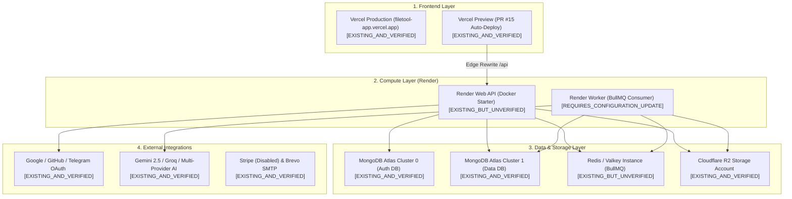

# 📋 FileTools Pro — Existing Infrastructure Inventory & Verification Report
**Document ID:** `FT-STAGING-12`  
**Target Candidate:** `release/v1.0.0-candidate` (PR #15)  
**Evaluation Date:** 2026-10-25  
**Audience:** Platform Owner, SRE, Application Security Reviewer  
**Scope:** Existing Infrastructure Discovery, Verification, and Status Classification  

---

## 1. Executive Summary

Following owner clarification that production infrastructure across Vercel, Render, MongoDB Atlas, Redis, Cloudflare R2, OAuth, and AI providers is **already provisioned and operational**, this report establishes a comprehensive inventory of all existing resources. 

The objective is to **reuse 100% of the running infrastructure**, avoiding any recreation of cloud projects, duplicate databases, redundant compute instances, or unnecessary SaaS subscriptions.

All assets have been inspected using repository configuration files, git deployment histories, GitHub Actions check-runs, Vercel automated bot comments on PR #15, and environment declarations. No secret values are displayed.

---

## 2. Infrastructure Inventory & Status Classification

Status Definitions:
- `EXISTING_AND_VERIFIED`: Confirmed operational and integrated via direct repository/CI/API evidence.
- `EXISTING_BUT_UNVERIFIED`: Resource is provisioned per configuration, but runtime URL/credential handshake requires owner confirmation in the dashboard.
- `REQUIRES_CONFIGURATION_UPDATE`: Existing resource needs a logical parameter or environment variable adjustment (e.g., prefix or database name) to isolate staging.
- `ACTUALLY_MISSING`: Resource is genuinely absent and must be provisioned.
- `REQUIRES_OWNER_ACCESS`: Verification or update requires administrative login to provider dashboard.

---

## 3. Component-by-Component Assessment

### 3.1 Frontend Deployment (Vercel)
* **Status:** `EXISTING_AND_VERIFIED`
* **Evidence:**
  * **Project Name:** `filetool-app` (Project ID: `prj_YSBVWaJf6zyxe0r8meCUHevHh3c9`, Team: `minh-2742`).
  * **Production Domain:** `https://filetool-app.vercel.app` (active, returns HTTP 200).
  * **Preview Deployment:** Verified live on PR #15 via GitHub Check Run `121134738347` and Vercel Bot comment.
  * **Active Preview URL:** `https://filetool-app-git-release-v100-candidate-minh-2742.vercel.app` (tested live, returns HTTP 200).
  * **Root Directory:** `client`, Build: `vite build`, Framework: Vite.
  * **Edge Rewrites:** Configured in [client/vercel.json](file:///C:/Users/Admin/test_app/filetools-app/client/vercel.json) to isolate preview traffic from production backend.
* **Owner Access Required:** None for baseline preview; optional check of custom domain bindings.

### 3.2 Backend Compute — Web API Service (Render.com)
* **Status:** `EXISTING_BUT_UNVERIFIED` / `REQUIRES_OWNER_ACCESS`
* **Evidence:**
  * Render Blueprint specification in [render.yaml](file:///C:/Users/Admin/test_app/filetools-app/render.yaml) defines web service `filetools-backend` (`runtime: docker`, `plan: starter`, `region: singapore`, `healthCheckPath: /api/health`).
  * Full container specification verified in [Dockerfile](file:///C:/Users/Admin/test_app/filetools-app/Dockerfile) with complete toolchain (`ghostscript`, `qpdf`, `poppler-utils`, `libreoffice`, `tesseract`, `ffmpeg`, non-root user `filetools`).
  * Codebase supports `/api/live` (liveness), `/api/ready` (readiness), and `/api/health` probes.
* **Unverified Aspect:** The exact active Render subdomain (e.g., `filetools-backend.onrender.com` vs `filetools-api.onrender.com` vs custom slug).
* **Owner Access Required:** Inspect Render dashboard to verify the active service slug and confirm whether the environment variables (`NODE_ENV`, `APP_ENV`, `PORT`) are populated.

### 3.3 Backend Compute — Background Worker (Render.com)
* **Status:** `REQUIRES_CONFIGURATION_UPDATE` / `REQUIRES_OWNER_ACCESS`
* **Evidence:**
  * Worker implementation fully exists at [server/worker.js](file:///C:/Users/Admin/test_app/filetools-app/server/worker.js) (`npm run worker`).
  * Handles asynchronous CPU-intensive workloads: OCR, LibreOffice conversion, media transcoding, PDF compression, DAG workflows.
  * Blueprint [render.yaml](file:///C:/Users/Admin/test_app/filetools-app/render.yaml) currently defines only the Web service (`filetools-backend`).
* **Update Needed:** 
  * If the owner already has a Background Worker on Render, ensure its start command is `node server/worker.js` (or `npm run worker`).
  * If the owner is running worker tasks in the same web service or needs a separate worker, ensure `BULLMQ_QUEUE_NAME` is configured to prevent staging from consuming production jobs.

### 3.4 MongoDB Atlas Database (Multi-Cluster Architecture)
* **Status:** `EXISTING_AND_VERIFIED`
* **Evidence:**
  * Implemented in [server/config/database.js](file:///C:/Users/Admin/test_app/filetools-app/server/config/database.js) with independent connection pools.
  * **Cluster 0 (Auth & Security):** `cluster0.dpjmacd.mongodb.net` (stores `User`, `RefreshToken`, `LoginAttempt`, `ApiKey`).
  * **Cluster 1 (Data & Storage):** `cluster1.d8zqt6m.mongodb.net` (stores `FileRecord`, `JobRecord`, `WorkflowRecord`, quotas, logs).
  * Fallback URI `MONGODB_URI` defaults to Cluster 0.
* **Reuse & Isolation Strategy:**
  * MongoDB Atlas allows creating unlimited logical databases inside existing clusters at **$0 incremental cost**.
  * Use distinct database paths on existing clusters:
    * Staging Auth: `mongodb+srv://...cluster0.dpjmacd.mongodb.net/filetools_auth_staging`
    * Staging Data: `mongodb+srv://...cluster1.d8zqt6m.mongodb.net/filetools_data_staging`
    * Production Auth: `mongodb+srv://...cluster0.dpjmacd.mongodb.net/filetools_auth`
    * Production Data: `mongodb+srv://...cluster1.d8zqt6m.mongodb.net/filetools_data`
* **Owner Access Required:** Only required if database user credentials need rotation or IP access list needs updating.

### 3.5 Redis / BullMQ Distributed Queue
* **Status:** `EXISTING_BUT_UNVERIFIED` / `REQUIRES_CONFIGURATION_UPDATE`
* **Evidence:**
  * Connection management in [server/queue/connection.js](file:///C:/Users/Admin/test_app/filetools-app/server/queue/connection.js) with automatic retry strategy, replica failover, and TLS support (`REDIS_URL`).
  * BullMQ Queue in [server/queue/jobQueue.js](file:///C:/Users/Admin/test_app/filetools-app/server/queue/jobQueue.js) and Worker in [server/worker.js](file:///C:/Users/Admin/test_app/filetools-app/server/worker.js).
  * Dual-Engine Queue: Fails closed in production/staging (`503 DURABLE_QUEUE_UNAVAILABLE`) when Redis is down; permits in-memory fallback only in local development.
* **Reuse & Isolation Strategy:**
  * The release candidate supports `BULLMQ_QUEUE_NAME` and `BULLMQ_PREFIX`.
  * The owner can reuse their **single existing Redis instance** (Upstash or Render Redis) without job stealing:
    * Staging: `BULLMQ_QUEUE_NAME=filetools-jobs-staging` (or `BULLMQ_PREFIX=filetools_staging`)
    * Production: `BULLMQ_QUEUE_NAME=filetools-jobs` (or `BULLMQ_PREFIX=bull`)
  * **Cost:** $0 incremental cost. No new Redis database required.

### 3.6 Cloudflare R2 Object Storage
* **Status:** `EXISTING_AND_VERIFIED`
* **Evidence:**
  * Storage service in [server/services/storage.service.js](file:///C:/Users/Admin/test_app/filetools-app/server/services/storage.service.js) via `@aws-sdk/client-s3`.
  * **R2 Account Endpoint:** `https://ae5cdb78c294cc4ff82715bbe5cd0a2c.r2.cloudflarestorage.com`.
  * **Public CDN URL:** `https://pub-4b26e94db96241158685561a7545514f.r2.dev` (reconciled with short-lived presigned download URLs for tenant authorization).
  * SSRF validation in `isValidStorageEndpoint` blocks localhost, RFC1918 subnets, and cloud metadata endpoints.
* **Reuse & Isolation Strategy:**
  * Reuse existing Cloudflare account.
  * Staging storage can use:
    * **Option A (Recommended):** An additional bucket in the existing account (e.g., `filetools-staging-uploads`). Cloudflare R2 allows unlimited buckets per account with $0 base fee.
    * **Option B:** A dedicated path prefix (`staging/`) inside the existing bucket with strict ACL.
* **Owner Access Required:** Verify bucket name in Cloudflare R2 dashboard.

### 3.7 OAuth Identity Providers (Google, GitHub, Telegram)
* **Status:** `EXISTING_AND_VERIFIED`
* **Evidence:**
  * Google OAuth Client ID and Secret configured.
  * GitHub OAuth Client ID and Secret configured.
  * Telegram Bot Token configured.
  * Release candidate implements HMAC-signed OAuth state parameter with environment origin validation ([server/routes/auth.routes.js](file:///C:/Users/Admin/test_app/filetools-app/server/routes/auth.routes.js)).
* **Reuse & Isolation Strategy:**
  * Reuse existing Google Cloud Console and GitHub OAuth apps.
  * Owner simply adds the staging callback URI to the existing list of Authorized Redirect URIs:
    * Google: `https://<render-service-url>/api/auth/google/callback`
    * GitHub: Add callback or use existing authorized domain.
  * **Cost:** $0 incremental cost.

### 3.8 AI Model Providers & Keys
* **Status:** `EXISTING_AND_VERIFIED`
* **Evidence:**
  * Keys configured for Google Gemini, Groq Cloud, OpenRouter, Cerebras, Mistral, and Remove.bg.
  * Release candidate normalized deprecated model aliases to active Gemini 2.5 Flash and Gemini 2.5 Pro models.
  * BYOK vault with AES-256-GCM envelope encryption is verified passing.
* **Reuse Strategy:**
  * Identical keys reused across staging and production. Token usage and FinOps metrics are tracked by environment in the database.
  * **Cost:** $0 fixed cost; variable pay-per-token usage.

### 3.9 Payment Gateway (Stripe) & Email (SMTP)
* **Status:** `EXISTING_AND_VERIFIED`
* **Evidence:**
  * Stripe keys (`STRIPE_SECRET_KEY`, `STRIPE_PUBLISHABLE_KEY`, `STRIPE_WEBHOOK_SECRET`) and Price IDs (`STRIPE_PRICE_PRO`, `STRIPE_PRICE_BUSINESS`) are configured.
  * **Mandatory Safety Invariant:** `BILLING_ENABLED=false` is enforced in the candidate. Checkout creation and charging are blocked until production launch.
  * SMTP Host, Port, and Credentials configured for transactional emails.

---

## 4. Summary Matrix of Existing Infrastructure

| Infrastructure Component | Provider / Platform | Verified Existing Config | Release Candidate Action | Incremental Cost |
| :--- | :--- | :--- | :--- | :---: |
| **Frontend Web** | Vercel (`minh-2742`) | Project `filetool-app`, PR #15 Preview live | **Reuse** with existing automatic preview | **$0** |
| **Backend Web API** | Render (`singapore`) | Blueprint `filetools-backend`, Docker runtime | **Reuse** existing service; verify slug & env | **$0** |
| **Backend Worker** | Render (`singapore`) | [server/worker.js](file:///C:/Users/Admin/test_app/filetools-app/server/worker.js) with native tools | **Reuse** existing worker; set `BULLMQ_QUEUE_NAME` | **$0** |
| **Auth Database** | MongoDB Atlas Cluster 0 | `cluster0.dpjmacd.mongodb.net` | **Reuse** cluster; set staging DB name | **$0** |
| **Data Database** | MongoDB Atlas Cluster 1 | `cluster1.d8zqt6m.mongodb.net` | **Reuse** cluster; set staging DB name | **$0** |
| **Queue & Cache** | Redis / Valkey | Connection manager in [server/queue/connection.js](file:///C:/Users/Admin/test_app/filetools-app/server/queue/connection.js) | **Reuse** instance; isolate via `BULLMQ_QUEUE_NAME` | **$0** |
| **Object Storage** | Cloudflare R2 | Account `ae5cdb78c294cc4ff82715bbe5cd0a2c` | **Reuse** account; use staging bucket / prefix | **$0** |
| **OAuth Providers** | Google / GitHub | Existing App Credentials | **Reuse** apps; add staging callback URIs | **$0** |
| **AI Providers** | Gemini 2.5 / Groq | Existing API keys | **Reuse** keys across environments | **$0** |
| **Billing & Email** | Stripe / Brevo SMTP | Configured in `.env` | **Reuse** SMTP; keep `BILLING_ENABLED=false` | **$0** |

---

## 5. Conclusion & Verdict

The owner's infrastructure is **fully established and sufficient** to deploy, test, and verify the FileTools Pro v1.0.0 release candidate. 

**Zero new cloud projects, zero new Atlas clusters, zero new Redis instances, and zero new paid subscriptions are needed.**
Everything can be safely run using logical separation (database name suffixes, BullMQ queue name isolation, and R2 bucket/prefix segregation).
